# Avid Viewer — User Guide & Release Notes

<!-- The version below and the Release notes section are updated automatically after each published build
     (.github/workflows/user-guide.yml). Feature descriptions are written by hand. -->
This guide covers **Avid Viewer 1.5.0**, the current public release. Avid Viewer is an IPTV player for Android TV and Fire TV. You bring your own provider (an Xtream Codes login or an M3U link); the app doesn't include any channels.

**Contents:** [Getting started](#1-getting-started) · [Main menu](#2-main-menu) · [TV Guide](#3-tv-guide) · [Full-screen playback](#4-full-screen-playback) · [Search](#5-search) · [Discover](#6-discover) · [Sports](#7-sports) · [Movies and Series](#8-movies-and-series) · [Settings](#9-settings) ([Profiles](#profiles)) · [Privacy](#10-privacy) · [Troubleshooting](#11-troubleshooting) · [Control4](#12-control4) · [Release notes](#release-notes)

## 1. Getting started

### Installing the Downloader app

1. Install the **Downloader** app from the Google Play Store or the Amazon Appstore.
2. Put the device into Developer Mode: go to **Settings › My Fire TV › About**, highlight your device's name and press **OK** 7 times.
3. Press **Back** and choose **Developer Options**.
4. Turn on **ADB debugging**.
5. Turn on **Install unknown apps** for Downloader.

### Install

1. Download **AvidViewer.apk**: on your TV box, open the Downloader app and enter the code **2895338** in the URL box, or download it directly from `github.com/mavenmarty/avid-viewer/releases/latest`.
2. Open the file and install it. You may need to allow installs from unknown sources for your browser or file manager.
3. Every version is signed with the same key, so a new version installs over the old one and keeps your playlists, favorites and settings.

### Add your first playlist

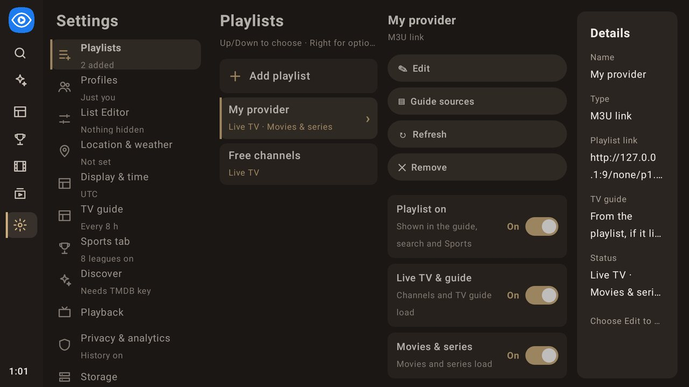

1. Open **Settings › Playlists** and choose **Add playlist**.
2. Pick the type:
   - **Xtream Codes**: enter a playlist name, the **Server (DNS)** (for example `http://example.com:8080`), your **Username** and **Password**. Live TV and the TV guide load from your login.
   - **M3U link**: enter a playlist name, the **M3U playlist link** and, optionally, a **TV guide (XMLTV) link**.
3. Choose which content to load (Live TV, Movies & series), then press **Add playlist**.

Your password is stored encrypted on the device (Android Keystore) and is never shown again.

### Using the remote

- **Arrows** move the highlight. **Hold an arrow** to speed up (3, then 6, then 12 items per repeat).
- **OK** selects. Text boxes open the keyboard only when you press OK on them.
- **Menu** (or **hold OK**) opens options for the highlighted item.
- **Back** goes up one level, landing on the item that led there. On the full menu while on the TV Guide, Back shows **Press Back again to exit**; a second Back within about 2.5 seconds closes the app.
- **Channel Up / Channel Down** (or Page Up / Page Down) move a page at a time in the TV Guide and change channels in full screen.
- **Channel and category lists wrap around.** A single press past the last item goes to the first, and the reverse. Holding a button stops at the end, so a fast scroll doesn't fly past. Other lists (the main menu, the playlist list, Settings and poster grids) stop at the end.
- If a press ever finds nothing highlighted, the app puts the highlight back.
- **Where you are:** in every list, the row you're in (the screen in the main menu, the category, the settings section, the playlist) is raised with a blue bar down its left edge. Lists you're not in are slightly dimmed. For a choice, the current value has a blue outline and a ✓; the main action is a filled button. On/off settings are switches. A button that's working shows a spinner and waits.

## 2. Main menu

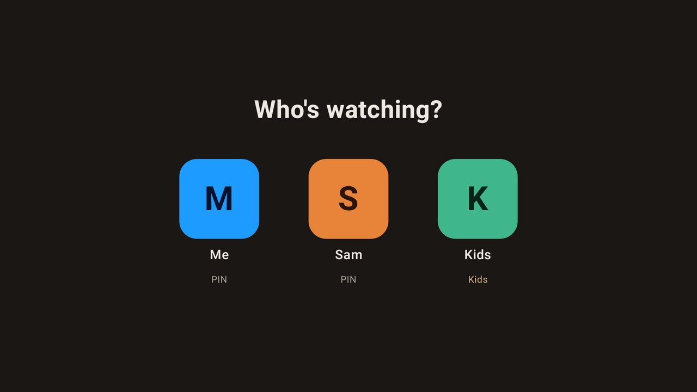

The menu on the left lists **Search, Discover, TV Guide, Sports, Movies, Series** and **Settings**. When the TV has more than one profile, the profile in use is shown at the top (its initial on its colour); **OK** on it opens **Switch profile** (see [Profiles](#profiles)). A Kids profile's menu has only Search, TV Guide, Movies and Series. Picking a screen highlights its first item. The menu is always on screen: once you've chosen a screen it shrinks to icons on the far left, and the labels come back when you move onto it.

At the bottom of the menu you'll see:

- The **clock and date** (if Show clock is on).
- **Current weather** (if a postal code is set and Show weather is on).
- An **Update x.y.z** button when a new version is available.

When the TV has more than one profile, the app first asks **Who's watching?** (or opens the last profile used, if you chose that in Settings › Profiles). Then it opens on the TV Guide with the menu shown as icons, on:

1. the last channel you watched, in its own category;
2. if that channel is in ★ Favorites or one of your lists, that list (the channel can belong to another playlist);
3. otherwise your first favorite, with ★ Favorites open;
4. with no favorites, the first channel of the first category.

## 3. TV Guide

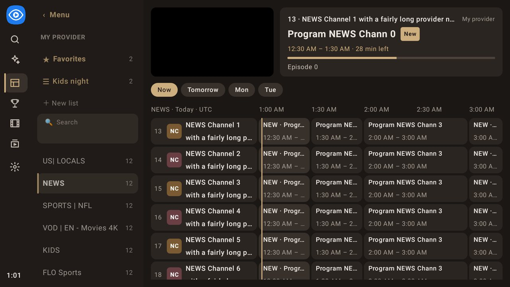

The TV Guide is the home screen for live TV. Next to the main menu it has:

- **Playlist list**: ★ Favorites, your own lists, then every playlist with live TV switched on. Press OK on a playlist to open its categories.
- **Category list**: the playlist's categories, with **‹ Menu**, ★ Favorites, your lists, **＋ New list** and **🔍 Search** at the top.
- **The guide**: the preview window and details panel at the top, the channel grid below.

**Back and Left step back one layer at a time:** from a channel to your current category in the category list, then to the playlist list (on that same category), then to the main menu. With only one playlist with live TV, the playlist list is skipped: from the categories, Back goes straight to the main menu. Holding Left doesn't skip layers, and inside the grid Left still moves through programs and time.

### The guide grid

- The top shows a **preview window** and a **details panel** for the highlighted channel or program: channel number and name (plus the playlist name when you have more than one), the program title with a **New** tag for new episodes, the times with **N min left** and a progress bar (or **starts in …** for a later program), up to two lines about the show, and what's **Next**.
- Below it is a **timeline grid**: two-line channel names on the left, programs across a 2.5-hour window, with a line marking "now". Above the times, the row names the category, the day and the time zone ("KIDS · Today · CST"). The columns sit on your clock's :00 and :30.
- **Left/Right** move between programs. Going past the last program in view scrolls the guide forward by half hours, **as far as the guide has listings, up to 7 days**. Left on the first program scrolls back, **up to 2 hours before now**; one more Left moves to the channel name.
- **Programs that have aired** (in those 2 hours) are dimmed and marked **already aired**. There's no catch-up: OK on one plays the channel live.
- **Day strip:** when the guide reaches past today, a row of buttons sits above the times: **Now**, **Tomorrow**, then the next days (**Sat**, **Sun**…). **OK** on a day moves the guide to that day at the same time as now; **Now** comes back. The day on screen is filled in.
- **Hold Left** on a later time to jump straight back to now.
- **Up/Down** move one channel and land on the program airing at the same time, so the highlighted time stays put as you move between rows. Quick taps are counted, so a fast run of presses lands about where you'd expect, even in a category with thousands of channels.
- **Up on the first channel** moves to the day strip (when it's shown), then the preview window; **Up again** jumps to the last channel. **Down on the last channel** goes back to the first.
- **CH+/CH−** (Page Up/Down) move a full page and wrap around at the ends.
- **OK** on a channel or program starts it in the preview. **OK again**, or OK on the preview window, opens it full screen.
- **Each category remembers where you were.** A category you haven't opened yet starts at its first channel. Coming back to one you've visited highlights the channel you left, even if channels above it were hidden or the list refreshed; if that channel is gone, the nearest one is highlighted, not the top.
- **The guide keeps its time.** If you scroll ahead (to tonight, say), the guide stays on that time when you open full screen or another screen and come back.
- **Back from full screen** returns to the same channel and program, even far down a long category.
- In the category list, **Up on ‹ Menu** jumps to the last category, and **Down on the last category** returns to ‹ Menu.

### Search in the guide

Highlight **🔍 Search** in the category list (just below ＋ New list) and press OK to type. Results appear as you type (after a short pause) and replace the guide. Part of a word is enough ("farg" finds Fargo), and words can come in any order. Results: **Channels** (with what's on now, and **▶ Preview** / **▶ Full screen**) and **Programs** on now or later (**▶ Tune in** / **▶ Channel**). Search covers every playlist; choosing a result from another playlist moves the guide there. **✕ Clear search**, just below, brings the guide back.

### Channel options (Menu or hold OK on a channel)

- **＋ Add to List…**: choose ★ Favorites or one of your lists, and the picker adds the channel and closes. Lists it's already in are marked ✓; choosing one of those takes it out. **＋ New list…** makes a list with the channel in it.
- **− Remove from [list]**: when you're viewing Favorites or a list.
- **✎ Rename**: give the channel your own name.
- **⇅ Re-order**: move the channel within its category (see *Re-ordering* below).
- **⊘ Hide channel**: hide it everywhere. You can bring it back in Settings › List Editor.
- **Match guide…**: pick the guide listings for this channel (see *Matching a channel to the guide* below).

Saving a **Rename** (channels, categories, lists, movie and series categories) closes the dialog; so does **Cancel**. Either way the highlight goes back to the item you renamed. The **Menu** button acts when you let it go.

### Matching a channel to the guide

If a channel shows the wrong listings, or none, press **Menu** on it and choose **Match guide…**:

- The guide channels with the closest names come first. Type in **Search guide channels** to find others.
- Choose one to use its listings. ✓ marks the current match, and the dialog says whether it came from your provider or was matched by hand.
- **Use provider's match** undoes a hand match. **No guide** shows no listings for the channel.
- The guide downloads again a few seconds after a change. The list comes from the last guide download, so if it's empty, download the guide first (Settings › TV guide) or add a guide source.

### Category options (Menu on a category in the left navigation)

- **✎ Rename**, **⇅ Re-order**, **⊘ Hide category**.

### Re-ordering

When you choose Re-order, a small help panel appears at the top right, over the preview window, so the list stays in view:

- **▲ ▼** move the item up or down (hold to move faster).
- **◀** moves it to the top; **▶** moves it to the bottom.
- **OK or Back** finishes, and the new order is saved.

While you're moving it, the item has a blue outline. A category shows its position (for example "4/27") and a channel shows ⇅ in place of its number. Channels move within whatever the guide is showing (a category, ★ Favorites or one of your lists), and channel numbers follow the new order.

### Favorites and your lists

- **★ Favorites** gathers channels from every playlist in one place and is always shown. Favorites, lists, renames, hidden channels and guide matches stay on the right channels when your provider adds, removes or reorders channels, and after restoring a backup.
- **Your lists** (for example "Kids" or "News") can also hold channels from any playlist. Make one with **＋ New list** or from Add to List.
- Press **Menu on a list** to **Rename**, **Move up / Move down** or **Delete** it. Deleting asks you to confirm; the channels stay in your playlists.
- **Suggested near [your town]**: at the top of Favorites, the app suggests channels from your playlists that look local to your postal code. Press **＋ Add to List** to keep one, or **Hide suggestions**. Dismissed channels aren't suggested again unless you restore them in Settings.

## 4. Full-screen playback

### Live TV

- **Up / Channel Up**: previous channel. **Down / Channel Down**: next channel. Switching stays inside the current category, list or Favorites and wraps around at the ends.
- **OK, Left, Right or Info**: show the info bar (channel number and name, ★ if it's a favorite, playlist, what's on now with times, and **Up next**). It hides after 5 seconds.
- **Menu**: open **Picture & sound** (below), which also has **＋ Add to List…** for the channel you're watching.
- **Back**: return to the screen you came from.

### Movies and episodes

- **Left / Rewind**: back 10 seconds. **Right / Fast-forward**: ahead 30 seconds.
- **OK / Play-Pause**: pause or resume.
- **Up, Down or Info**: show the progress bar.
- The progress bar appears when playback starts or you press a button, and hides 5 seconds after the last press. It shows "Loading…" while the video starts, and stays up while paused ("Paused · …").
- Stopping part-way saves your place for **Resume**.
- **Menu**: open **Picture & sound** (below).

### Picture & sound

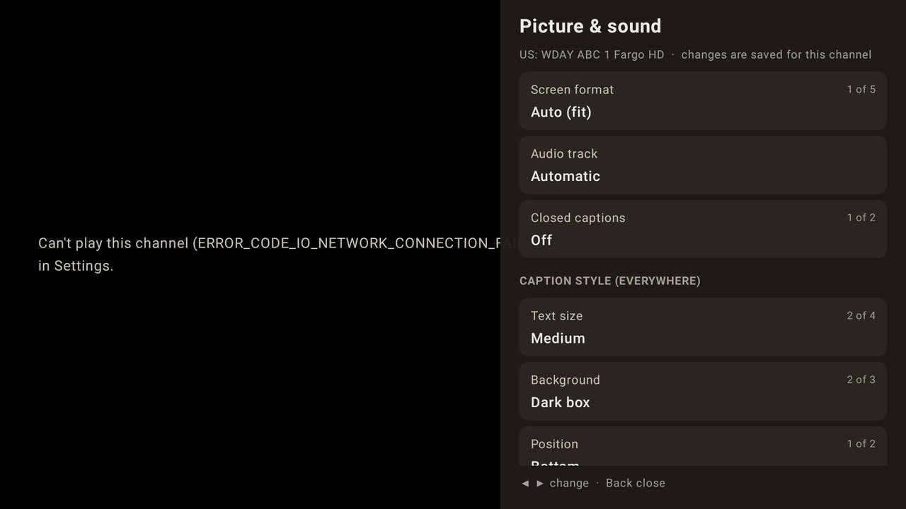

Press **Menu** while watching full screen. A panel opens on the right. **▲▼** move between rows, **◀▶** change a row's value (**OK** steps to the next value), and **Back** or **Menu** closes it.

- **Screen format:** Auto (fit), Fill screen (stretch), Zoom (crop edges), 16:9 or 4:3.
- **Audio track:** **Automatic** (the stream's own choice) or one of the stream's audio tracks, described in plain words, for example "English · Dolby Digital 5.1" or "Spanish · AAC Stereo · Secondary audio". Secondary audio (SAP) and described video are labeled when the channel sends them.
- **Closed captions:** **Off**, or a caption track: TV captions (CC1–CC4), digital captions or subtitles. If none have been found yet, **On (when available)** shows them as soon as they appear.
- **Caption style** (the same everywhere): **Text size** (Small, Medium, Large, Extra large), **Background** (None with outlined text, Dark box, Solid black) and **Position** (Bottom, Raised).
- **Save changes for:**
  - **This channel only:** for a movie, this movie; for an episode, the whole series.
  - **All channels:** the setting for everything.
  - A channel's own choices win over the ones for all channels. **Use the settings for all channels here** clears this channel's own choices.
- **＋ Add to List…** (live TV): add the channel to ★ Favorites or one of your lists.

Audio tracks and captions only appear when the stream carries them, so they vary from channel to channel.

## 5. Search

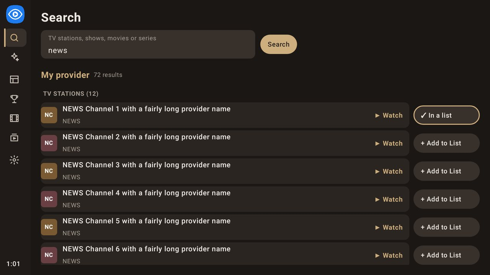

The **Search** screen searches **every playlist** at once: TV stations, programs in the TV guide (now and upcoming), movies and series.

- **Results appear as you type**, after a short pause. Pressing **Search** works too.
- **Forgiving matching:** part of a word is enough ("farg" finds Fargo), every word you type must appear but in any order ("news fargo" finds "KVLY Fargo News HD"), and punctuation doesn't matter ("spider man" finds "Spider-Man: No Way Home").
- **"Nothing found for …"** names what was searched; try fewer letters or another word.

Results are grouped by playlist and by kind, each with an action:

- **Tune in** for a program, **Play** for a movie, **Episodes** for a series (choose a season and episode).
- **+ Add to List** for a channel (shows **✓ In a list** once added).
- **+ My List** for a movie or series (shows **✓ My List**).

After you play a channel, program, movie or episode from Search, **Back** returns to the results with that result highlighted.

## 6. Discover

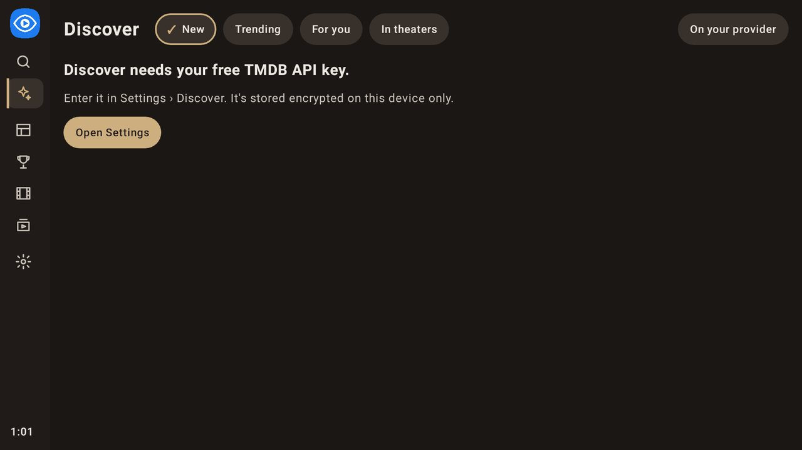

Discover shows what's new and popular, and where to watch it, using TMDB and JustWatch data.

- **Tabs**: New, Trending, For you, In theaters.
- **On your provider**: only show titles your own playlists have (the ones tagged **▶ ON YOUR PROVIDER**).
- **My services**: only show titles on the streaming services you've picked.
- **Menu on a title**: add it to **My List**, or press again to take it off. A ✓ on the poster shows it's in My List. Only titles on your provider can go in My List.
- Titles your provider carries are tagged **▶ ON YOUR PROVIDER** (with a large catalog, the tag may appear a moment after the posters). Open one to play it (**▶ Play**, or **▶ Episodes** for a series), add it to **My List**, or **Search my playlists**.
- **Every version on your provider:** when your playlists have the title more than once (other languages, qualities or playlists), its page lists **N versions on your provider**, English first, each with its language, category and playlist. The page scrolls as one: **Down** from the buttons moves through the versions and then **Where to watch**. **OK** on a version plays that movie or opens that series. The main button plays the first and says which ("Plays: English · EN | Drama · My provider").
- **Where to watch** lists Stream, Free, Rent and Buy options for your region.

Discover needs a free **TMDB API key**. Enter it in **Settings › Discover**; it's stored encrypted on the device.

## 7. Sports

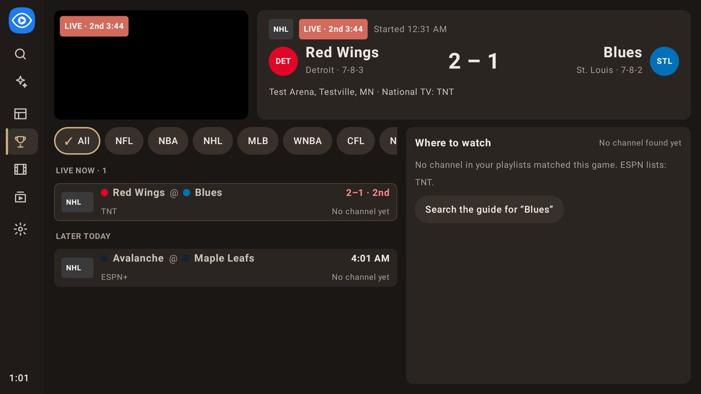

Sports lists real games from **ESPN's schedules** for today and the next 2 days, plus recent finals, then finds the channels in your playlists that carry them. Leagues: NFL, NBA, NHL, MLB, WNBA, CFL, college football (FBS) and men's college basketball (Division I).

- **Top:** the preview window and the highlighted game. It shows the league, the status (**LIVE** with the period and clock, **FINAL**, or the start time), both teams with logos, records and the score, the venue, and the national TV or streaming service.
- **Left:**
  - **League filters:** **All**, then each league you've switched on.
  - **Games:** grouped as **Live now**, **Later today**, the next days and **Final**. Each card shows the matchup, its networks, its time or score, and how many channels were found. Games with no channel found are greyed out.
- **Right: Where to watch.** The game's channels, best first, each with why it matched:
  - **National TV / Streaming:** a channel named for the network ESPN lists (TNT, ESPN2, Fox, Prime Video…).
  - **In the guide:** a listing during the game that names both teams.
  - **Event channel:** the channel's name has both teams, for example "NHL 03: Red Wings @ Blues".
  - **Local TV:** a team's regional network (FanDuel Sports Network, MSG, Altitude…).
- **OK on a game** moves to its channels. **OK on a channel** plays it in the preview; **OK** again opens full screen. In full screen, **Channel Up/Down** goes through that game's channels, best first, wrapping around at the end; the info bar shows the game and "channel 2 of 3". **Back** returns to Sports with the channel you were watching (or the game) highlighted.
- **Every playlist:** Sports searches every switched-on playlist with live TV. Hidden channels and categories are skipped.
- **North America only:**
  - US channels come first; Canadian channels are the backup.
  - Channels marked for other countries are left out, for example "UK |" in the name, or a category for another country.
- **Finding channels…:** the games appear as soon as ESPN answers. Until a game's channels have been looked for, its card says **Finding channels…** (usually a few seconds); games are listed meanwhile even if **Games with no channel found** is set to Hide.
- **Games further ahead:** guide listings and event channels for later games depend on how far ahead your guide goes (up to 7 days), so some appear closer to the start. **Search the guide for "[team]"** jumps to the TV Guide's search.
- **Updates:** each day is asked for separately. Today and yesterday are refreshed about every minute while Sports is open (scores while games are live), the next 2 days every 30 minutes. In the background Sports refreshes every 30 minutes. If ESPN can't be reached, Sports says so and shows the last list saved on the TV.

## 8. Movies and Series

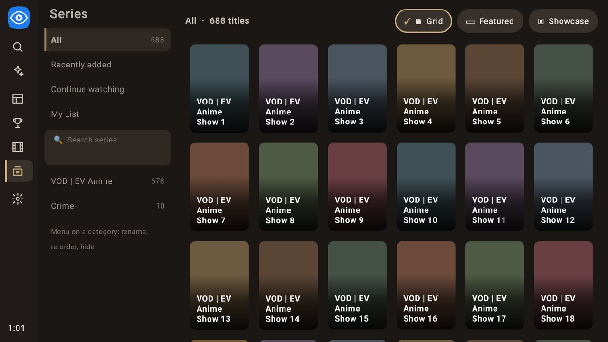

- **Left side**: Playlists, then categories: **All**, **Recently added**, **Continue watching**, **My List**, and your provider's categories.
- **Right side**: posters for the chosen category. A category you pause on is read ahead, so OK shows it at once.
- **Posters fill their tiles.** The title and year appear on a dark fade only on the highlighted poster, and on titles that have no artwork (most posters already show their title). The highlighted poster grows a little and gets a ring. **✓** in a corner means the title is in My List.
- **Layouts**: the buttons above the posters switch between three ways of browsing. Each profile remembers its choice; **Up** from the top row of posters reaches them.
  - **▦ Grid**: rows of posters.

    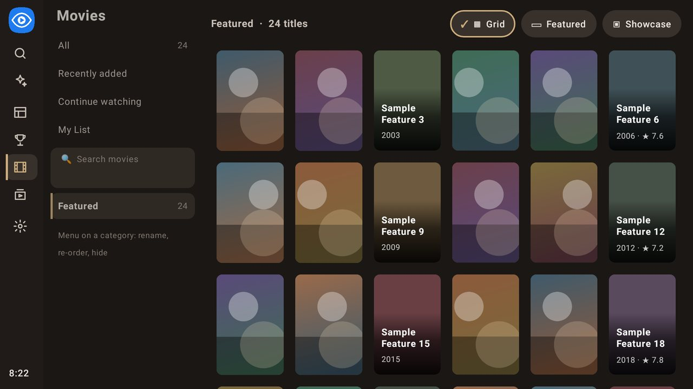

  - **▭ Featured**: the highlighted title's artwork, name, year and rating above the posters.

    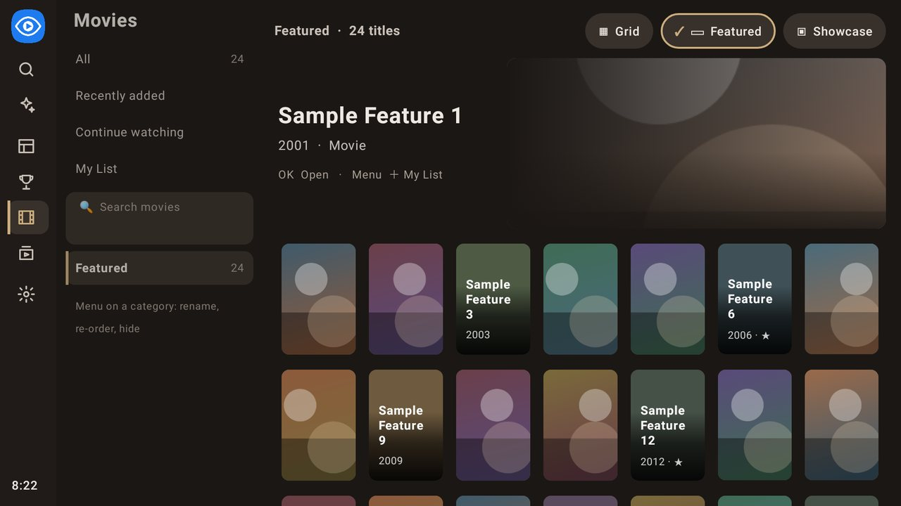

  - **▣ Showcase**: the highlighted title's artwork fills the screen, with one row of posters along the bottom (**Left/Right** to move along it).

    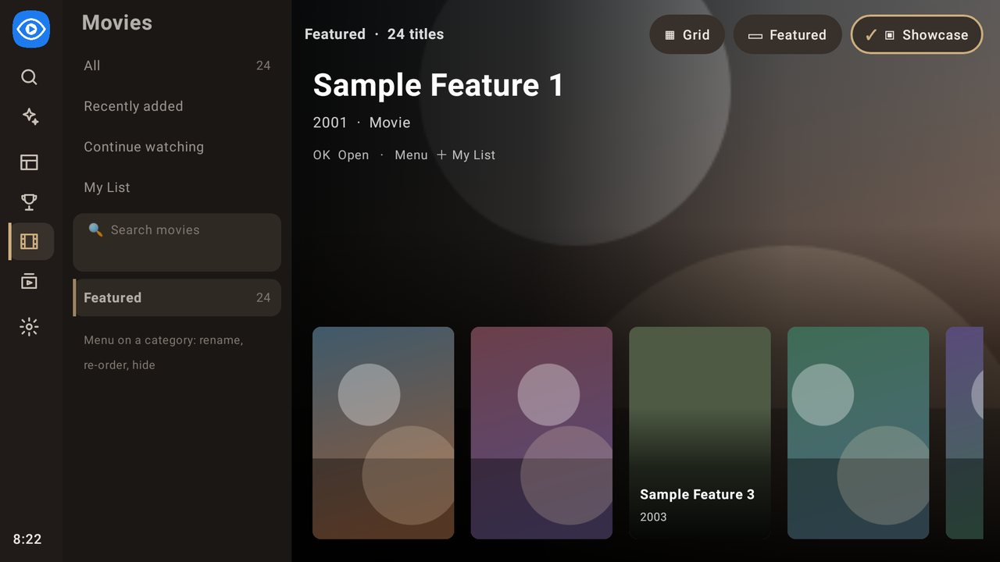

- **Each title is listed once.** When your playlists have the same title several times (other languages, qualities such as 4K or HD, or other playlists), it appears once, shown by its English copy (else one with no language marked). This applies to All, Recently added, every category and the search.
- **🔍 Search movies / 🔍 Search series** is in the category list, below My List. Results replace the poster grid; **✕ Clear search** ends the search.
- **OK on a poster** opens its page: plot, cast, director, **▶ Play**, or **▶ Resume from [time]** and **Start over**, plus **+ My List**.
- **⇄ N versions** (on a title with several copies) lists each copy with its language, name, category and playlist; ✓ marks the one shown, and the line **This version: …** under the buttons says which one you're on. **OK** on another copy shows that one, with its own episodes, resume point and My List button. The language comes from codes on the name or category ("EN |", "FR -", "VF", "MULTI"…); copies without one show "Language not marked". Series pages list episodes by **Season**, with resume points; episodes you've played to the end say **✓ Watched**. **A series page opens on the next episode to watch**, with its season chosen: Season 1, Episode 1 for a series you haven't started, otherwise the episode after the last one you finished (or the one you stopped part-way through). The page scrolls as one: **Up** from the episode goes to the season buttons, then the title's buttons; from the buttons, **Down** goes to the season buttons, then through every episode, however long the description. After you watch an episode and press **Back**, that episode is highlighted.
- **Each category (and each search) keeps its own place.**
- **Back** goes one step at a time: from a title's page to its poster, from a poster to the category you're in (highlighted), then to the main menu, on **Movies** or **Series**.
- **Left** from the first column of posters (in Showcase, from the first poster) goes to the category you're browsing.
- **Category list wraps around**: Up on **All** jumps to the last category, and Down on the last returns to All. The poster grid stops at the end.
- **Menu on a category**: **Rename**, **Re-order** or **Hide** it. Hidden categories come back in Settings › List Editor.
- If you have more than one playlist, movies and series from all of them are merged.

## 9. Settings

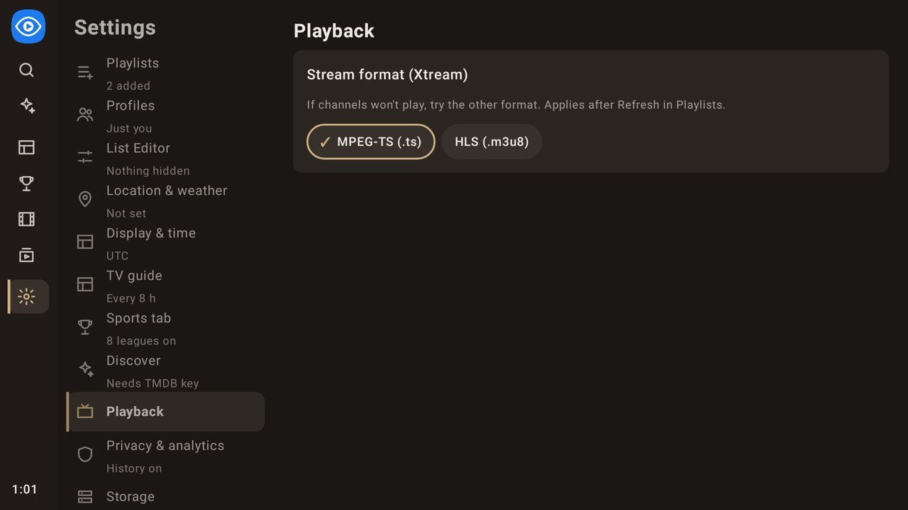

Settings has sections on the left and the open section's options on the right. **Up/Down** move through the sections; the section list scrolls to keep the highlighted one in view. **OK** opens the highlighted section and moves into it, on its first option (**Right** also moves into the open section). Inside a section, Up and Down stop at the first and last option. **Left** at the left edge of a section, or **Back**, returns to that section in the list; **Back** again opens the main menu.

### Playlists

- The list of your playlists (Up/Down to choose, Right for options) and **Add playlist**. While you're in the form on the right, the list narrows, so the page never has more than three full columns.
- **Back** in the add or edit form with changes that aren't saved asks **Discard changes?**. **Keep editing** has the highlight; **Discard** drops the changes. The guide source form, postal code and TMDB key ask the same way.
- For each playlist:
  - **✎ Edit**: change its details. If you change the server, login or links, its channels and guide are downloaded again, and you're asked to confirm first.
  - **↻ Refresh**: replace the saved channels, guide, movies and series with what your provider has now.
  - **✕ Remove**: delete the playlist and its login from the device. To keep it for later, turn it off instead.
  - **▤ Guide sources**: where this playlist's TV guide comes from (see below).
  - Switches: **Playlist on** (off hides it everywhere without deleting anything), **Live TV & guide**, and **Movies & series**.
- **Details** shows the type, server, username, playlist link, TV guide source and status.

**Guide sources** (Settings › Playlists › choose a playlist › ▤ Guide sources)

- **Download from these sources every 4 / 8 / 12 / 24 h**: the same setting as in Settings › TV guide; it applies to every playlist.
- **Provider's guide** (on/off): the guide that comes with an Xtream login, or the M3U file's own guide link.
- **＋ Add guide source**: a name, an XMLTV address (`.xml` or `.xml.gz`) and a **time offset** (−12 to +12 hours) for a guide that's consistently early or late.
- Each source has **Turn off / Turn on**, **✎ Edit**, **▲ ▼** to change the order, and **✕ Delete** (asks first). Each one shows when it last downloaded and how many channels it covered, or why it failed.
- **Order matters:** sources are read top to bottom, and for each channel the first source with listings is used.
- **Download now** gets this playlist's guide again.

**Downloads that stall** give up after 45 seconds. A download that fails before it starts (no connection, a busy server) is tried again twice, after 1 and 3 seconds. Loading, empty and error messages look the same on every screen, and errors have **Try again**.

**Background downloads.** About 10 seconds after the app opens, it updates each switched-on playlist in turn, fetching only what's out of date: channels older than a day, the guide when it's older than your guide setting (8 hours by default), and movies & series older than a day. Content that's switched off is never loaded. The first download of a large movie catalog can make a Fire TV Stick feel slower for a minute or two.

### Profiles

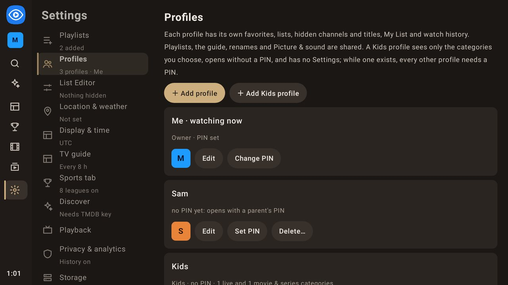

Each person in the household can have their own profile. A profile has its own ★ Favorites and lists, hidden channels and categories, hidden movie and series categories and titles, My List, last channel, dismissed local suggestions, watch history (and whether it's paused), resume points and watched episodes. Playlists and logins, guide sources and matches, renamed and re-ordered items, Picture & sound and every other setting are shared.

When you update from an earlier version, everything you had becomes the owner's profile, **Me**. Nothing changes until you add a second profile.

Each profile also has its own **theme** (colours) and its own Movies and Series **layout**. See [Display & time](#display--time).

**Settings › Profiles** (second in the list of sections)

- **＋ Add profile**: a name and a colour.
- **＋ Add Kids profile**: the same, for a child. If no grown-up has a PIN yet, the app asks you to set the owner's PIN first.
- For each profile:
  - **Edit**: name, colour and **Theme**; for a Kids profile, also the categories it can watch.
  - **Set PIN / Change PIN**: a 4-digit PIN, entered twice. **Remove PIN** appears only while there's no Kids profile.
  - **Parent** (grown-up profiles other than the owner): a parent can manage profiles, and their PIN opens any profile. The owner is always a parent.
  - **Delete…**: asks first, then deletes that profile's favorites, lists, hidden items and history. It can't be undone. The owner's profile and the profile in use can't be deleted.
- **When the app starts**: **Ask who's watching** (the default) or **Last profile used**. With Last profile used, if that profile needs a PIN the app opens on the Kids profile instead.
- In a profile that isn't a parent, changing profiles asks for a parent's PIN.

**Kids profile**

- **Categories**: a switch for each live TV category and each movie and series category. A new Kids profile starts with the categories whose names look made for children. Adult categories are greyed out and are never shown.
- The TV Guide, Movies, Series and Search show only those categories. Channels outside them can't be opened from favorites, lists, search or the last channel.
- Discover, Sports and Settings aren't in a Kids profile's menu.
- A Kids profile never needs a PIN. While a Kids profile exists, every other profile needs one, so a child can't switch out.

**Who's watching? and switching**

- **Who's watching?**: **Left/Right** pick a profile, **OK** opens it. Profiles that need a PIN show "PIN"; Kids profiles show "Kids". Nothing plays until a profile is chosen.
- **Switch profile**: **OK** on the profile at the top of the main menu. Choose another profile, or **Manage profiles…** to open Settings › Profiles.
- **PIN**: type the 4 digits with the remote's number keys or the on-screen pad (**Delete** removes the last digit, **Cancel** goes back). A profile's own PIN or any parent's PIN opens it. After 5 wrong PINs in a row the app says "Too many tries. Wait a minute."
- **Forgot a PIN?** Open a parent's profile and use **Change PIN** on that profile; the old PIN isn't needed.

Profiles are included in backups (see [Backup & restore](#backup--restore)).

### TV guide

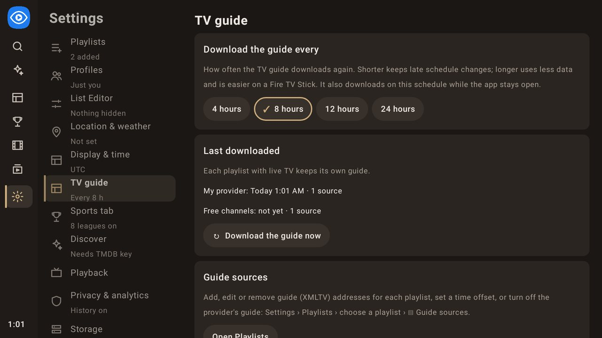

- **Download the guide every**: 4, 8, 12 or 24 hours (8 is the default). The app also follows this while it stays open. Each download keeps up to 7 days of listings. A guide source that hasn't changed since the last download isn't downloaded again.
- **Last downloaded**: when each playlist's guide last downloaded and how many sources it has. **Download the guide now** gets every guide again.
- **Channels matched by hand**: how many there are, with **Clear all matches** (asks first).

### List Editor

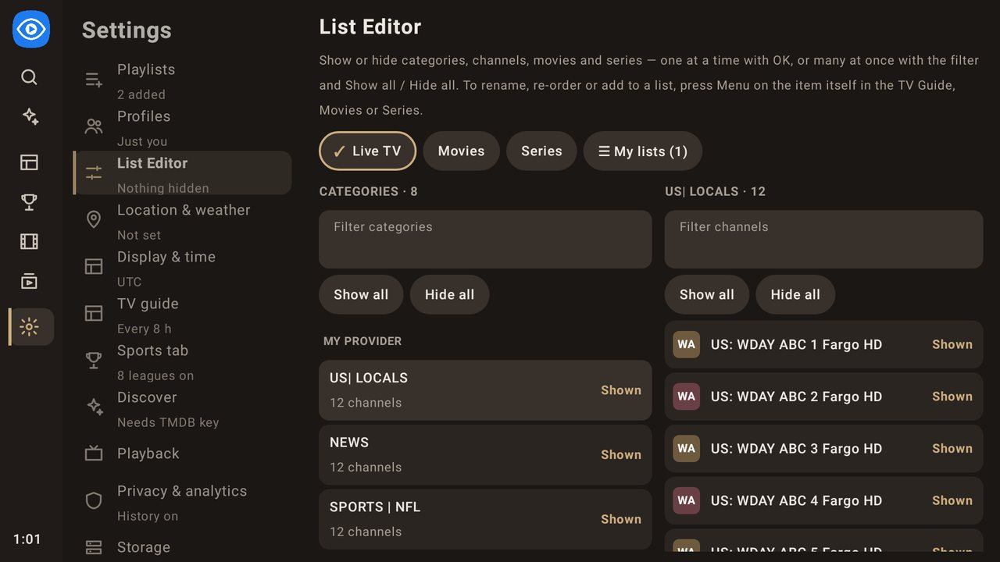

Show or hide items one at a time with OK, or many at once with the filter and **Show all / Hide all**. It has four tabs:

- **Live TV**: categories by playlist, then the channels in each category.
- **Movies** and **Series**: categories and titles.
- **☰ My lists**: show or hide your lists in the TV Guide. ★ Favorites is always shown.

Rename, re-order and Add to List are done with Menu on the item itself in the TV Guide, Movies or Series.

- Headers show counts, for example "EN - MOVIES 4K · 1105 · 222 hidden". With a filter typed, Show all / Hide all act only on the matches (for example "Hide 222").
- Hidden movies, series and categories also disappear from search.
- A hidden list keeps its channels. Add to List marks it "(hidden)".

### Location & weather

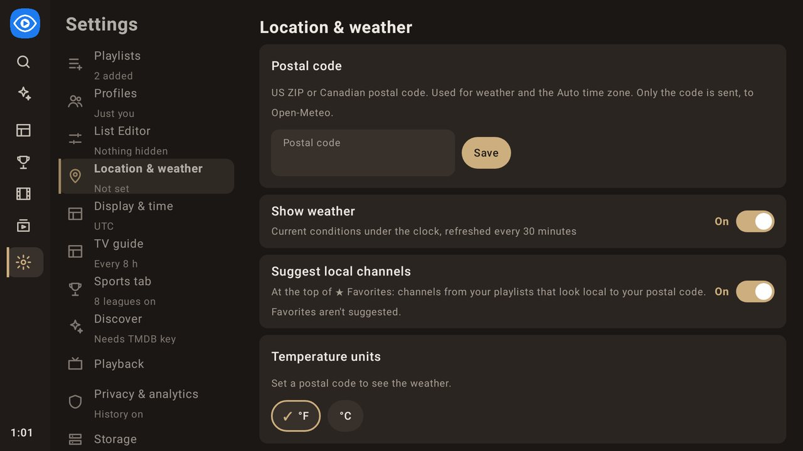

- **Postal code**: a US ZIP or Canadian postal code (Done on the keyboard saves it). It's used for weather, local channel suggestions and the Auto time zone. Only the code is sent, to Open-Meteo.
- **Show weather**: current conditions under the clock, refreshed every 30 minutes.
- **Suggest local channels**: on or off. **Show them again** restores suggestions you dismissed.
- **Temperature units**.

### Display & time

- **Theme**: the colours of the profile you're using. Each profile has its own; change another profile's in Settings › Profiles › Edit. **OK** on a preview picks it, and ✓ marks the one in use.
  - **Dark roast**: dark brown, a soft warm-grey highlight with dark text, muted gold. New installs and new profiles start on it.
  - **Midnight blue**: navy with a bright blue ring, the look up to 1.3.0. Profiles that existed before 1.4.0 keep it until you change it.
  - **Espresso & cream**, **Espresso & ivory** and **Mocha & latte**: other warm themes, from darkest to lightest base.

  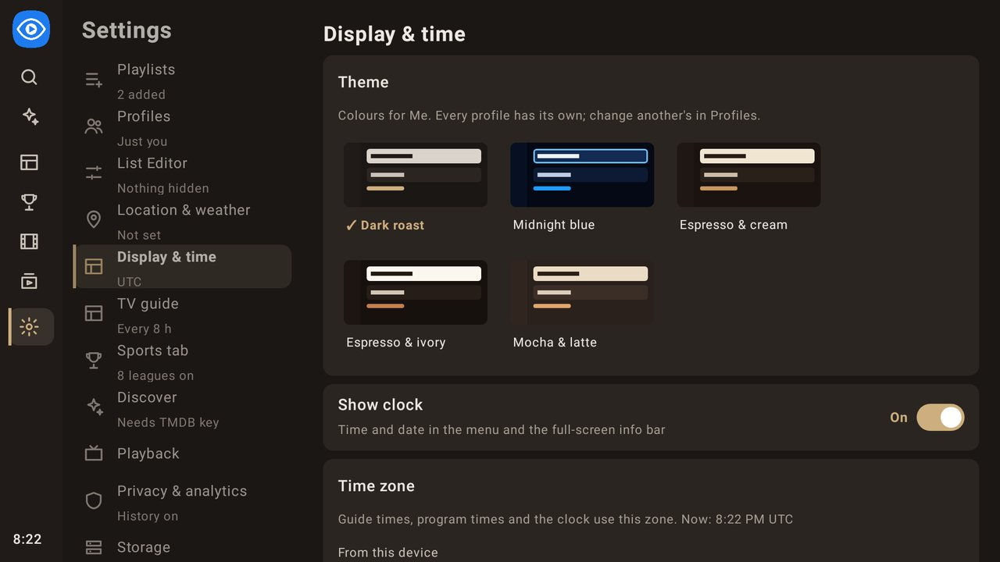

  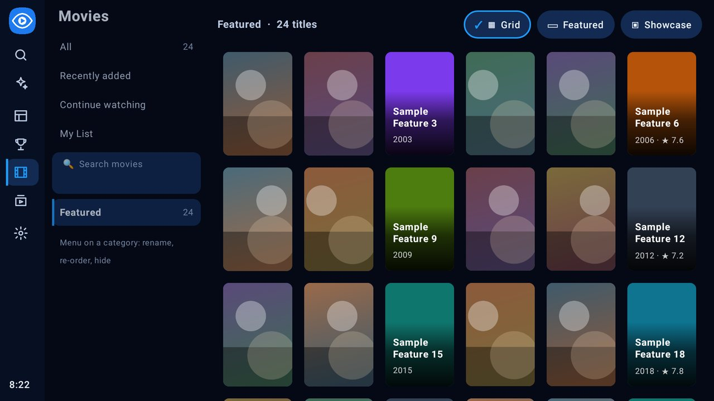

- **Show clock**: time and date in the menu and in the full-screen info bar.
- **Time zone**: Auto (from your postal code), Device, Eastern, Central, Mountain, Arizona, Pacific, Alaska, Hawaii or Atlantic. Guide and program times use this zone.

### Sports tab

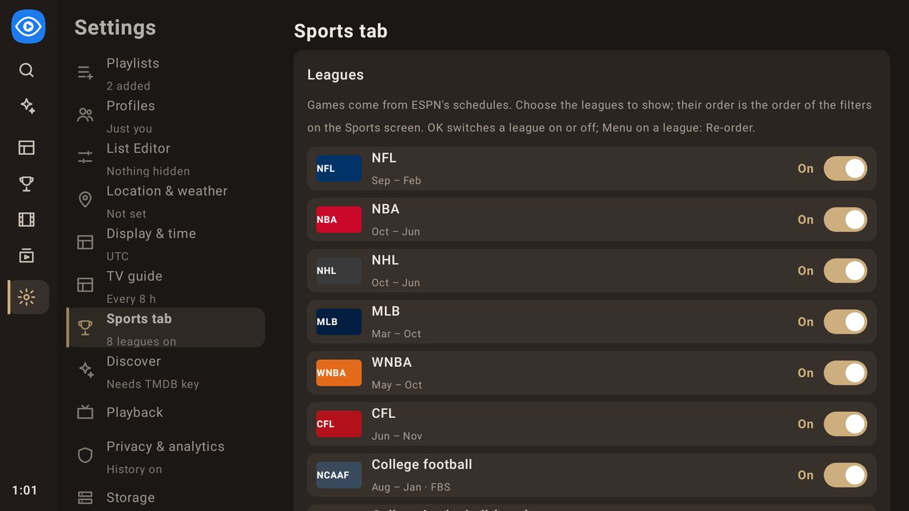

- **Leagues**: **OK** switches a league on or off.
  - **Menu** on a league re-orders it: ▲▼ move, ◀ top, ▶ bottom, OK done. The order is the order of the filters on the Sports screen.
- **Games with no channel found**: Show (greyed out, with ESPN's networks) or Hide.
- **Finished games stay for**: 6, 12 or 24 hours.
- **Scores**: Show or Hide. Hiding them avoids spoilers: live games show only the period.
- Soccer, rugby, cricket, golf, motor racing and combat sports aren't included yet.

### Discover

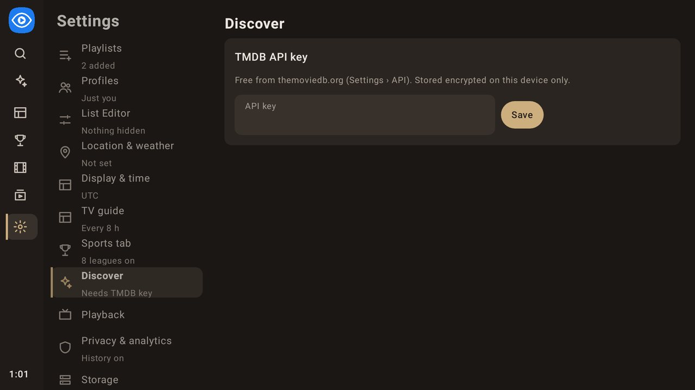

- **TMDB API key**: Save it (or press Done on the keyboard), or Remove it (asks first).
- **My streaming services**: pick the services you subscribe to.

### Playback

- **Stream format (Xtream)**: **MPEG-TS (.ts)** or **HLS (.m3u8)**. If channels won't play, try the other format. The change applies after a Refresh in Playlists.

### Privacy & analytics

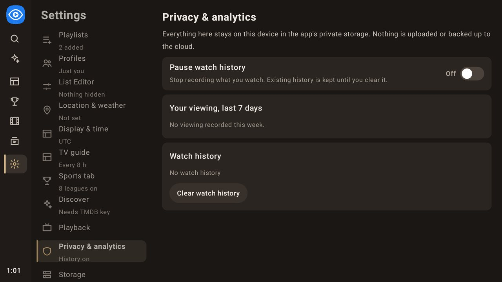

Everything here stays on the device; nothing is uploaded or backed up to the cloud. Watch history, the pause switch and the 7-day summary belong to the profile in use.

- **Pause watch history**: stop recording what you watch.
- **Your viewing, last 7 days**: hours watched and your top channels.
- **Clear watch history** (the app keeps up to 90 days). It asks first.

### Storage

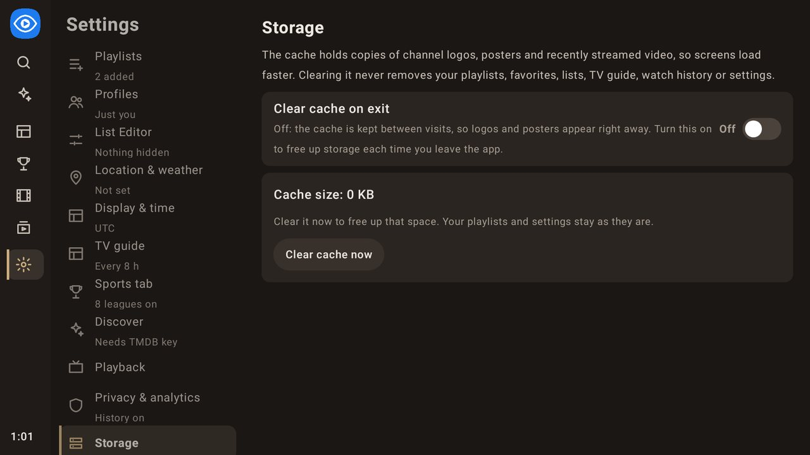

- **Clear cache on exit**: empty the cache (logos, posters, recently streamed video) every time you leave the app.
- **Cache size** and **Clear cache now** (asks first). Clearing never removes your playlists, favorites, lists, guide, history or settings.

### Updates & about

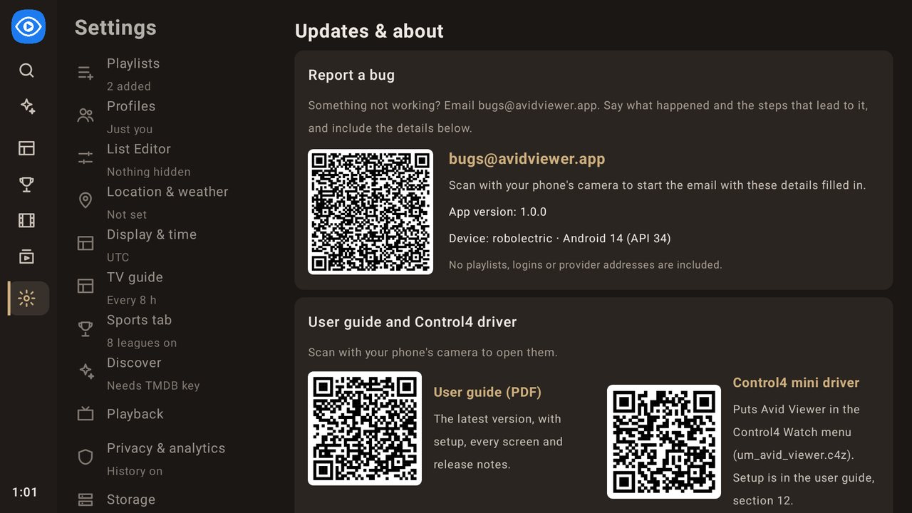

- **App updates**: the installed version, **Check now**, **Download and install**, and the **Check for updates automatically** switch.
  - The **Update available** dialog (**Update now** / **Later**) opens by itself only when the app starts, before you press anything. If a new version is found later, the main menu shows **Update x.y.z** instead, so nothing pops up while you're browsing or watching.
  - The download shows its progress. If the connection stalls, the app waits 15 seconds and continues from where it stopped (up to 8 tries). The finished file is checked before installing, and a damaged download is refused.
  - If Android's installer doesn't appear within about 25 seconds, an **Open installer** button opens Android's own install screen for the same file.
- **Last crash**: if the app closed unexpectedly, the details are kept here on the device, with **Report issue** and **Clear crash report** (asks first). **Report issue** sends them to **bugs@avidviewer.app** and then clears them (see *If the app closes unexpectedly* below).
- **Report a bug**: email **bugs@avidviewer.app** with what happened and the steps that lead to it. The section lists the details to include, read from the TV (app version, device model, Android and Fire OS versions, and the last crash's error). Scan the **QR code** with a phone camera to start that email with the details filled in; **Open email app** appears only on TVs that have one. No playlists, logins or provider addresses are included.
- **User guide and Control4 driver**: two QR codes to scan with a phone. **User guide (PDF)** opens the latest version of this guide; **Control4 mini driver** downloads `um_avid_viewer.c4z` (see [Control4](#12-control4)).
- **Moving through this section:** opening it (OK on Updates & about) highlights **Report a bug** first; **Down** moves to the QR codes, then to Backup & restore and App updates. Blocks without buttons (Report a bug on TVs without an email app, and the QR codes) take the highlight themselves, with a ring around the whole block, so the page scrolls each one fully into view.
- **Credits**: TMDB, JustWatch, Open-Meteo and ESPN.

#### Backup & restore

A backup saves your playlists (with their logins), ★ Favorites and your lists, renamed and re-ordered channels and categories, hidden items, Sports leagues and options, location, the TMDB key, network-share settings, all other settings, watch history and resume points, and every profile with its own favorites, lists, hidden items and history (PINs are stored only as one-way hashes). After a restore the app opens on the owner's profile. Channels, guides and movie catalogs aren't included; they download again after a restore.

Because it holds your provider logins, every backup is locked with a **PIN** you choose (4 or more digits). The PIN can't be recovered if you forget it.

**Back up to this device**

1. Choose **Back up now**, enter a PIN twice, then **Save backup**.
2. The file is saved to **Download › AvidViewer**, with a name like `AvidViewer-backup-2026-11-09_2015.avbak`. It stays there even if you delete the app.
3. On Android 9 and older, the app first asks for permission to save to the Download folder.

**Restore**

1. Choose **Restore from a backup**. This opens the device's file picker, or a file manager app if one is installed. If neither exists, the app lists the backups it finds in the Download folder.
2. Check the confirmation, which shows when the backup was made and which playlists it holds. Restoring replaces the playlists and settings on this device and can't be undone.
3. Enter the backup's PIN. A wrong PIN is refused and nothing changes. After a restore, channels and guides start downloading again.

**Network share (SAMBA)**

Keep backups in a shared folder on a PC or NAS, so a reinstalled app or a new TV can restore without a file manager or USB drive.

1. Enter the **share address**, for example `\\192.168.1.20\Backups\AvidViewer` (`\\NAS\Backups` and `smb://server/share/folder` also work). The folder is created if it's missing.
2. Enter a **user name** (`DOMAIN\user` works) and **password**. Leave both empty for a guest share.
3. Choose **Save and test**. The app connects and tells you how many backups are already there.
4. **Back up to the share** asks for a PIN, then saves the file there.
5. **Restore from the share** lists the backups, newest first. Pick one, enter its PIN and confirm.

The share password is stored encrypted on the TV and is included in your PIN-locked backups.

**Moving to another TV:** copy the `.avbak` file across (network share, USB drive or file manager), then restore it on the new TV.

## 10. Privacy

- All your data stays on the device. Android cloud backup and device-to-device transfer are turned off.
- Provider passwords and the TMDB key are encrypted with the Android Keystore.
- Backup files are encrypted and locked with your PIN, because they contain provider logins.
- Profile PINs are stored only as salted one-way hashes, never as the digits.
- Crash details leave the TV only when you choose **Report issue**. They go to bugs@avidviewer.app through a small mail relay, with web addresses, server and host names, IP addresses, user names, passwords and tokens removed first.
- Outside services get only what they need: your postal code (Open-Meteo, for weather), title lookups (TMDB/JustWatch, if you add a key), scoreboards (ESPN), update checks (GitHub) and, when you choose Report issue, the crash report (the Avid Viewer crash relay, a Google Apps Script web app).

## 11. Troubleshooting

- **Channels won't play**: switch the Stream format in Settings › Playback, then Refresh the playlist.
- **No channels or guide**: check that the playlist, and its Live TV switch, are on in Settings › Playlists, then choose Refresh.
- **No movies or series**: turn on Movies & series for the playlist and Refresh.
- **Discover is empty**: add a TMDB API key in Settings › Discover, or turn off "My services".
- **Sports showed no games for a long time after updating to 1.2.0** (with a big TV guide and several playlists): update to 1.3.0 or later; games now appear at once.
- **Sports is empty**: check the leagues in Settings › Sports tab; off-season leagues have no games. "Couldn't reach ESPN" means the schedules couldn't be downloaded, so the last list is shown. On 1.0.141 this appeared for every league; update to 1.0.147 or later.
- **A game shows "No channel yet"**: your playlists have no channel named for its network, and no guide listing or event channel for it yet. Those often appear closer to the start. You can also use **Search the guide** on the game.
- **Discover froze or the app closed after about 20 seconds** (1.0.137 and earlier, with large movie catalogs): update the app.
- **Channels and the guide took minutes to appear after updating to 1.0.160** (with a big movie and series catalog): update to 1.0.162 or later. If you're still on 1.0.160, leave the app open until they appear; it only happens once.
- **The app froze or closed while pressing Up/Down quickly in the TV Guide** (1.0.147 and earlier, mostly in big categories after wrapping from the top to the bottom): update to 1.0.160 or later.
- **No audio tracks or captions to choose in Picture & sound**: the stream doesn't carry them. Many live channels have one audio track and no captions; try another channel, or set captions to **On (when available)** so they show when a program has them.
- **Movies or Series were slow, or the app stopped responding on Series** (1.0.160 to 1.0.162, with a big catalog): update to 1.0.165 or later.
- **A title is missing from Movies or Series**: it may be listed once under another copy. Open it and use **⇄ N versions**.
- **A channel or category disappeared**: it may be hidden. Check Settings › List Editor.
- **A guide row ends early and Right won't go further**: fixed in 1.0.133 for guides that list overlapping programmes; update the app.
- **A channel shows the wrong listings, or none**: press Menu on it and choose **Match guide…**. If a whole guide is consistently early or late, set a **time offset** on its source in Settings › Playlists › ▤ Guide sources.
- **Favorites landed one channel off after a restore** (on a version before 1.0.94): that backup can't fix them automatically. Set them once, then make a new backup; newer backups record which channel each favorite points to.
- **An update hangs at about 95%** (updating from 1.0.82 or earlier, which have the old updater): try again. If it still hangs, install the new version once by hand with the Downloader app; later updates resume stalled downloads.

### If the app closes unexpectedly

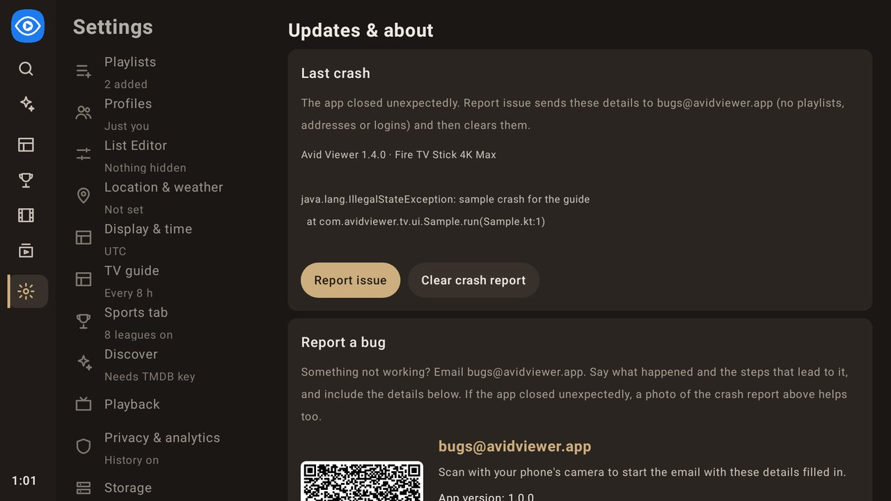

The next time it starts, the app says **Avid Viewer closed unexpectedly**:

- **Report issue** sends the details to **bugs@avidviewer.app**: the app version, the TV model and Android / Fire OS version, and the error. Web addresses, host names, IP addresses, user names, passwords and tokens are removed first; no playlists, logins or keys are sent. When it's sent, the message says thanks, closes after a few seconds, and the details are cleared.
- If it can't be sent (no connection, for example), the message says so and the details stay in **Settings › Updates & about › Last crash**, where **Report issue** can try again.
- **Cancel** closes the message. Nothing is sent, and the details stay in Last crash.

### Backup questions

**After reinstalling on a newer Fire TV, the app can't see my backup.** On Fire OS 8 (Android 11), a reinstalled app may not be allowed to see a backup the old install saved, and some Fire TVs have no file picker. The app suggests installing a free file manager such as **X-plore**, which lets you pick the file. Backing up to a network share avoids the problem altogether.

**The network share won't connect.**

- Use the PC's or NAS's **IP address** if the TV can't find it by name. The app says "try the IP address" when this is the problem.
- Make sure the user has permission to **change** files in the shared folder, not just read them.
- Avid Viewer supports SMB 2 and 3 (Windows 10/11 and most NAS boxes). Devices that only offer SMB 1 won't connect.
- Other errors are explained in plain words: wrong password, no share by that name, no permission to write, or server not reachable.

**I forgot my backup PIN.** It can't be recovered. Make a new backup with a new PIN.

### Reliability

Every build runs automated usability tests before it's released: the real app screens on a TV-sized screen, driven by simulated remote presses. They cover every screen and Settings section, re-ordering, List Editor bulk actions, search, hold-to-scroll, backups (including a real network share) and a 600-press random-key crash hunt. A failing test stops the release.

## 12. Control4

The **Avid Viewer** Control4 driver (`um_avid_viewer.c4z`) adds Avid Viewer to the Watch menu. Picking it switches the room to your Fire TV and opens Avid Viewer. Your Control4 installer adds it in Composer.

**Download:** [Control4 drivers folder](https://drive.google.com/drive/folders/1PeYs-U4YgndrVZm6PN-uAF-hgRGoIr9d) on Google Drive, or the [driver file directly](https://drive.google.com/file/d/10XxPywvX456lPTmou6xsqERmbTfhOJul/view?usp=drivesdk). Anyone with the link can download it. You can also scan the QR code in **Settings › Updates & about** with a phone.

### What you need

- Avid Viewer installed on the Fire TV.
- A Fire TV driver in your Control4 system that works with Control4's universal app drivers. Its connections include an **App Switcher** with App or MiniApp inputs.

### Setup in Composer

1. Add the Avid Viewer driver to the room.
2. Under **Connections**, connect the driver's **Avid Viewer** output to a free **App / MiniApp** input on the Fire TV driver's App Switcher.
3. In **System Design**, select the room and check that it shows **Audio Path = Yes** for Avid Viewer.
4. Refresh Navigators.

### Using it

- Choose **Avid Viewer** under **Watch** on a Control4 remote, touchscreen or the app.
- Remote keys pass through to the Fire TV, so the D-pad, OK, Back and Menu work in Avid Viewer as usual.
- If the Fire TV driver's **Passthrough Mode** is Off, the Fire TV takes over as the selected device once Avid Viewer opens.

### Control4 troubleshooting

- **The remote stops working after choosing Avid Viewer:** the room has no audio path for Avid Viewer. Fix the connections until System Design shows Audio Path = Yes.
- **The Fire TV switches on but Avid Viewer doesn't open:** check that the app is installed. Some third-party Fire TV drivers only launch apps from their own list and can't use this driver.
- **To see what the driver sends:** turn on its **Debug Mode** property. Its **Fire TV Package** property shows `com.avidviewer.tv`.

---

## Release notes

Every public release since 1.0.35, newest first. From 1.1.0, versions are numbered major.minor.patch: new features raise the middle number, fixes the last one (the GitHub tag adds a build number, for example `v1.1.0.186`). Releases are published on GitHub (`mavenmarty/avid-viewer`) as `AvidViewer.apk`. The app offers each new version itself, or you can check in Settings › Updates & about › **Check now**.

<!-- new-releases: entries for new builds are added automatically below this line -->

### 1.5.0 — November 13, 2026, 7:25 PM CT (current)

**Change log**

- Docs: user guide for 1.4.0 (release notes; themes, poster layouts; screenshots; PDF shows images)
- Playback log and Stream info, to explain freezes
- Screenshots of every user guide section; Playback log block below App updates

### 1.4.0 — November 13, 2026, 2:38 PM CT

**Release notes**

- **A new look: themes.** Each profile picks its own colours in Settings › Profiles (Edit), or for the profile you're using in Settings › Display & time › **Theme**. There are five: **Dark roast** (dark brown with a soft warm-grey highlight), **Midnight blue** (the look up to 1.3.0), **Espresso & cream**, **Espresso & ivory** and **Mocha & latte**. If you're updating, your profiles keep Midnight blue until you change them; new installs and new profiles start on Dark roast. In the warm themes the highlight is a light tile with dark text, which is easier on the eyes than the blue ring.
- **Posters first in Movies and Series.** Posters fill their tiles, with no frame or text block under them. The title and year show on a dark fade only on the highlighted poster (and on titles with no artwork); the highlighted poster grows a little and gets a ring.
- **Three layouts for Movies and Series**: **Grid**, **Featured** (the highlighted title's artwork and details above the posters) and **Showcase** (its artwork fills the screen, with one row of posters along the bottom). Switch with the buttons above the posters; each profile remembers its choice. See [Movies and Series](#8-movies-and-series).

**Change log**

- Themes: five colour themes, one per profile (Settings › Profiles › Edit, and Settings › Display & time for the profile in use); profiles from before 1.4.0 keep Midnight blue, new installs and new profiles get Dark roast; themes and layouts are saved with profiles (and in backups)
- Movies and Series: posters fill their tiles; title and year on a fade on the highlighted poster and on posters with no artwork; the highlighted poster grows and gets a ring
- Movies and Series: Grid, Featured and Showcase layouts, remembered per profile
- Tests for themes on existing and new installs; screenshots of the layouts and every theme

### 1.3.0 — November 13, 2026, 1:18 PM CT

**Release notes**

- **Sports lists games straight away again.** In 1.2.0, Sports could show no games for 20 minutes or more after updating, with a big TV guide and several playlists. The schedule now appears as soon as ESPN answers, with **Finding channels…** on each game until its channels are found, which now takes seconds.
- **Report issue after a crash.** The "Avid Viewer closed unexpectedly" message now has **Report issue** and **Cancel**. Report issue sends the crash details to bugs@avidviewer.app (with addresses and logins removed), then clears them; Cancel keeps them on the TV. The same button is in Settings › Updates & about › Last crash. See *If the app closes unexpectedly*.

**Change log**

- Sports: the guide and channels are read in index order, so finding a game's channels takes seconds; games are listed before their channels are found ("Finding channels…"); overlapping re-matches become one more pass
- Crash message: Report issue (sends to bugs@avidviewer.app, then clears) and Cancel (keeps); Report issue in Settings › Last crash; addresses, hosts, IPs and logins removed before sending
- The crash relay that emails reports (a Google Apps Script web app)
- Tests for the faster guide reads, the crash message's Report issue and Cancel, and what's removed from reports

### 1.2.0 — November 13, 2026, 10:22 AM CT

**Release notes**

- **Crash fixed in Sports:** the app could close while Sports was finding channels for games, if the TV guide was being refreshed at the same moment (seen on a Fire TV with a large guide). The guide is now read in small pieces, and Sports keeps the games already shown if a read fails (GitHub #9).
- **Discover: Menu adds to My List.** Press **Menu** on a title to add it to My List, or again to take it off, as on Movies and Series. A ✓ marks it, and a note at the bottom confirms. Titles that aren't on your provider say so (#10).
- **Discover: “On your provider” button.** Shows only the titles your own playlists have, the ones tagged **▶ ON YOUR PROVIDER** (#13).
- **Sports full screen stays on your game.** **Channel Up/Down** now goes through the channels found for the game you're watching (wrapping around), and the info bar says which, for example "Red Wings at Blues · channel 2 of 3" (#12).
- **Sports: Back keeps your place.** Back from full screen returns to Sports with the channel you were watching highlighted (or the game's card), instead of the button at the top left (#11).

**Change log**

- Sports matching can't crash when the guide refreshes mid-read (#9)
- Discover — Menu adds a title to My List (#10); “On your provider” filter (#13)
- Sports full screen — Channel Up/Down stays on the game's channels (#12); Back keeps your place (#11)

### 1.1.0 — November 13, 2026, 8:33 AM CT

**Release notes**

- **Profiles:** each person gets their own ★ Favorites and lists, hidden channels and categories, My List, last channel, watch history, resume points and next episode. Playlists, the guide and settings are shared. See [Profiles](#profiles).
- **Who's watching?** at start when the TV has more than one profile (or the last profile used, if you prefer). **Switch profile** from the top of the main menu.
- **Kids profile:** only the categories a parent picks, never adult categories, and no Discover, Sports or Settings.
- **A PIN per profile:** any grown-up profile can have its own 4-digit PIN, and every one needs a PIN while a Kids profile exists. A parent's PIN opens any profile.
- **Profiles are in backups.**
- **New version numbers:** major.minor.patch. This release is 1.1.0; earlier versions update to it as usual.

**Change log**

- Profiles with their own favorites, lists, hidden items, My List, last channel, history, resume points and watched episodes; Who's watching? at start or the last profile used; switcher in the main menu; Settings › Profiles
- Kids profile limited to chosen live, movie and series categories (adult categories never), without Discover, Sports or Settings
- A PIN per profile (a parent's opens any), needed by every other profile while a Kids profile exists; 5 wrong tries wait a minute
- Profiles in backups; a restore opens on the owner's profile
- Version numbers from the changes in each release (feature → minor, fix → patch); tags `v<x.y.z>.<build>` so older installs keep finding updates
- Tests for profiles and Kids limits; screenshots of the profile screens

### 1.0.179 — November 12, 2026, 7:16 PM CT

**Release notes**

- **The TV Guide scrolls days ahead**, as far as the listings go (up to 7 days), with a day strip (**Now**, **Tomorrow**, **Sat**…) to jump between days. Downloads keep 7 days of listings instead of 36 hours.
- **2 hours back:** programs that have aired are dimmed and marked "already aired"; OK on one plays the channel live.
- **Hold Left** on a later time to jump back to now. The time columns sit on your local :00 and :30, and the time row names the category.
- **Back with one playlist:** from the categories, Back goes straight to the main menu (GitHub #7).
- **Series pages open on the next episode to watch**; finished episodes say ✓ Watched (#8).
- **Faster Movies & Series:** the category you pause on is read ahead, and posters no longer download for every row that flies past while you hold a button.
- **Steadier downloads:** stalled downloads give up after 45 seconds; failed starts are tried again; an unchanged guide isn't downloaded again.
- **No lost typing:** Back on a form with unsaved changes asks "Discard changes?". Clear cache, Clear crash report, Clear watch history and Remove (TMDB key) ask first.
- **One look everywhere:** a blue bar marks the row you're in, the current value has an outline and a ✓, on/off settings are switches, busy buttons show a spinner, and lists you're not in are dimmed. Loading and error messages are the same on every screen, with **Try again**.
- **TalkBack** no longer reads decorative symbols, and announces the current row or value as selected.
- **Menu button:** the highlighted item now takes the press (on 1.0.170 it could only beep). Holding OK still opens the same menu.

**Change log**

- TV Guide: up to 7 days ahead with a day strip and Now; 2 hours back, dimmed; local half hours; hold Left for now; category in the time row
- Back from the guide's categories skips the playlist list with one live playlist (#7)
- Series page opens on the next unwatched episode (#8)
- Downloads: shorter timeout with retries; unchanged guide sources aren't downloaded again
- Images: one shared, capped downloader; none start while a button is held; highlighted movie category read ahead
- Discard changes? on forms; confirmations for destructive settings; shared loading, empty and error messages with Try again
- One style for the current row and value, switches and busy buttons; dimmed inactive lists; TalkBack fixes
- Menu key handled by the highlighted item; Rename › Cancel returns to the channel
- Tests for each of these; screenshots of the main screens on every test build

### 1.0.170 — November 12, 2026, 4:11 PM CT

**Release notes**

- **Series pages always reach the episodes.** A series opened from My List, or with a long description, could leave the episode list no room, so Down jumped to the main menu. The whole title page now scrolls as one list: details, the season buttons, then every episode.
- **Back steps through Movies and Series one level at a time:** title page → its poster → the category you were in → the main menu, on Movies or Series. Before, Back from a poster skipped the category list and opened the main menu on Discover.
- **Left from the posters lands on your category**, not on whichever category was level with the poster.

**Change log**

- Title page is one scrolling list with the seasons and episodes (GitHub #4)
- Movies & Series: Back from the posters and Left from the first column go to the current category (#5, #6)
- Tests: a series from My List with three copies reaches Episode 1; the whole Back chain and Left by remote

### 1.0.167 — November 12, 2026, 10:50 AM CT

**Release notes**

- **Discover: every version of a title can be reached.** On a Discover title page, the versions on your provider had no room left on a TV screen below the description and Where to watch, so Down couldn't reach them. The page now scrolls as one: the buttons, the description, each version, then Where to watch.

**Change log**

- Discover title page scrolls as one list; Where to watch can be highlighted
- Tests: a long description and three versions, each reached with Down and playable

### 1.0.165 — November 12, 2026, 9:30 AM CT

**Release notes**

- **Movies and Series are quick again, and no longer freeze.** Since 1.0.160, a big catalog made Movies take about 10 seconds to open, with pauses of several seconds when moving to the posters, and opening Series could freeze the app until Fire TV closed it. The "each title once" lists re-grouped the whole catalog for every page; that's now worked out once in the background (a few seconds after start-up, after a download, and after hiding or showing titles), so lists open as quickly as before. Right after start-up or a download, a title may appear twice for a few seconds.

**Change log**

- Each title's copy is stored, worked out in one background pass; list pages read it with no grouping
- Titles shown again in the List Editor appear right away
- Tests: 60,000 titles, 20 pages in under 2 seconds; categories keep their own copy; Hide all / Show all

### 1.0.162 — November 12, 2026, 8:47 AM CT

**Release notes**

- **Playlists load right away after updating.** On the first launch after updating to 1.0.160, a big movie and series catalog held up the channels and the guide for minutes while the app worked out each title's language; if the app was closed meanwhile, the work started over. The upgrade now takes a moment, and the language work happens in the background about 8 seconds after start-up. Until it's done, a title in Movies or Series may briefly show a copy other than the English one.

**Change log**

- Catalog upgrade only adds the language column; languages are filled in the background in short batches
- Language detection is much faster
- Tests: a 60,000-title catalog from 1.0.147 upgrades in under 3 seconds with channels available at once

### 1.0.160 — November 12, 2026, 7:05 AM CT

**Release notes**

- **No more freezes with fast taps in the TV Guide.** Pressing Up/Down quickly in a big category could lock the app until Fire TV closed it, especially right after the list wrapped from the top to the bottom.
- **Picture & sound in full screen.** **Menu** opens a panel with the screen format, audio track (including secondary audio), closed captions and caption style. Choices can be kept for one channel, or used for all. **Add to List** is in the panel too. See *Picture & sound*.
- **Each title once in Movies and Series.** The same title in several languages, qualities or playlists is listed once, shown by its English copy. Its page has **⇄ N versions** to pick another copy.
- **Discover lists every version.** A title's page shows each version on your provider, English first, with its language, category and playlist. Before, it opened only one, sometimes in another language.
- **Series pages:** Down reaches the seasons and episodes even when the description is long.
- **Forgiving search, as you type.** Part of a word is enough ("farg" finds Fargo), words can come in any order, and punctuation doesn't matter. Results appear while you type, on the Search screen and in the TV Guide's search. "Nothing found" now names what was actually searched.

On first launch after updating, the app reads the language of each saved movie and series once. Nothing downloads again.

**Change log**

- TV Guide: channel names move Up/Down themselves and count fast presses from the channel they're heading to; checked with 8,000 channels
- Full screen › Menu: Picture & sound panel (screen formats, audio and caption tracks from the stream, caption style), saved per channel, movie or series, or for all channels
- Movies & Series: one entry per title, English copy first; ⇄ versions on the title page
- Discover: every version on your provider, English first; hidden copies left out
- Search: every word in any order, part of a word, punctuation ignored; results as you type
- Tests: fast taps and wrap-around, the Picture & sound panel, track choices, grouped lists and versions, long series descriptions, search matching

### 1.0.147 — November 11, 2026, 9:41 PM CT

**Release notes**

- **Sports shows games again.** In 1.0.141 every league showed "Couldn't reach ESPN…" and no games, because ESPN's feed refuses requests for several days at once. The app now asks one day at a time, and saves each day's games on the TV, so Sports keeps showing the last list when ESPN is slow or down.

**Change log**

- Sports: one request per league and day (ESPN refuses date ranges); today and yesterday refreshed after about a minute, the next 2 days every 30 minutes; each day saved on the device
- Checked against ESPN's live feed: NFL, NBA, NHL, college football and men's college basketball games with their networks
- Tests: no request uses a range; recently answered days aren't asked again; saved days shown after a restart with ESPN unreachable

### 1.0.141 — November 11, 2026, 4:51 PM CT

**Release notes**

- **Sports, rebuilt around ESPN's schedules:** real games for today and the next 2 days, plus recent finals, for the NFL, NBA, NHL, MLB, WNBA, CFL, college football and men's college basketball. Each game shows where to watch it in your playlists, best first: national TV, guide listings, event channels, then local networks. US channels come first and Canadian ones as a backup; channels for other countries are left out. Before, Sports guessed events from guide listings and often showed promos (and lately nothing).
- **Settings › Sports tab:** choose leagues and their order, whether to show games with no channel found, how long finished games stay, and whether to show scores. Custom keyword and playlist categories, and Add to Sports tab in the category Menu, are gone.
- **Discover no longer freezes or closes** with a large movie and series catalog (the remote stopped responding and the app closed after about 20 seconds). Movies and Series could stall the same way.

**Change log**

- Sports from ESPN's scoreboard feed: 8 North American leagues, today−1 to today+2 (day by day if a range is refused), last answer kept
- Channel matching across playlists: national networks by name, guide listings naming both teams, event channels, local networks; US first, Canada next, other countries left out
- New Sports screen and Settings › Sports tab
- Discover / Movies: paged title lists compared by identity (Compose compared them item by item, reading whole catalogs on the main thread)
- Tests: ESPN parsing, network and country names, matching order, Sports screen with a stand-in ESPN, ESPN unreachable, settings, paged-list comparison

### 1.0.137 — November 11, 2026, 2:12 PM CT

**Release notes**

- **Settings › Updates & about shows every block in full.** On Fire TV, Report a bug and the user guide / Control4 QR codes were cut off at the top of the screen. They can now be highlighted, so the page scrolls them into view: opening the section lands on Report a bug, and Down moves to the QR codes. On TVs with an email app, **Open email app** takes the highlight instead.

**Change log**

- Updates & about: Report a bug and the QR code block can take the highlight, so they're scrolled into view whole (the page used to skip past them to the first button, pushing their tops off screen)
- Tests: opening Updates & about lands on Report a bug; both blocks are reachable with Down and Up and shown whole

### 1.0.133 — November 11, 2026, 12:37 PM CT

**Release notes**

- **Much lighter on Fire TV Stick with big playlists:** channels, the TV guide, movies and series are now kept in a small database on the TV. Screens read only what they show, and downloads go straight into storage instead of being held in memory. Saved channels, guides and catalogs move in on the first launch, so nothing downloads again.
- **The app remembers where you were:** each TV Guide category comes back on the channel you left, the guide keeps the time you scrolled to (Back from full screen lands on the same show), and Movies and Series keep their place in each category, with Back from a title's page landing on its poster.
- **Starts on your last channel**, even a favorite from another playlist; without one, on your first favorite.
- **Settings:** a section opens when you press **OK**, not when you highlight it, and **Left** and **Back** return to the section you were in.
- **Back at the top asks before closing:** "Press Back again to exit".
- **Back after Search** returns to your results, on the result you chose.
- **Settings › Updates & about:** QR codes for the latest user guide and the Control4 driver.
- **TV guide fixes:** guides that list overlapping programmes no longer push the end of a row off screen; changing guide sources quickly no longer lets an older download overwrite a newer one; a failed or empty download keeps the channels and guide you already had.

**Change log**

- On-device database (SQLite) for movies & series, live channels and guide programmes; screens read pages, and search, favorites, category counts and the guide's search box look things up instead of loading whole playlists
- Downloads (M3U, Xtream live/movies/series, XMLTV) stream straight into the database in one transaction; failed or empty downloads keep the saved data; saved choices follow changed keys; old files moved in on first use
- Guide downloads for a playlist run one at a time
- Navigation memory: per-category channel and scroll, guide time and programme, poster after a title page
- Highlight placement retries until it lands (replaces fixed delays); Left-as-Back only in the guide
- Settings: OK opens a section; Left/Back return to its row; entry on the first option
- Back at the top: press again to exit; Back after Search returns to the result
- Start on the last channel, else from Favorites or a list, else the first favorite
- QR codes for the user guide PDF and the Control4 mini driver
- Tests: database (rollback, upgrades, remapping, guide windows), navigation memory, Settings Left/Back/OK, exit, search return, wrap limits, startup channel, QR codes

### 1.0.109 — November 11, 2026, 7:21 AM CT

**Release notes**

- **Steadier on Fire TV Stick with large playlists:** Xtream channel lists download using far less memory, other playlists no longer stay fully loaded in the background, and moving the highlight in a big guide or movie category no longer recalculates the whole list each time. Screens look and behave the same.
- **Favorites from other playlists** are still kept ready, so ★ Favorites and your lists show them instantly. Search still covers every playlist.
- **The "Update available" dialog no longer pops up while you're browsing.** It opens by itself only when the app starts. Otherwise, use **Update** in the main menu or Settings › Updates & about.

**Change log**

- Xtream live channels read one at a time (about 60% less memory for the same list); a guide id sent as null is no longer treated as the text "null"
- Other playlists keep only favorite and list channels in memory; search, local suggestions and category counts read playlists one at a time
- Channel numbers, categories, category channel lists, lookups and movie/series filters are computed once per change instead of on every highlight move
- The guide makes focus handles only for rows on screen
- Update dialog only before the first button press after launch
- Tests: streamed parsing with messy provider data, favorites-only memory, cached lists stay current, update dialog timing

### 1.0.97 — November 10, 2026, 9:00 PM CT

**Release notes**

- **Cleaner top of the TV Guide:** a new details panel shows the channel number, a New tag, time left with a progress bar, two lines about the show, and what's next. The key instructions and category label are gone, leaving room for one more guide row.
- **Search moved into the category lists** of the TV Guide (below ＋ New list), Movies and Series (below My List).
- **Settings fixes:** the list of sections scrolls, so Updates & about is reachable again; Up and Down no longer jump out of the section you're in; the guide download frequency also shows in each playlist's Guide sources.

**Change log**

- TV Guide header: new details panel; key instructions and category label removed; one more guide row
- Search in the guide's category list (below ＋ New list) and in the Movies and Series category lists (below My List); grid search box removed
- Settings: scrollable section list; Up/Down stay within a section (Playlists columns too); frequency setting in Guide sources
- Tests: search placement and header contents; every section reachable; Down at the end of Playlists stays put

### 1.0.94 — November 10, 2026, 7:27 PM CT

**Release notes**

- **TV guide management:** choose how often the guide downloads (4, 8, 12 or 24 hours), add, edit and delete guide sources for each playlist with a time offset, and match a channel to the right listings by hand (**Menu › Match guide…**).
- **Favorites stay on the right channels** when a provider changes its list, including after restoring a backup. Before, they could land one channel off.
- **Back and Left step back one layer at a time:** channels → your category → the playlist list → the main menu.
- **The main menu is always on screen**, as icons, next to the TV Guide.
- **Quicker dialogs:** choosing a list in Add to List, or saving a rename, closes the dialog.
- **Re-order instructions** sit over the preview window, so the list stays in view.

**Change log**

- Settings › TV guide: refresh every 4/8/12/24 h (also while the app runs), last download per playlist, download now, matched-channel count
- Guide sources per playlist: provider on/off; add/edit/turn off/re-order/delete with time offset; sources merged in order; the old single guide address becomes the first source (also in backups)
- Menu › Match guide…: name-ranked guide channels, search, provider's match, no guide
- Stable M3U channel keys from the stream address; old keys remapped on every download; backup references used on restore
- Layered Back and Left; main menu always visible (icons); current category kept when going back
- Add to List and Rename close on the action; smaller re-order panel at the top
- Tests: guide sources, stable keys and restore after a changed list, layer navigation, quick dialogs

### 1.0.86 — November 10, 2026, 5:42 PM CT

**Release notes**

- **Report a bug** in Settings › Updates & about: the address, the details to include, and a QR code that starts the email on your phone.
- **In-app updates no longer hang around 95%:** a slow or stalled download picks up where it stopped, and if Android's installer doesn't respond, **Open installer** finishes the update. *(Updating from 1.0.82 or earlier still uses the old updater; if it hangs, try again or install 1.0.86 once by hand.)*

**Change log**

- Settings › Updates & about: Report a bug (bugs@avidviewer.app, device details, QR code)
- In-app update: stall detection and resume (up to 8 tries), size and APK checks, installer fallback via Android's install screen
- Tests: Report a bug section and email link; update download that stalls at 95%, server without resume support, damaged file

### 1.0.82 — November 10, 2026, 3:45 PM CT

**Release notes**

- **Discover no longer crashes on Fire TV** after 10–15 seconds of browsing.
- **Less memory and smoother navigation with large catalogs** on every screen that loads movies, series or channels. With a large catalog, the "▶ On your provider" tags on Discover may appear a moment after the posters. Nothing needs to download again after updating.

**Change log**

- Channel and movie & series files are saved and loaded one item at a time instead of as one large block (older files still load; a damaged file loads as empty)
- Discover's "On your provider" matching runs in the background instead of on the screen's thread
- Title-name cleaning patterns are prepared once instead of for every title
- Tests: 60,000-title save/load, older files, damaged file, 120,000-title matching without blocking

### 1.0.80 — November 10, 2026, 9:39 AM CT

**Release notes**

- **Lists wrap around:** Down on the last channel or category jumps to the top; Up on the first jumps to the bottom. Holding a button stops at the end. In the TV Guide, Up on the first channel still goes to the preview window first.
- **Series episodes fixed:** you can move from the episodes back up to the season buttons, and after watching, the highlight returns to the episode you watched.
- **TV Guide keeps your place:** Back from full screen returns to the channel you were watching, even far down a long category. Choosing a category reliably highlights its first channel.
- **Navigation lock-ups fixed:** holding an arrow on a slow device (such as a Fire TV Stick) no longer piles up moves and freezes the screen. If a press ever finds nothing highlighted, the app puts the highlight back.
- **Full-screen bar for movies and episodes** hides again a few seconds after you press a button; it stays up only while paused.

**Change log**

- Wrap-around in channel and category lists (a fresh press only; holding stops at the ends)
- Series: Up from the first episode reaches the seasons; Back from the player highlights the episode that played
- TV Guide: Up from the first channel reaches the preview, Up again wraps
- TV Guide and series page: keep placing the highlight until it lands (fixes Back from full screen and newly chosen categories)
- Held-key throttle (late or bunched repeats are dropped) and focus rescue when a key reaches nothing
- Full-screen bar for movies and episodes hides once playing
- New usability tests for each reported bug (series episodes by remote, Back from full screen, wrap-around, holding buttons on every screen), with a fake provider server

### 1.0.67 — November 9, 2026, 8:35 PM CT

**Release notes**

- **New minimalist icon:** a white eye whose pupil is a play button, on blue, with a matching banner on the Fire TV / Android TV home row.
- **Backup & restore** in Settings › Updates & about: a PIN-locked file of your playlists (with logins), lists and settings, saved to the Download folder, where it stays even if the app is deleted.
- **Network share (SAMBA) backups:** save to and restore from a shared folder on a PC or NAS.

**Change log**

- New minimalist app icon (eye with play-button pupil) and matching TV banners
- Backup & restore in Settings › Updates & about (PIN-locked file in Download; restore via file picker or the Download folder); tests
- Backups on a SAMBA network share (SMB 2/3): save, list, restore; tested against a real Samba server in the build

### 1.0.61 — November 9, 2026, 7:10 PM CT

**Release notes**

- **Hold to scroll faster:** holding an arrow speeds up scrolling in every list and grid (3, then 6, then 12 items per repeat). Full screen still changes one channel per press.
- **Re-order in place:** re-order categories and channels from the Menu key, with on-screen instructions.
- **List Editor redesign:** tabs for Live TV · Movies · Series · My lists. It's now only for showing and hiding, and you can hide individual movies and series too. Rename and Re-order moved to the Menu key on the item itself.
- **Movies and Series categories:** Menu offers Rename, Re-order and Hide, the same as TV categories.
- **Crash reports:** after an unexpected close, the app tells you on the next launch and keeps the details on the device.
- **Reliability fixes** found by the new automated usability tests: the highlight could drop off a moving item after a big jump, the first-item highlight could fail on slow devices, and TV Guide rows lost their highlight when moved.

**Change log**

- Hold an arrow key to scroll faster (3, 6, then 12 items per repeat); the guide keeps the highlighted time
- Re-order categories and channels in place from the Menu key (Up/Down, hold to speed up; Left = top; Right = bottom) with on-screen help
- Usability tests (Robolectric + Compose UI) and on-device crash reports; List Editor layout A; Movies/Series category Menu
- TV Guide rows keyed by channel so a moved row keeps its highlight
- Keep the moving item highlighted after jumps; a key press cancels a late automatic highlight
- First-item highlight retries each frame and confirms focus

### 1.0.45 — November 9, 2026, 5:35 PM CT

**Release notes**

- **Faster on Fire TV Stick:** content that's switched off is never loaded, and movies load only when you open Movies, Series or Discover.
- **No more "active playlist":** search covers every playlist, Movies and Series combine titles from all of them, and every switched-on playlist stays downloaded in the background.
- **TV Guide:** scrolls up to 12 hours ahead, Up/Down keeps the time you're on, and channel names no longer widen when highlighted.
- **Readable text everywhere:** long text wraps instead of being cut off.
- **Built-in Sports categories** can be removed and restored.
- **Settings menu** shrinks to icons when you move into a section.
- **Picking a screen from the left menu** highlights that screen's first item.
- **My lists in the List Editor.** *(From 1.0.61 this page only shows and hides lists; rename, re-order and delete are on the Menu key in the TV Guide.)*

**Change log**

- Performance: skip live/VOD of playlists where they're off; load VOD only when a VOD screen needs it
- Search every playlist: keep all playlists downloaded in the background; guide search across playlists; merged Movies/Series; no "active" playlist in the UI; no channel-name flyout
- Readability: wrap descriptions, flow button rows, roomier List Editor, clearer Storage; removable built-in Sports categories; Settings menu shrinks to icons
- Time zone buttons wrap instead of overflowing
- TV Guide: scroll up to 12 hours ahead; Up/Down keeps the highlighted time across rows
- List Editor › My lists: show/hide, rename, re-order and remove lists
- Picking a screen in the left menu highlights that screen's first item

### 1.0.37 — November 9, 2026, 2:42 PM CT

**Release notes**

- **Settings › Channels becomes the List Editor:** show or hide categories (by playlist) and channels (by category), one at a time or in bulk with a filter. *(Redesigned in 1.0.61.)*
- **Hiding a category now applies to its own playlist only.** Before, it hid a same-named category in every playlist. Categories hidden before this release stay hidden everywhere until you show them once in the List Editor.

**Change log**

- List Editor: bulk show/hide categories by playlist and channels by category

### 1.0.35 — November 9, 2026, 2:08 PM CT

**Release notes**

- **Settings › Playlists rework:** a three-column layout with Edit, Refresh and Remove, plus on/off switches for each playlist.
- **Per-playlist content switches:** turn a playlist off entirely, or load only Live TV or only Movies & series.
- **Confirmations:** Refresh, Remove and saving an edit each ask first. Cancel is highlighted by default.
- **Local channel suggestions** near your postal code at the top of ★ Favorites.
- **Channel lists:** "Add to Favorites" becomes **Add to List**, so you can make your own lists alongside Favorites.
- **Preview windows:** move onto the preview and press OK to watch full screen.
- **Category scrolling:** a newly chosen category starts at the top; the same category keeps your place.

**Change log**

- Playlists settings: list, actions and edit form; on/off, Live TV and VOD switches; confirmations
- Local channel suggestions from the postal code in Favorites (skips favorites, dismissible)
- Channel lists (Add to List, new lists, list options); OK on preview windows opens full screen
- Close channel options when the list picker opens
- A new category starts at the top; the same category keeps its scroll (guide, movies, series)
