# Avid Viewer — User Guide & Release Notes

<!-- The version below and the Release notes section are updated automatically after each published build
     (.github/workflows/user-guide.yml). Feature descriptions are written by hand. -->
This guide covers **Avid Viewer 1.18.0**, the current public release. Avid Viewer is an IPTV player for Android TV and Fire TV. You bring your own provider (an Xtream Codes login or an M3U link); the app doesn't include any channels.

**Contents:** [Getting started](#1-getting-started) · [Main menu](#2-main-menu) · [TV Guide](#3-tv-guide) · [Full-screen playback](#4-full-screen-playback) · [Search](#5-search) · [Discover](#6-discover) · [Sports](#7-sports) · [Movies and Series](#8-movies-and-series) · [Settings](#9-settings) ([Profiles](#profiles)) · [Privacy](#10-privacy) · [Troubleshooting](#11-troubleshooting) · [Control4](#12-control4) · [Supplemental services](#13-supplemental-services) · [Cable & satellite](#14-using-your-cable-or-satellite-subscription) · [Release notes](#release-notes)

## 1. Getting started

### Installing the Downloader app

1. Install the **Downloader** app from the Google Play Store or the Amazon Appstore.
2. Put the device into Developer Mode: go to **Settings › My Fire TV › About**, highlight your device's name and press **OK** 7 times.
3. Press **Back** and choose **Developer Options**.
4. Turn on **ADB debugging**.
5. Turn on **Install unknown apps** for Downloader.

### Install

1. Download **AvidViewer.apk**: on your TV box, open the Downloader app and enter the code **2895338** in the URL box, or download it directly from `github.com/mavenmarty/avid-viewer/releases/latest`.
2. Open the file and install it. You may need to allow installs from unknown sources for your browser or file manager.
3. Every version is signed with the same key, so a new version installs over the old one and keeps your playlists, favorites and settings.

### First start: the welcome screen

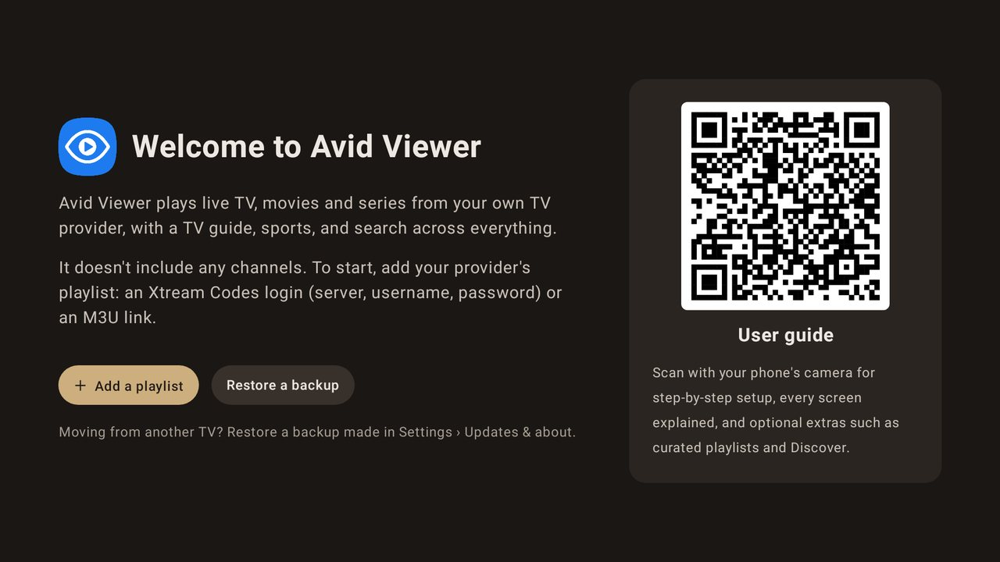

The first time you open Avid Viewer, and every time it starts while there are no playlists, it shows a welcome screen:

- **From 1.17.0 a device is linked to an account before it gets playlists** (licensing): the welcome screen shows the steps to link it, and there is no Add a playlist there.
- **Link to your account** (right side, from 1.13.0): the device shows its own 8-character code and a QR code. Scan the QR code with your phone (it opens **avidviewer.app/link** with the code filled in), or go to avidviewer.app/link and type the code. Sign in or make an account, then choose **Add this device**. A new code replaces one that runs out (10 minutes). Once it's added, the device offers the backups in your account, for moving from another device; see [Backup & restore](#backup--restore). After linking, the panel says **Linked to** your email with **Restore a backup**.

Once a playlist has been added, the app opens on the TV Guide instead.

### Set up with your phone

From 1.15.0 your playlists and profiles live in your account at avidviewer.app, and you manage them from a phone or computer instead of the remote: **playlists** go to **profiles**, each profile chooses what it can see, and profiles go to **devices**.

1. **Link the device to your account:** its welcome screen shows a code and a QR code (or Settings › Account › **Link this device**). Scan the QR code with your phone, or type the code at **avidviewer.app/link**, and choose **Add this device**. See [Account](#account).
2. **Playlists** (avidviewer.app/playlists): **＋ Add a playlist**, enter a **name** and either an **Xtream Codes login** (server, username, password) or an **M3U link**, with an optional guide (XMLTV) link, and tick the **profiles** that get it.
3. **Profiles** (avidviewer.app/profiles): **＋ Add a profile** for each person (or the kids). **Manage** a profile to choose its playlists, its devices, and **what it can see** in each playlist: categories and channels, for live TV, movies and series.
4. **Devices** (avidviewer.app/devices): tick the profiles that appear on each device.
5. **Favorites and lists** (1.16.0): Profiles › **Manage** › **Favorites & lists**. **Order and names** of categories and channels: Playlists › **Edit** › **Order & names**. See [Organizing on the website](#organizing-on-the-website).

While Avid Viewer is open, a device picks up changes within a minute: a playlist arrives when any profile on the device has it, is checked like one added by hand, and leaves when no profile there has it any more. Each page shows where things stand (for example **waiting for the device to open**).

**You type a login only when you add or edit a playlist.** The first time, choose **Set up with passkey** on the Playlists page. From then on the website keeps logins locked with a key that only your **passkey** can unlock: when a profile goes to a new device, the page asks for your passkey (not the login) and locks a copy for that device, and **Edit** can show the saved login. Your devices also send the logins they have (locked so only your browser opens them), so playlists you typed on a TV, or saved before 1.15.0, don't need typing again. Without a passkey (or with a password manager that can't do this yet), the login goes to the devices that have the playlist when you save it, and you type it again for new ones.

**Playlists added on a TV** (1.15.1) are listed under **Added on your devices**. **Add to account** makes one an account playlist for that device's profiles; the device keeps its copy, favorites and everything else. If you add a playlist on the website that a device already has (the same server and username, or the same M3U link), that device uses its own copy for it rather than adding a second one (1.15.2).

**Removing a playlist:** **Remove** on its row takes it off every profile; each device removes it at its next check-in. It stays listed, tagged **Removing**, until every device has confirmed.

**What the website knows** about each playlist shows under its name: live categories and channels, movie and series categories, and which device sent them. If there are none, it says why (for example the device couldn't load the playlist).

**Needs your attention** (1.15.1): every account tab lists what failed or is waiting on you, such as a playlist a device couldn't add (with the device's own words and what to check), a device waiting for a login, a device that needs an update, or changes waiting for a device that hasn't checked in. The tabs show counts. **Dismiss** hides an item until something about it changes; **Show dismissed** brings it back. A device not seen for 7 days is marked **Away**: its changes wait for it, and you can remove it if it's no longer used.

**The website's tabs:** Playlists · Profiles · Devices (profiles on each device, rename, remove, Add a device) · Backups (each device's backup, Show PIN, how to restore) · Account (passkeys, locked logins, signed-in browsers, privacy, delete account).

**Private by design:** each device's copy is locked with a key only that device has (made when it's linked; it never leaves the device), and the copy kept in your account is locked with your passkey. The website can't read your logins. To help you choose what each profile sees, devices send each account playlist's category and channel names and counts. Where you stopped (see [Pick up where you left off](#pick-up-where-you-left-off)) is sent locked, so the website can't read what you watch.

**Watching now:** the Playlists and Devices pages show which playlists are playing, on which device and profile, and for how long, never the channel or title. **Stop stream** ends playback on that device within a few seconds (useful when your provider allows only one or two streams); the device says **This stream was stopped from your account** and offers **Watch again**.

### Pick up where you left off

From 1.17.0, where a profile stopped in each movie and episode, and the episodes it finished, follow it to its other TVs:

- A title's page says where it stopped on another TV (for example **Stopped at 34:12 on Living room, today 8:40 PM**) with **▶ Resume** and **Start over**. A series opens on the next episode as usual, including episodes finished on another TV.
- **Continue watching** (Movies and Series) lists the newest first; a place from another TV says **from Bedroom**. A series stays there until its latest episode is watched, and comes back when a new episode or season appears (1.17.1). **Menu** on a poster there removes it, on every TV; a removed series stays off until something new happens to it.
- **The last live channel** (1.18.0) comes first in Continue watching, on every TV: the channel this profile last watched for 2 minutes or more, until the program on it ends (if less than 10 minutes were left when you stopped, until the next one ends; 1 hour on a channel with no guide). **OK** tunes it; **Menu** › Remove takes it off. When this TV's own last channel is newer, it comes second. On the website it's on the profile's **Watching** tab ("Live TV · until 9:00 PM").
- The same title on another playlist (another provider, a 4K copy) picks up there too, matched by title and year, or series, season and episode.
- **Private:** everything is locked on the TV with a key only your TVs and your passkey have; avidviewer.app and its admins can't read titles, times or TV names. The first time, unlock once with your passkey on the website (Needs your attention says when a TV is waiting for the key). For live TV only the last channel is sent, never the program (1.18.0).
- **On by default.** Turn it off for the whole account (Account tab, **Keep my watch history**) or for one profile (the profile's **Watching** tab, which also lists its places with **Mark watched** and **Remove**, and has **Clear history**). Off deletes what your account holds; each TV keeps its own place. **Pause history** on a TV stops that TV sending.
- **Kids profiles** never share where they stopped and have no Discover, for their privacy.

### Organizing on the website

From 1.16.0, **favorites and lists belong to a profile** and follow it to every TV, and **the order and names of a playlist's live categories and channels** belong to the playlist, for every profile and device. Change them on the website or on a TV (Add to List, Re-order, Rename): the change reaches the account and the other TVs within a minute while Avid Viewer is open, and **the most recent change wins**, wherever it was made. The first time a TV syncs a profile, its favorites and lists are combined with the account's (lists with the same name become one).

- **Favorites & lists** (a profile's page): pick ★ Favorites or a list on the left. **＋ Add channels** searches all of the profile's playlists or lets you browse a playlist's categories, listing every channel; tick channels, or use **Select all** / **Select none** for the channels shown (1.17.2), and choose **Add**. Each channel has **⤒** (top), **▲ ▼** (one step), **⤓** (bottom) and **✕** (remove from the list). **＋ New list**, and for a list: **Rename**, **Hide on the TV**, **Delete list**. Drag lists to change their order on the TV; ★ Favorites is always first. **Sort** (1.18.0) for each list: **A–Z** (channels from every playlist mixed, by name) or **Manual**; dragging a channel switches to Manual. Channels the profile can't see aren't offered.
- **Order & names** (a playlist's page): categories on the left, the chosen category's channels on the right. **Rename** in place (the provider's name shows underneath; empty = the provider's name; Enter saves, Esc cancels). **Sort channels** (1.18.0): **Provider's order · A–Z · Manual**, one setting for every category of the playlist, on every profile and device; A–Z uses the names as shown, renames included; dragging a channel switches to Manual, starting from the order shown. Categories: **Arrange:** A–Z or the provider's order. **Undo last change**, and **Reset all to the provider's order and names**.
- **Drag and drop:** drag a row by **⋮⋮** with a mouse or finger; the page scrolls at the top and bottom edges. With a keyboard: Tab to ⋮⋮, **Space** to pick it up, **↑ ↓** to move, **Space** to drop, **Esc** to cancel.
- Live TV only for now: movie and series category order is still set on each TV.

**Devices on 1.14.0** keep the playlists sent to them, but need 1.15.0 to use profiles from the account.

### Add your first playlist

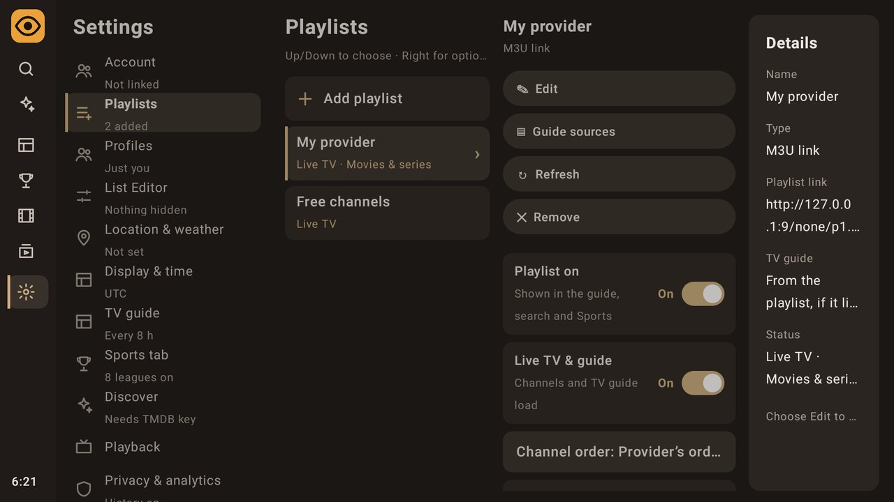

Easiest: add playlists at avidviewer.app/playlists (see [Set up with your phone](#set-up-with-your-phone)). To type one with the remote, the device must be linked to your account first (1.17.0): on a device that isn't, Add playlist shows its link code instead of the form. Devices that already had playlists before 1.17.0 keep them, and ask to be linked (Not now waits 7 days).

1. Open **Settings › Playlists** and choose **Add playlist**.
2. Pick the type:
   - **Xtream Codes**: enter a playlist name, the **Server (DNS)** (for example `http://example.com:8080`), your **Username** and **Password**. Live TV and the TV guide load from your login.
   - **M3U link**: enter a playlist name, the **M3U playlist link** and, optionally, a **TV guide (XMLTV) link**.
3. Choose which content to load (Live TV, Movies & series), then press **Add playlist**.

Your password is stored encrypted on the device (Android Keystore) and is never shown again.

Have cable or satellite TV (Xfinity, Spectrum, Cox, DIRECTV, DISH, Midco and others)? Those providers don't offer M3U links; see [Using your cable or satellite subscription](#14-using-your-cable-or-satellite-subscription).

### Using the remote

- **Arrows** move the highlight. **Hold an arrow** to speed up (3, then 6, then 12 items per repeat).
- **OK** selects. Text boxes open the keyboard only when you press OK on them.
- **Menu** (or **hold OK**) opens options for the highlighted item.
- **Back** goes up one level, landing on the item that led there. On the full menu while on the TV Guide, Back shows **Press Back again to exit**; a second Back within about 2.5 seconds closes the app.
- **Channel Up / Channel Down** (or Page Up / Page Down) move a page at a time in the TV Guide and change channels in full screen.
- **Channel and category lists wrap around.** A single press past the last item goes to the first, and the reverse. Holding a button stops at the end, so a fast scroll doesn't fly past. Other lists (the main menu, the playlist list, Settings and poster grids) stop at the end.
- If a press ever finds nothing highlighted, the app puts the highlight back.
- **Where you are:** in every list, the row you're in (the screen in the main menu, the category, the settings section, the playlist) is raised with a blue bar down its left edge. Lists you're not in are slightly dimmed. For a choice, the current value has a blue outline and a ✓; the main action is a filled button. On/off settings are switches. A button that's working shows a spinner and waits.

## 2. Main menu

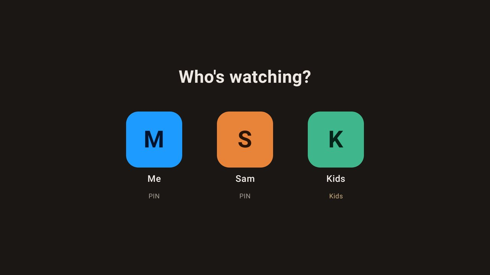

The menu on the left lists **Search, Discover, TV Guide, Sports, Movies, Series** and **Settings**. When the TV has more than one profile, the profile in use is shown at the top (its initial on its colour); **OK** on it opens **Switch profile** (see [Profiles](#profiles)). A Kids profile's menu has only Search, TV Guide, Movies and Series. Picking a screen highlights its first item. The menu is always on screen: once you've chosen a screen it shrinks to icons on the far left, and the labels come back when you move onto it.

At the bottom of the menu you'll see:

- The **clock and date** (if Show clock is on).
- **Current weather** (if a postal code is set and Show weather is on).
- An **Update x.y.z** button when a new version is available.

When the TV has a Kids profile, the app first asks **Who's watching?**; otherwise it opens on the last profile used (see [Which profile opens](#profiles)). Then it opens on the TV Guide with the menu shown as icons, on:

1. the last channel you watched, in its own category;
2. if that channel is in ★ Favorites or one of your lists, that list (the channel can belong to another playlist);
3. otherwise your first favorite, with ★ Favorites open;
4. with no favorites, the first channel of the first category.

## 3. TV Guide

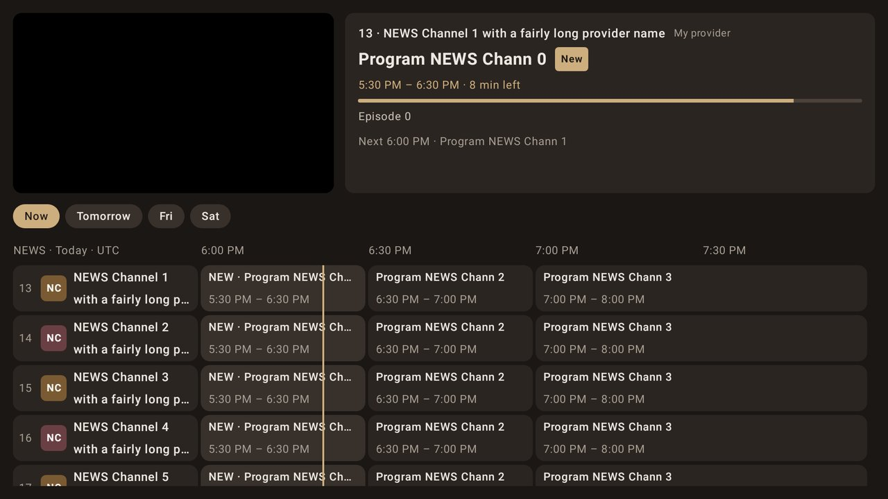

The TV Guide is the home screen for live TV. Next to the main menu it has:

- **Playlist list**: ★ Favorites, your own lists, then every playlist with live TV switched on. Press OK on a playlist to open its categories.
- **Category list**: the playlist's categories, with **‹ Menu**, ★ Favorites, your lists, **＋ New list** and **🔍 Search** at the top.
- **The guide**: the preview window and details panel at the top, the channel grid below.

**The guide fills the screen.** As soon as you've chosen a category and the highlight is in the guide (channels, programs or the preview), the main menu and the category list step aside: the guide shows **2 hours across the full width** (2.5 hours while the category list is showing). **Left** from the channel names, or **Back**, brings them back, with your current category highlighted. **Right** from the category list goes to the first channel on screen (or opens another category, like OK). The row above the times always names the category.

**Back and Left step back one layer at a time:** from a channel to your current category in the category list, then to the playlist list (on that same category), then to the main menu. With only one playlist with live TV, the playlist list is skipped: from the categories, Back goes straight to the main menu. Holding Left doesn't skip layers, and inside the grid Left still moves through programs and time.

### The guide grid

- The top shows a **preview window** and a **details panel** for the highlighted channel or program: channel number and name (plus the playlist name when you have more than one), the program title with a **New** tag for new episodes, the times with **N min left** and a progress bar (or **starts in …** for a later program), up to two lines about the show, and what's **Next**.
- Below it is a **timeline grid**: two-line channel names on the left, programs across 2 hours (full width) or 2.5 hours (with the category list), with a line marking "now". Above the times, the row names the category, the day and the time zone ("KIDS · Today · CST"). The columns sit on your clock's :00 and :30.
- **Left/Right** move between programs. Going past the last program in view scrolls the guide forward by half hours, **as far as the guide has listings, up to 7 days**. The guide doesn't scroll back before now (1.10.0): Left on the first program moves to the channel name, and Left again to the category list.
- **The program airing now** starts at the left edge; any part that has already aired isn't shown. There's no catch-up: OK plays the channel live.
- **Day strip:** when the guide reaches past today, a row of buttons sits above the times: **Now**, **Tomorrow**, then the next days (**Sat**, **Sun**…). **OK** on a day moves the guide to that day at the same time as now; **Now** comes back. The day on screen is filled in.
- **Hold Left** on a later time to jump straight back to now.
- **Up/Down** move one channel and land on the program airing at the same time, so the highlighted time stays put as you move between rows. Quick taps are counted, so a fast run of presses lands about where you'd expect, even in a category with thousands of channels.
- **Up on the first channel** moves to the day strip (when it's shown), then the preview window; **Up again** jumps to the last channel. **Down on the last channel** goes back to the first.
- **CH+/CH−** (Page Up/Down) move a full page and wrap around at the ends.
- **OK** on a channel or program starts it in the preview. **OK again**, or OK on the preview window, opens it full screen.
- **Each category remembers where you were.** A category you haven't opened yet starts at its first channel. Coming back to one you've visited highlights the channel you left, even if channels above it were hidden or the list refreshed; if that channel is gone, the nearest one is highlighted, not the top.
- **The guide keeps its time.** If you scroll ahead (to tonight, say), the guide stays on that time when you open full screen or another screen and come back.
- **Back from full screen** returns to the same channel and program, even far down a long category.
- In the category list, **Up on ‹ Menu** jumps to the last category, and **Down on the last category** returns to ‹ Menu.

### Search in the guide

Highlight **🔍 Search** in the category list (just below ＋ New list) and press OK to type. Results appear as you type (after a short pause) and replace the guide. Part of a word is enough ("farg" finds Fargo), and words can come in any order; near matches (a small typo) follow the exact ones, as in [Search](#5-search). Results: **Channels** (with what's on now, and **▶ Preview** / **▶ Full screen**) and **Programs** on now or later (**▶ Tune in** / **▶ Channel**). Search covers every playlist; choosing a result from another playlist moves the guide there. **✕ Clear search**, just below, brings the guide back.

### Channel options (Menu or hold OK on a channel)

- **＋ Add to List…**: choose ★ Favorites or one of your lists, and the picker adds the channel and closes. Lists it's already in are marked ✓; choosing one of those takes it out. **＋ New list…** makes a list with the channel in it.
- **− Remove from [list]**: when you're viewing Favorites or a list.
- **✎ Rename**: give the channel your own name.
- **⇅ Re-order**: move the channel within its category (see *Re-ordering* below).
- **⊘ Hide channel**: hide it everywhere. You can bring it back in Settings › List Editor.
- **Match guide…**: pick the guide listings for this channel (see *Matching a channel to the guide* below).

**Rename** (channels, categories, lists, movie and series categories) opens with the keyboard up and the current name selected: type the new name and press **Done** on the keyboard to save. **＋ New list** works the same way. **Cancel** closes without saving. Either way the highlight goes back to the item you renamed.

**When an item disappears** (you hide a category, delete a list, take a poster off My List), the highlight goes to the item that took its place, never back to the main menu. The **Menu** button acts when you let it go.

### Matching a channel to the guide

If a channel shows the wrong listings, or none, press **Menu** on it and choose **Match guide…**:

- The guide channels with the closest names come first. Type in **Search guide channels** to find others.
- Choose one to use its listings. ✓ marks the current match, and the dialog says whether it came from your provider or was matched by hand.
- **Use provider's match** undoes a hand match. **No guide** shows no listings for the channel.
- The guide downloads again a few seconds after a change. The list comes from the last guide download, so if it's empty, download the guide first (Settings › TV guide) or add a guide source.

### Category options (Menu on a category in the left navigation)

- **✎ Rename**, **⇅ Re-order**, **⊘ Hide category**.

### Re-ordering

When you choose Re-order, a small help panel appears at the top right, over the preview window, so the list stays in view:

- **▲ ▼** move the item up or down (hold to move faster).
- **◀** moves it to the top; **▶** moves it to the bottom.
- **OK or Back** finishes, and the new order is saved.

With a linked account (1.16.0), a playlist's live category and channel order and names go to every TV, and can also be set on the website.

**Sorting** (1.18.0): **Menu on a category › Sort channels** chooses **Provider's order**, **A–Z** (by the name as shown, renames included) or **Manual** for every category of the playlist, on every profile and TV (also Settings › Playlists › a playlist › **Channel order**). Re-ordering a channel in a playlist sorted A–Z or by the provider switches it to Manual, starting from the order on screen. Categories are always in your own order.

While you're moving it, the item has a blue outline. A category shows its position (for example "4/27") and a channel shows ⇅ in place of its number. Channels move within whatever the guide is showing (a category, ★ Favorites or one of your lists), and channel numbers follow the new order.

### Favorites and your lists

- **★ Favorites** gathers channels from every playlist in one place and is always shown. From 1.16.0, with a linked account, favorites and lists follow the profile to every TV and can be managed on the website ([Organizing on the website](#organizing-on-the-website)). Favorites, lists, renames, hidden channels and guide matches stay on the right channels when your provider adds, removes or reorders channels, and after restoring a backup.
- **Your lists** (for example "Kids" or "News") can also hold channels from any playlist. Make one with **＋ New list** or from Add to List.
- Press **Menu on a list** to **Rename**, **Move up / Move down**, **Sort** or **Delete** it. **Menu on ★ Favorites** has **Sort**. Sort (1.18.0): **A–Z** mixes channels from every playlist by name; **Manual** keeps your order. Each profile sorts its own lists; re-ordering a channel switches the list to Manual. Deleting asks you to confirm; the channels stay in your playlists.
- **Suggested near [your town]**: at the top of Favorites, the app suggests channels from your playlists that look local to your postal code. Press **＋ Add to List** to keep one; the highlight moves on to the next suggestion. **Hide suggestions** is at the right of the heading: press **▲** from a suggestion to reach it. Dismissed channels aren't suggested again unless you restore them in Settings.
- **Removing a channel** from Favorites or a list (Menu › Remove, the Add to List picker, or hiding it) keeps the highlight on the channel that takes its place.

## 4. Full-screen playback

### Live TV

- **Up / Channel Up**: previous channel. **Down / Channel Down**: next channel. Switching stays inside the current category, list or Favorites and wraps around at the ends.
- **OK, Left, Right or Info**: show the info bar (channel number and name, ★ if it's a favorite, playlist, what's on now with times, and **Up next**). It hides after 5 seconds.
- **Menu**: open **Picture & sound** (below), which also has **＋ Add to List…** for the channel you're watching.
- **Back**: return to the screen you came from.
- **Full screen by itself** (from 1.14.0): when a channel is playing in a preview (TV Guide, Favorites, Sports…) and no button is pressed for 5 minutes, the app goes to full screen on that channel, so still menus don't burn into the screen. **Back** returns to where you were. Nothing playing: the menus stay.

### Movies and episodes

- **Left / Rewind**: back 10 seconds. **Right / Fast-forward**: ahead 30 seconds.
- **OK / Play-Pause**: pause or resume.
- **Up, Down or Info**: show the progress bar.
- The progress bar appears when playback starts or you press a button, and hides 5 seconds after the last press. It shows "Loading…" while the video starts, and stays up while paused ("Paused · …").
- Stopping part-way saves your place for **Resume**.
- **Menu**: open **Picture & sound** (below).

### Picture & sound

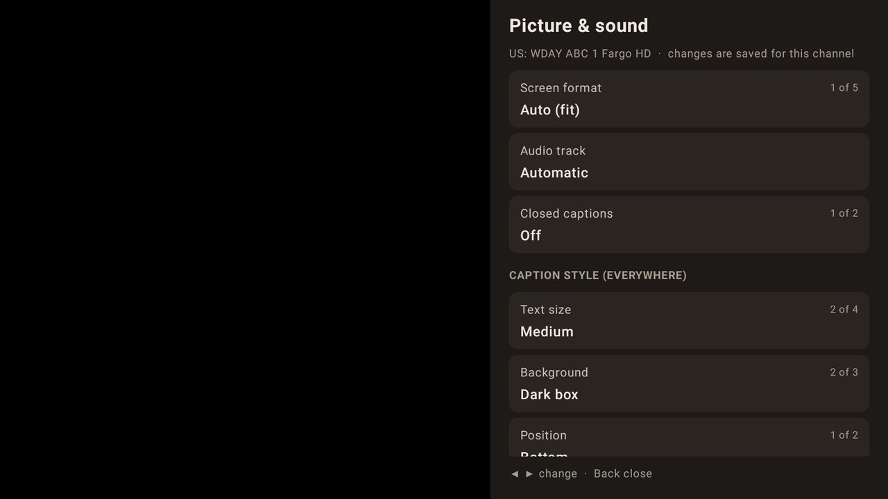

Press **Menu** while watching full screen. A panel opens on the right. **▲▼** move between rows, **◀▶** change a row's value (**OK** steps to the next value), and **Back** or **Menu** closes it.

- **Screen format:** Auto (fit), Fill screen (stretch), Zoom (crop edges), 16:9 or 4:3.
- **Audio track:** **Automatic** (the stream's own choice) or one of the stream's audio tracks, described in plain words, for example "English · Dolby Digital 5.1" or "Spanish · AAC Stereo · Secondary audio". Secondary audio (SAP) and described video are labeled when the channel sends them.
- **Closed captions:** **Off**, or a caption track: TV captions (CC1–CC4), digital captions or subtitles. If none have been found yet, **On (when available)** shows them as soon as they appear.
- **Caption style** (the same everywhere): **Text size** (Small, Medium, Large, Extra large), **Background** (None with outlined text, Dark box, Solid black) and **Position** (Bottom, Raised).
- **Save changes for:**
  - **This channel only:** for a movie, this movie; for an episode, the whole series.
  - **All channels:** the setting for everything.
  - A channel's own choices win over the ones for all channels. **Use the settings for all channels here** clears this channel's own choices.
- **＋ Add to List…** (live TV): add the channel to ★ Favorites or one of your lists.
- **Stream info** (at the bottom of the panel): what the TV is getting right now.
  - **Video**: picture size, codec (H.264, HEVC…), frame rate and bitrate, when the stream says.
  - **Download speed**: how fast the stream is arriving, and what the stream needs.
  - **Buffered ahead**: seconds of video already downloaded. Near 0 means a freeze is likely.
  - **Freezes here** and **Dropped frames** on this channel so far, and the last problem with its likely cause.
  - **Send playback log to bugs@avidviewer.app**.

Audio tracks and captions only appear when the stream carries them, so they vary from channel to channel.

## 5. Search

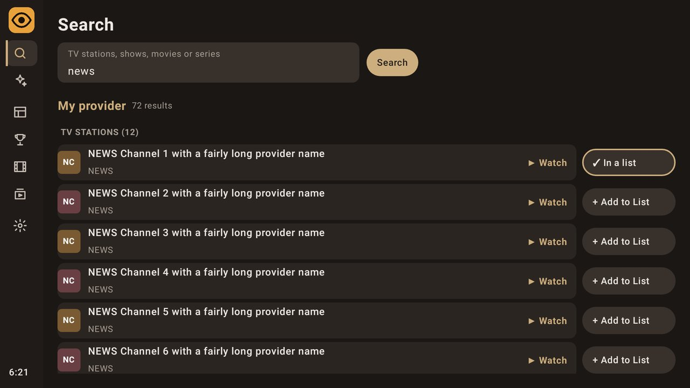

The **Search** screen searches **every playlist** at once: TV stations, programs in the TV guide (now and upcoming), movies and series.

- **Results appear as you type**, after a short pause. Pressing **Search** works too.
- **Forgiving matching:** part of a word is enough ("farg" finds Fargo), words can come in any order ("news fargo" finds "KVLY Fargo News HD"), and punctuation doesn't matter ("spider man" finds "Spider-Man: No Way Home").
- **Near matches:** a small typo still finds the name ("the ofice" finds The Office, "breking bad" finds Breaking Bad, "godfathr" finds The Godfather), and from a search of three or more words one may be missing ("the office us" finds The Office). A short word such as "tv" may be missing too. Numbers must match ("abc 6" doesn't offer ABC 3).
- **Best matches first:** names that start with what you typed, then names holding every word, then near matches.
- **"Nothing found for …"** names what was searched; try fewer letters or another word.

Results are grouped by playlist and by kind, each with an action:

- **Tune in** for a program, **Play** for a movie, **Episodes** for a series (choose a season and episode).
- **+ Add to List** for a channel (shows **✓ In a list** once added).
- **+ My List** for a movie or series (shows **✓ My List**).

After you play a channel, program, movie or episode from Search, **Back** returns to the results with that result highlighted.

## 6. Discover

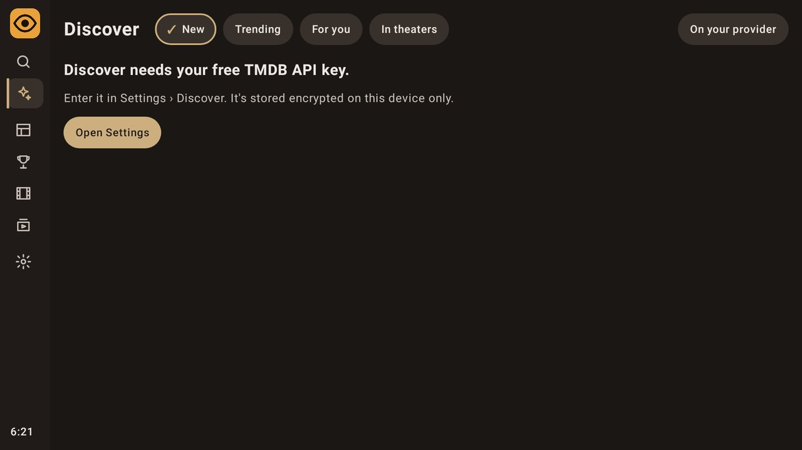

Discover shows what's new and popular, and where to watch it, using TMDB and JustWatch data.

- **Tabs**: New, Trending, For you, In theaters.
- **Per profile (1.17.0)**, on the website (Profiles › a profile › **Discover**): My streaming services, how Discover opens (**Everything**, **On your provider** or **My services**) and **titles for grown-ups** (off: movies rated R or NC-17 are left out; TMDB's lists have no series ratings). My List follows the profile to every TV. Kids profiles have no Discover.
- **TMDB key for the whole account (1.17.0)**: enter it once on a profile's Discover tab on the website; every TV gets it, locked.
- **On your provider**: only show titles your own playlists have (the ones tagged **▶ ON YOUR PROVIDER**).
- **My services**: only show titles on the streaming services you've picked.
- **Menu on a title**: add it to **My List**, or press again to take it off. A ✓ on the poster shows it's in My List. Only titles on your provider can go in My List.
- Titles your provider carries are tagged **▶ ON YOUR PROVIDER** (with a large catalog, the tag may appear a moment after the posters). Open one to play it (**▶ Play**, or **▶ Episodes** for a series), add it to **My List**, or **Search my playlists**.
- **Every version on your provider:** when your playlists have the title more than once (other languages, qualities or playlists), its page lists **N versions on your provider**, English first, each with its language, category and playlist. The page scrolls as one: **Down** from the buttons moves through the versions and then **Where to watch**. **OK** on a version plays that movie or opens that series. The main button plays the first and says which ("Plays: English · EN | Drama · My provider").
- **Where to watch** lists Stream, Free, Rent and Buy options for your region.

Discover needs a free **TMDB API key**. Enter it in **Settings › Discover**; it's stored encrypted on the device. How to get one: [TMDB](#tmdb-discover) in Supplemental services.

## 7. Sports

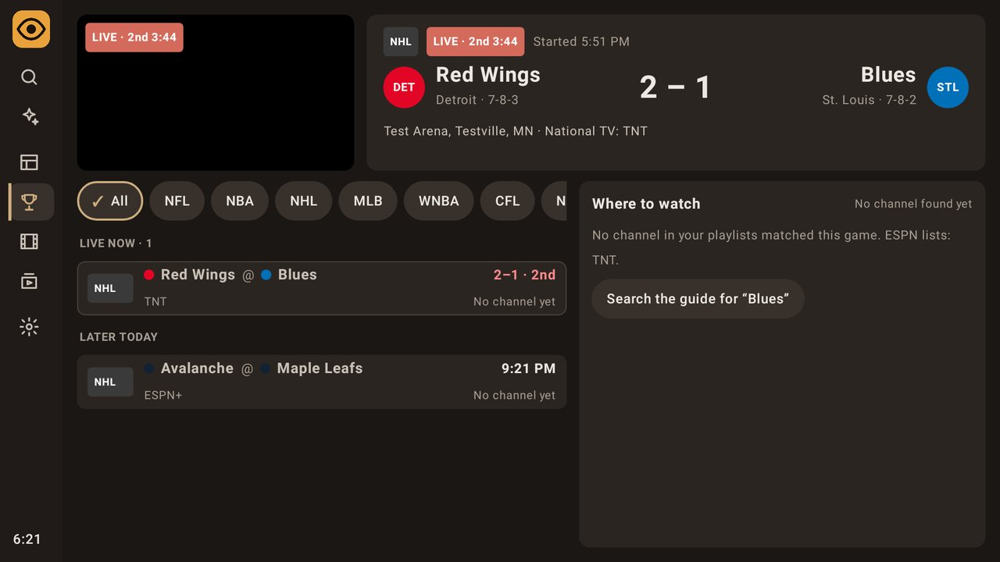

Sports lists real games from **ESPN's schedules** for today and the next 2 days, plus recent finals, then finds the channels in your playlists that carry them. Leagues: NFL, NBA, NHL, MLB, WNBA, CFL, college football (FBS) and men's college basketball (Division I).

- **Top:** the preview window and the highlighted game. It shows the league, the status (**LIVE** with the period and clock, **FINAL**, or the start time), both teams with logos, records and the score, the venue, and the national TV or streaming service.
- **Left:**
  - **League filters:** **All**, then each league you've switched on.
  - **Games:** grouped as **Live now**, **Later today**, the next days and **Final**. Each card shows the matchup, its networks, its time or score, and how many channels were found. Games with no channel found are greyed out.
- **Right: Where to watch.** The game's channels, best first, each with why it matched:
  - **National TV / Streaming:** a channel named for the network ESPN lists (TNT, ESPN2, Fox, Prime Video…).
  - **In the guide:** a listing during the game that names both teams.
  - **Event channel:** the channel's name has both teams, for example "NHL 03: Red Wings @ Blues".
  - **Local TV:** a team's regional network (FanDuel Sports Network, MSG, Altitude…).
- **OK on a game** moves to its channels. **OK on a channel** plays it in the preview; **OK** again opens full screen. In full screen, **Channel Up/Down** goes through that game's channels, best first, wrapping around at the end; the info bar shows the game and "channel 2 of 3". **Back** returns to Sports with the channel you were watching (or the game) highlighted.
- **Every playlist:** Sports searches every switched-on playlist with live TV. Hidden channels and categories are skipped.
- **North America only:**
  - US channels come first; Canadian channels are the backup.
  - Channels marked for other countries are left out, for example "UK |" in the name, or a category for another country.
- **Finding channels…:** the games appear as soon as ESPN answers. Until a game's channels have been looked for, its card says **Finding channels…** (usually a few seconds); games are listed meanwhile even if **Games with no channel found** is set to Hide.
- **Games further ahead:** guide listings and event channels for later games depend on how far ahead your guide goes (up to 7 days), so some appear closer to the start. **Search the guide for "[team]"** jumps to the TV Guide's search.
- **Updates:** each day is asked for separately. Today and yesterday are refreshed about every minute while Sports is open (scores while games are live), the next 2 days every 30 minutes. In the background Sports refreshes every 30 minutes. If ESPN can't be reached, Sports says so and shows the last list saved on the TV.

## 8. Movies and Series

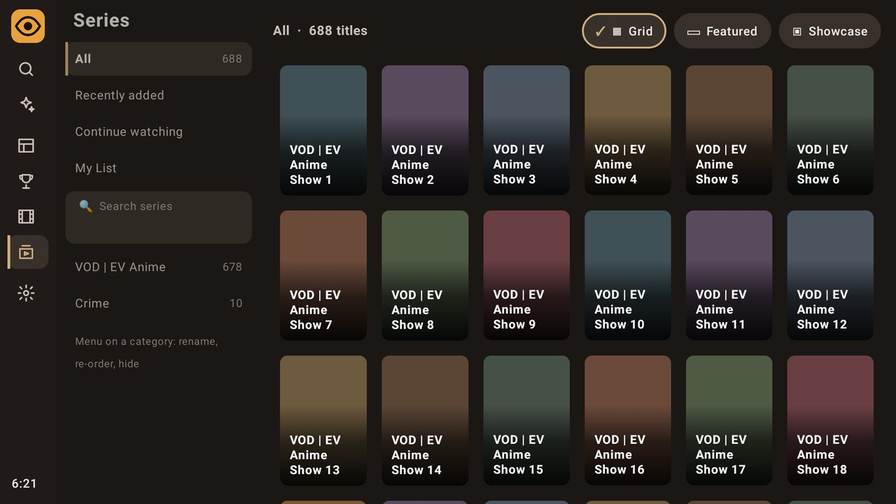

- **Left side**: Playlists, then categories: **All**, **Recently added**, **Continue watching** (movies part-way, and series until their latest episode is watched), **My List**, and your provider's categories.
- **Right side**: posters for the chosen category. A category you pause on is read ahead, so OK shows it at once.
- **Posters fill their tiles.** The title and year appear on a dark fade only on the highlighted poster, and on titles that have no artwork (most posters already show their title). The highlighted poster grows a little and gets a ring. **✓** in a corner means the title is in My List.
- **Layouts**: the buttons above the posters switch between three ways of browsing. Each profile remembers its choice; **Up** from the top row of posters reaches them.
  - **▦ Grid**: rows of posters.

    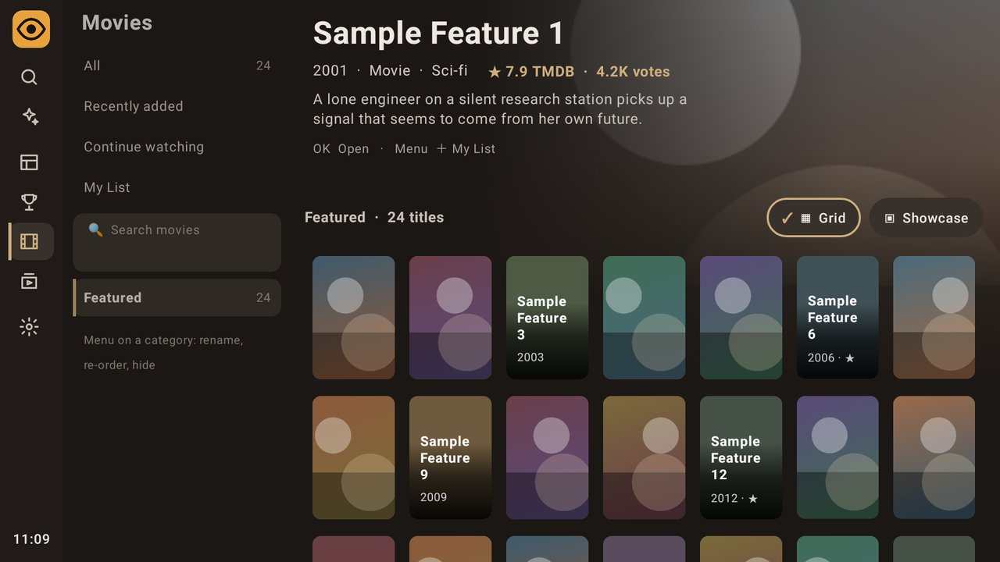

  - **▭ Featured**: the highlighted title's artwork, name, year and rating above the posters.

    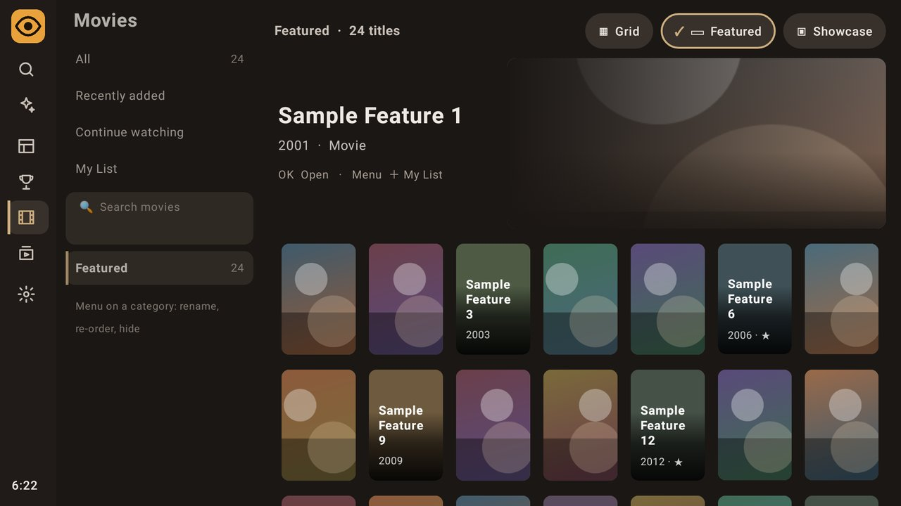

  - **▣ Showcase**: the highlighted title's artwork fills the screen, with one row of posters along the bottom (**Left/Right** to move along it).

    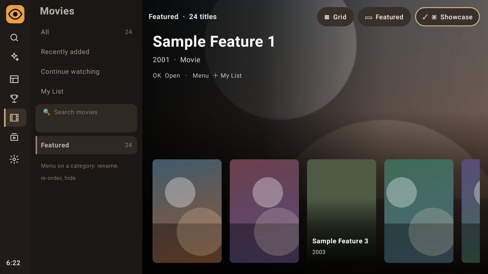

- **Each title is listed once.** When your playlists have the same title several times (other languages, qualities such as 4K or HD, provider tags such as "NF -" in front of the name, or other playlists), it appears once, shown by its English copy (else one with no language marked). This applies to All, Recently added, every category and the search.
- **🔍 Search movies / 🔍 Search series** is in the category list, below My List. Results replace the poster grid; **✕ Clear search** ends the search. When fewer than 30 titles hold every word you typed, near matches (a small typo, or a word left out) are added after them.
- **OK on a poster** opens its page: plot, cast, director, **▶ Play**, or **▶ Resume from [time]** and **Start over**, plus **+ My List**.
- **⇄ N versions** (on a title with several copies) lists each copy with its language, name, category and playlist; ✓ marks the one shown, and the line **This version: …** under the buttons says which one you're on. **OK** on another copy shows that one, with its own episodes, resume point and My List button. The language comes from codes on the name or category ("EN |", "FR -", "VF", "MULTI"…); copies without one show "Language not marked". Series pages list episodes by **Season**, with resume points; episodes you've played to the end say **✓ Watched**. **A series page opens on the next episode to watch**, with its season chosen: Season 1, Episode 1 for a series you haven't started, otherwise the episode after the last one you finished (or the one you stopped part-way through). The page scrolls as one: **Up** from the episode goes to the season buttons, then the title's buttons; from the buttons, **Down** goes to the season buttons, then through every episode, however long the description. After you watch an episode and press **Back**, that episode is highlighted.
- **Each category (and each search) keeps its own place.**
- **Back** goes one step at a time: from a title's page to its poster, from a poster to the category you're in (highlighted), then to the main menu, on **Movies** or **Series**.
- **Left** from the first column of posters (in Showcase, from the first poster) goes to the category you're browsing.
- **Category list wraps around**: Up on **All** jumps to the last category, and Down on the last returns to All. The poster grid stops at the end.
- **Menu on a category**: **Rename**, **Re-order** or **Hide** it. Hidden categories come back in Settings › List Editor.
- If you have more than one playlist, movies and series from all of them are merged.

## 9. Settings

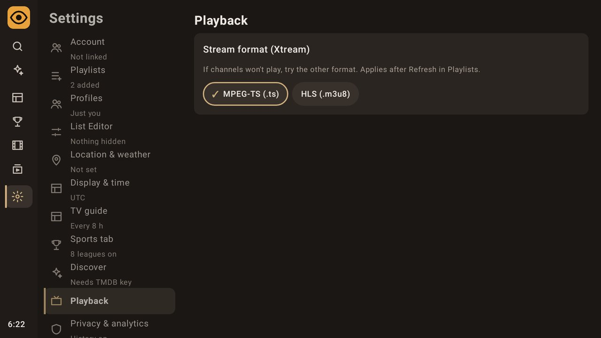

Settings has sections on the left and the open section's options on the right. **Up/Down** move through the sections; the section list scrolls to keep the highlighted one in view. **OK** opens the highlighted section and moves into it, on its first option (**Right** also moves into the open section). Inside a section, Up and Down stop at the first and last option. **Left** at the left edge of a section, or **Back**, returns to that section in the list; **Back** again opens the main menu. From 1.12.0 **Account** is the first section, just above **Playlists** (Settings still opens on Playlists).

### Playlists

- The list of your playlists (Up/Down to choose, Right for options) and **Add playlist**. While you're in the form on the right, the list narrows, so the page never has more than three full columns.
- **Back** in the add or edit form with changes that aren't saved asks **Discard changes?**. **Keep editing** has the highlight; **Discard** drops the changes. The guide source form, postal code and TMDB key ask the same way.
- For each playlist:
  - **✎ Edit**: change its details. If you change the server, login or links, its channels and guide are downloaded again, and you're asked to confirm first.
  - **↻ Refresh**: replace the saved channels, guide, movies and series with what your provider has now.
  - **✕ Remove**: delete the playlist and its login from the device. To keep it for later, turn it off instead.
  - **▤ Guide sources**: where this playlist's TV guide comes from (see below).
  - Switches: **Playlist on** (off hides it everywhere without deleting anything), **Live TV & guide**, and **Movies & series**.
- **Details** shows the type, server, username, playlist link, TV guide source and status.
- **From your phone** (under the add form, from 1.14.0): link this device to your account, then add playlists at avidviewer.app/playlists. See [Set up with your phone](#set-up-with-your-phone).

**Guide sources** (Settings › Playlists › choose a playlist › ▤ Guide sources)

- **Download from these sources every 4 / 8 / 12 / 24 h**: the same setting as in Settings › TV guide; it applies to every playlist.
- **Provider's guide** (on/off): the guide that comes with an Xtream login, or the M3U file's own guide link.
- **＋ Add guide source**: a name, an XMLTV address (`.xml` or `.xml.gz`) and a **time offset** (−12 to +12 hours) for a guide that's consistently early or late. The keyboard opens on **Name**; **Next** on the keyboard moves to the address, and **Done** there saves. The highlight goes back to the button after **Save** or **Cancel**. **▲ / ▼** move a source and keep the highlight on it. While you're in Guide sources, the playlist list steps aside; **Left** brings it back.
- Each source has **Turn off / Turn on**, **✎ Edit**, **▲ ▼** to change the order, and **✕ Delete** (asks first). Each one shows when it last downloaded and how many channels it covered, or why it failed.
- **Order matters:** sources are read top to bottom, and for each channel the first source with listings is used.
- **Download now** gets this playlist's guide again.

**Downloads that stall** give up after 45 seconds. A download that fails before it starts (no connection, a busy server) is tried again twice, after 1 and 3 seconds. Loading, empty and error messages look the same on every screen, and errors have **Try again**.

**Background downloads.** About 10 seconds after the app opens, it updates each switched-on playlist in turn, fetching only what's out of date: channels older than a day, the guide when it's older than your guide setting (8 hours by default), and movies & series older than a day. Content that's switched off is never loaded. The first download of a large movie catalog can make a Fire TV Stick feel slower for a minute or two.

### Profiles

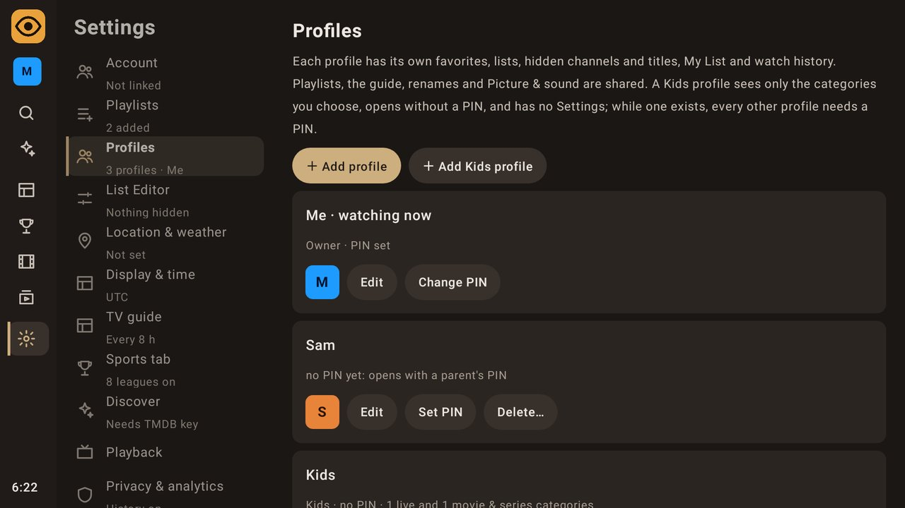

Each person in the household can have their own profile. A profile has its own ★ Favorites and lists, hidden channels and categories, hidden movie and series categories and titles, My List, last channel, dismissed local suggestions, watch history (and whether it's paused), resume points and watched episodes. Playlists and logins, guide sources and matches, renamed and re-ordered items, Picture & sound and every other setting are shared.

Each profile also has its own **theme** (colours) and its own Movies and Series **layout**. See [Display & time](#display--time).

**Profiles from your account (1.15.0).** On a linked device, profiles are managed at **avidviewer.app/profiles**, with their PINs, playlists and what each one can see, and each device shows the profiles ticked for it at avidviewer.app/devices. Settings › Profiles then says **Managed at avidviewer.app** and lists them (each can still pick its colour theme). The first time a device on 1.15.0 checks in, its own profiles are added to your account (a profile with the same name as one already there becomes that one), with their PINs, what they hid in the account's playlists and, for Kids, their categories; their favorites and history stay on the device. A profile taken off a device disappears from it, but its favorites and history stay there in case it comes back.

**On the website:**

- **New profile:** a name and colour; **Parent** (its PIN unlocks any profile on the TV); a 4-digit **PIN** (optional unless your account has a Kids profile).
- **Kids profile:** sees only the categories you allow (everything starts hidden; adult categories can never be shown). Before a Kids profile is created, every grown-up profile needs a PIN, so a child can't switch to it; the page asks for any that are missing. A Kids profile that came from a device whose grown-ups have no PIN stays unfinished (not sent to devices) until you choose **Finish setting up** and set them (1.15.1). A grown-up's PIN can't be removed while a Kids profile exists. PINs are saved only as a salted one-way hash and reach devices the same way.
- **What a profile can see:** pick a playlist, then **Live TV**, **Movies** or **Series**: each category is **Shown** or **Hidden**; open a live category to hide single channels. Hidden items disappear from the guide, search, Favorites and Sports for that profile on every device it's on. The names come from the playlist as a device last downloaded it. The page says whose choices you're editing, for which playlist, and when they were last saved; each profile keeps its own (1.17.2).

**On a device that isn't linked,** Settings › Profiles works as before: **＋ Add profile**, **＋ Add Kids profile** (if no grown-up has a PIN yet, the app asks you to set the first profile's PIN), and for each profile **Edit** (name, colour, theme; a Kids profile's categories), **Set PIN / Change PIN**, **Parent**, **Delete…**. In a profile that isn't a parent, changing profiles asks for a parent's PIN.

**Which profile opens when the app starts (1.18.0)**

- **One profile (or none):** there are no profiles anywhere: no Who's watching?, no switcher, no profile on the info bar.
- **A Kids profile on the device:** the app opens on **Who's watching?**, with the Kids profile highlighted (the last Kids profile used on this device, otherwise the first one in your account's order). **OK** opens Kids; a grown-up profile asks for its PIN. Nothing plays until a profile is chosen. (1.15.0–1.17.2 opened Kids with a 5-second splash instead.)
- **No Kids profile:** the app opens straight on the last profile used (if that profile has its own PIN, Who's watching? asks for it).

**Kids profile on the TV**

- The TV Guide, Movies, Series and Search show only its categories. Channels outside them can't be opened from favorites, lists, search or the last channel.
- Discover, Sports and Settings aren't in a Kids profile's menu.
- A Kids profile never needs a PIN. While a Kids profile exists, every other profile needs one (its own or a parent's).

**Who's watching? and switching**

- **Who's watching?** (at start with a Kids profile, or from **Switch profile**): **Left/Right** pick a profile, **OK** opens it. Profiles that need a PIN show "PIN"; Kids profiles show "Kids".
- **Switch profile**: **OK** on the profile at the top of the main menu.
- **The profile in use** shows on the info bar over video (above the clock, and on movies and episodes), on devices with two or more profiles.
- **PIN**: type the 4 digits with the remote's number keys or the on-screen pad. A profile's own PIN or any parent's PIN opens it. After 5 wrong PINs in a row the app says "Too many tries. Wait a minute."
- **Forgot a PIN?** Change it at avidviewer.app/profiles (or, on a device that isn't linked, from a parent's profile); the old PIN isn't needed.

Profiles are included in backups (see [Backup & restore](#backup--restore)).

### TV guide

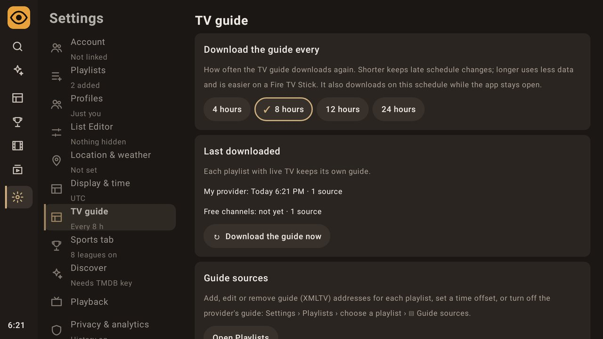

- **Download the guide every**: 4, 8, 12 or 24 hours (8 is the default). The app also follows this while it stays open. Each download keeps up to 7 days of listings. A guide source that hasn't changed since the last download isn't downloaded again.
- **Last downloaded**: when each playlist's guide last downloaded and how many sources it has. **Download the guide now** gets every guide again.
- **Channels matched by hand**: how many there are, with **Clear all matches** (asks first).

### List Editor

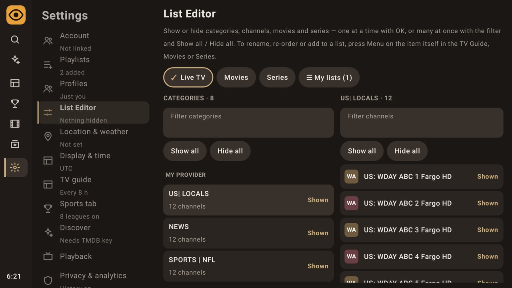

Show or hide items one at a time with OK, or many at once with the filter and **Show all / Hide all**. It has four tabs:

- **Live TV**: categories by playlist, then the channels in each category.
- **Movies** and **Series**: categories and titles.
- **☰ My lists**: show or hide your lists in the TV Guide. ★ Favorites is always shown.

Rename, re-order and Add to List are done with Menu on the item itself in the TV Guide, Movies or Series.

- Headers show counts, for example "EN - MOVIES 4K · 1105 · 222 hidden". With a filter typed, Show all / Hide all act only on the matches (for example "Hide 222").
- Hidden movies, series and categories also disappear from search.
- A hidden list keeps its channels. Add to List marks it "(hidden)".

### Location & weather

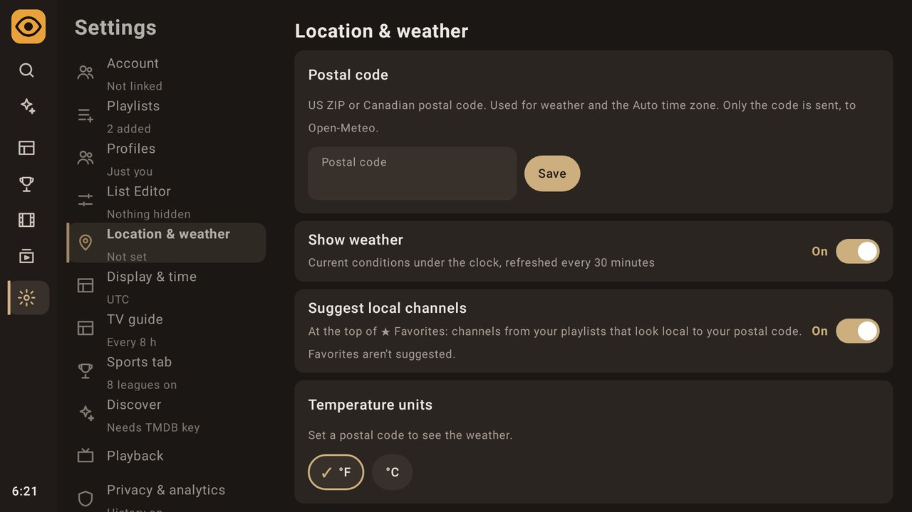

- **Postal code**: a US ZIP or Canadian postal code (Done on the keyboard saves it). It's used for weather, local channel suggestions and the Auto time zone. Only the code is sent, to Open-Meteo.
- **Show weather**: current conditions under the clock, refreshed every 30 minutes.
- **Suggest local channels**: on or off. **Show them again** restores suggestions you dismissed.
- **Temperature units**.

### Display & time

- **Theme**: the colours of the profile you're using. Each profile has its own; change another profile's in Settings › Profiles › Edit. **OK** on a preview picks it, and ✓ marks the one in use.
  - **Dark roast**: dark brown, a soft warm-grey highlight with dark text, muted gold. New installs and new profiles start on it.
  - **Midnight blue**: navy with a bright blue ring, the look up to 1.3.0. Profiles that existed before 1.4.0 keep it until you change it.
  - **Espresso & cream**, **Espresso & ivory** and **Mocha & latte**: other warm themes, from darkest to lightest base.

  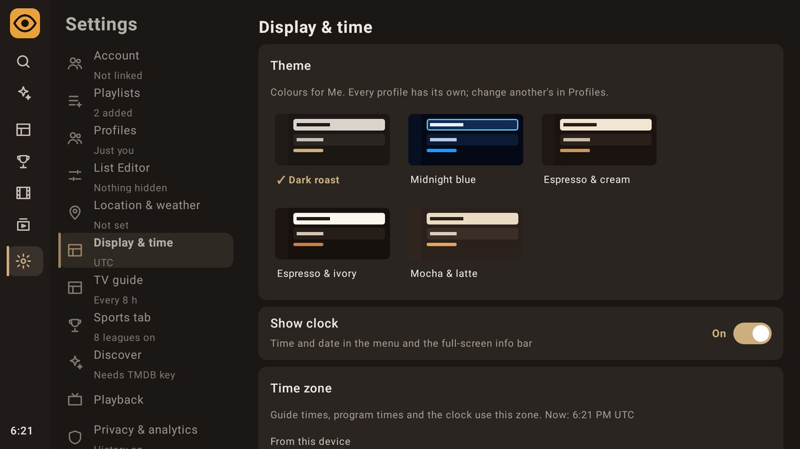

  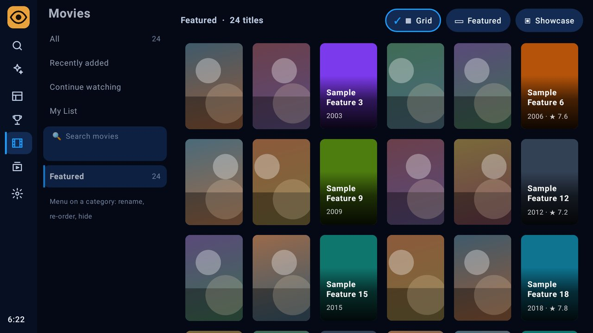

- **Show clock**: time and date in the menu and in the full-screen info bar.
- **Time zone**: Auto (from your postal code), Device, Eastern, Central, Mountain, Arizona, Pacific, Alaska, Hawaii or Atlantic. Guide and program times use this zone.

### Sports tab

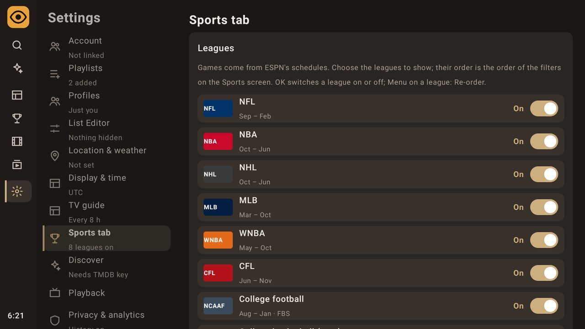

- **Leagues**: **OK** switches a league on or off.
  - **Menu** on a league re-orders it: ▲▼ move, ◀ top, ▶ bottom, OK done. The order is the order of the filters on the Sports screen.
- **Games with no channel found**: Show (greyed out, with ESPN's networks) or Hide.
- **Finished games stay for**: 6, 12 or 24 hours.
- **Scores**: Show or Hide. Hiding them avoids spoilers: live games show only the period.
- Soccer, rugby, cricket, golf, motor racing and combat sports aren't included yet.

### Discover

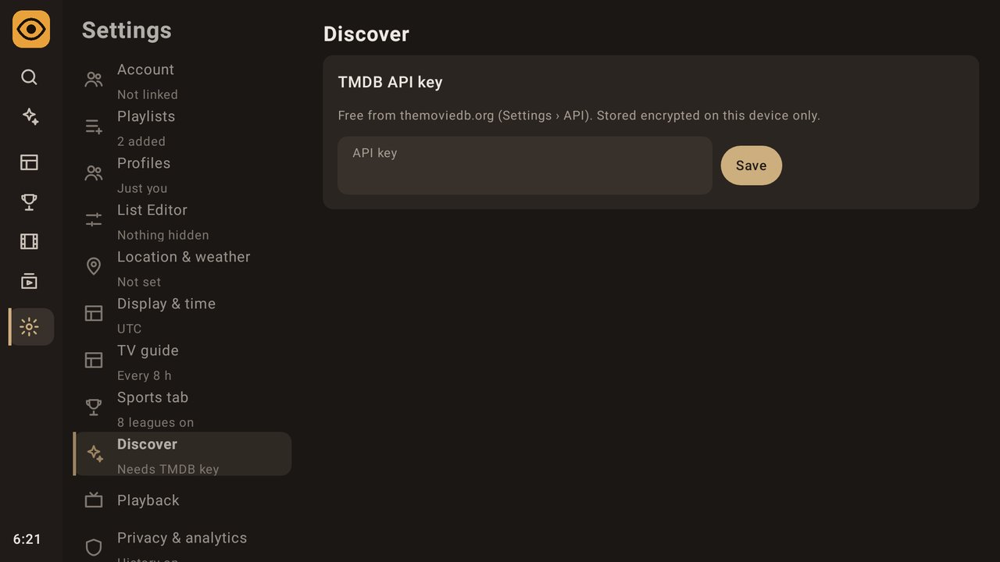

- **TMDB API key**: Save it (or press Done on the keyboard), or Remove it (asks first). With a linked account it can be set once for every TV on the website (1.17.0).
- **My streaming services**: pick the services you subscribe to. From 1.17.0 these belong to the profile and follow it to every TV.

### Playback

- **Stream format (Xtream)**: **MPEG-TS (.ts)** or **HLS (.m3u8)**. If channels won't play, try the other format. The change applies after a Refresh in Playlists.

### Privacy & analytics

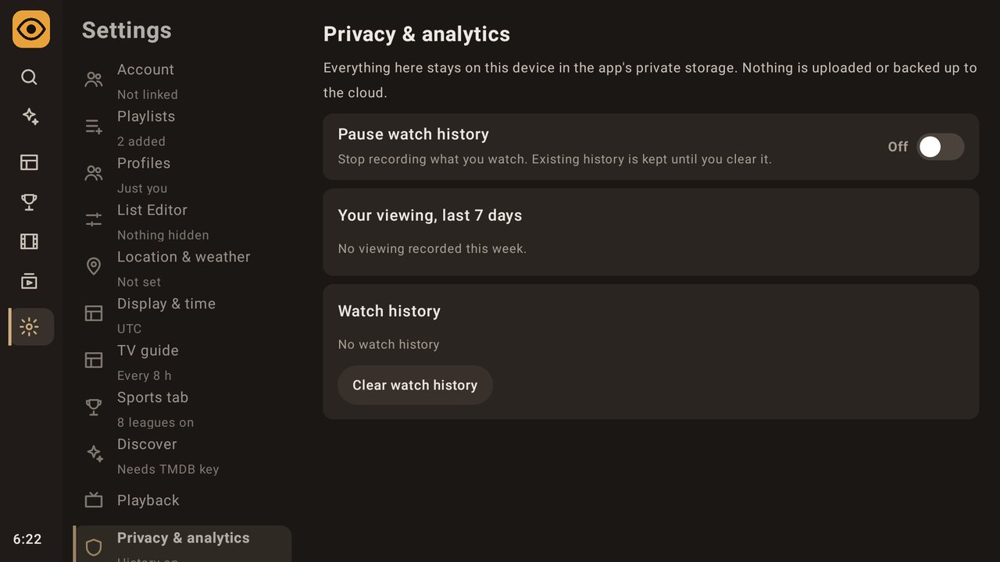

Everything here stays on the device; nothing is uploaded or backed up to the cloud. Watch history, the pause switch and the 7-day summary belong to the profile in use.

- **Pause watch history**: stop recording what you watch.
- **Your viewing, last 7 days**: hours watched and your top channels.
- **Clear watch history** (the app keeps up to 90 days). It asks first.

### Storage

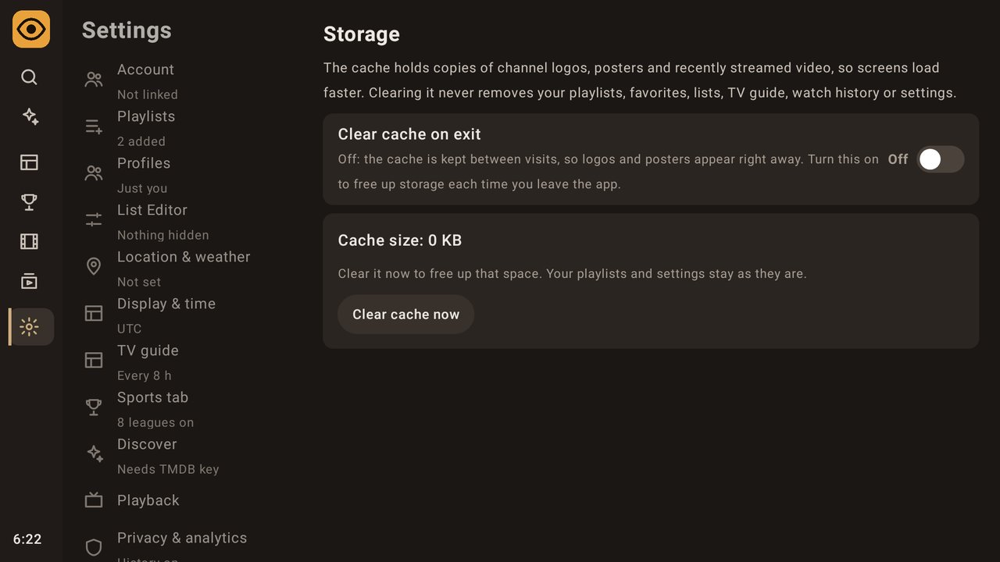

- **Clear cache on exit**: empty the cache (logos, posters, recently streamed video) every time you leave the app.
- **Cache size** and **Clear cache now** (asks first). Clearing never removes your playlists, favorites, lists, guide, history or settings.

### Updates & about

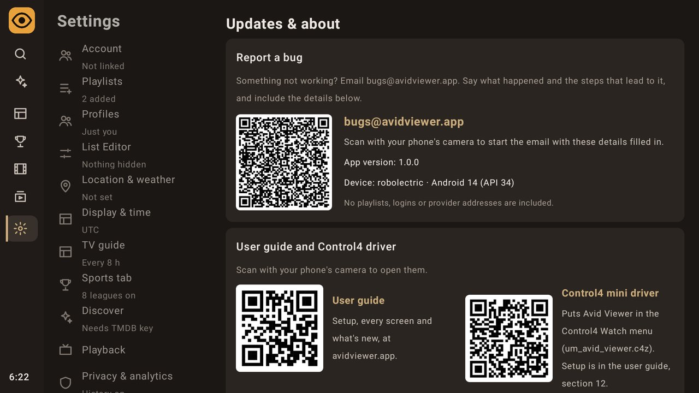

- **App updates**: the installed version, **Check now**, **Download and install**, and the **Check for updates automatically** switch.
  - The main menu shows **Update x.y.z** as soon as a new version is found, and **Download and install** is here.
  - The **Update available** dialog (**Update now** / **Later**) opens by itself only once the newest version has been out for **24 hours** and isn't installed yet. If an even newer version comes out in the meantime, the 24 hours start again. **Later** waits another 24 hours. It never opens over full-screen video. A TV left running checks for new versions every 6 hours (when **Check for updates automatically** is on).
  - The download shows its progress. If the connection stalls, the app waits 15 seconds and continues from where it stopped (up to 8 tries). The finished file is checked before installing, and a damaged download is refused.
  - If Android's installer doesn't appear within about 25 seconds, an **Open installer** button opens Android's own install screen for the same file.
- **Last crash**: if the app closed unexpectedly, the details are kept here on the device, with **Report issue** and **Clear crash report** (asks first). **Report issue** sends them to **bugs@avidviewer.app** and then clears them (see *If the app closes unexpectedly* below).
- **Playback log**: a summary ("Playback log: 3 freezes (longest 12 s), 1 error today") and the latest problems, each with its likely cause. Channels and titles appear as short codes ("Live channel 4F2A", "Title 9C01"), never by name. **Send playback log** sends it to bugs@avidviewer.app; **Clear log** asks first. **Send it automatically** (on by default) sends it at most once a day, and only when there were freezes or errors since the last send.
- **Report a bug**: email **bugs@avidviewer.app** with what happened and the steps that lead to it. The section lists the details to include, read from the TV (app version, device model, Android and Fire OS versions, and the last crash's error). Scan the **QR code** with a phone camera to start that email with the details filled in; **Open email app** appears only on TVs that have one. No playlists, logins or provider addresses are included.
- **User guide and Control4 driver**: two QR codes to scan with a phone. **User guide** opens this guide on avidviewer.app (always the latest version); **Control4 mini driver** downloads `um_avid_viewer.c4z` (see [Control4](#12-control4)).
- **Moving through this section:** opening it (OK on Updates & about) highlights **Report a bug** first; **Down** moves to the QR codes, then to Backup & restore and App updates. Blocks without buttons (Report a bug on TVs without an email app, and the QR codes) take the highlight themselves, with a ring around the whole block, so the page scrolls each one fully into view.
- **Credits**: TMDB, JustWatch, Open-Meteo and ESPN.

### Account

From 1.11.0 a device can be linked to an Avid Viewer account at avidviewer.app. From 1.12.0 that's also where its backups are kept (see below).

- **Making an account:** at **avidviewer.app/signin**, enter your email for a one-time sign-in link, or use a passkey you've added. There are no passwords. Your account page (**avidviewer.app/account**) lists your devices, their backups, passkeys and signed-in browsers, your watch-history choice, and **Delete account**.
- **Link this device** (Settings › Account, or the code on the welcome screen): the device shows an 8-character code and a QR code. Scan the QR code with your phone (the code is filled in for you), or open **avidviewer.app/link** (**Add a device** on your Account page) and type the code. Sign in if asked, check the device it found, give it a name, and choose **Add this device**. The device notices within a few seconds and shows **Linked to** your email. The code works for 10 minutes; **Cancel** stops waiting.
- **Linked:** Settings › Account shows the account and this device's name. **Sign out of this device** (asks first) unlinks it and forgets its backup PIN; playlists and settings on the device stay.
- **Your devices** on avidviewer.app/account shows each linked device's name, model, app version and when it last checked in, with **Rename** and **Remove**. A removed device unlinks itself the next time it checks in (a minute after the app starts, then every 6 hours); its backup stays in your account for 30 days.
- **Profiles on this device** (1.15.0, Settings › Account): the account's profiles on this device and their playlists, with **Check for changes now**.
- **What's shared:** linking sends the device's name, model and Avid Viewer version; from 1.14.0 also a public key, so the website can send it playlists only it can open; from 1.15.0 its profiles (names, Kids, Parent, PINs as salted hashes) the first time, the category and channel names of your account's playlists, and while something plays, which playlist and profile (for Watching now). Your settings go to your account only in a backup, locked with your backup PIN. From 1.17.0, where each profile stopped (movies, episodes and, from 1.18.0, the last live channel) is sent locked with a key only your TVs and your passkey have; the website and its admins can't read it. Watching now shows only the playlist, device and profile, never the channel or title.

#### Backup & restore

From 1.12.0, backups are kept in your **avidviewer.app account**, so only a device linked to your account can back up or restore. On a device that isn't linked, this section shows **Link this device** (see [Account](#account)). Backup files on the device and network-share (SAMBA) backups were removed in 1.12.0.

A backup holds your playlists (with their logins), ★ Favorites and your lists, renamed and re-ordered channels and categories, hidden items, Sports leagues and options, location, the TMDB key, all other settings, watch history and resume points, and every profile with its own favorites, lists, hidden items and history (profile PINs are stored only as one-way hashes). After a restore the app opens on the owner's profile. Channels, guides and movie catalogs aren't included; they download again after a restore.

**One backup per device.** Each linked device keeps one backup in your account, its most recent; every new backup replaces the last one.

**Back up**

1. Choose **Back up now**. The first time, choose a **backup PIN** (4 or more digits, entered twice), then **Back up**. Because the backup holds your provider logins, it's locked with this PIN before it leaves the device.
2. The device remembers the PIN, so later backups don't ask again. **Change PIN** sets a new one (and backs up with it).
3. **Back up every day** (on by default) backs up once a day, only when something changed. Turn it off to back up only when you choose Back up now.
4. **Last backup** shows when this device last backed up.

**Restore, or copy another device's setup**

1. Choose **Restore from your account**. It lists every backup in your account, newest first: **This device**, your other devices, and removed devices.
2. Choose one. The confirmation shows which device it's from, when it was made and which playlists it holds. Restoring replaces the playlists and settings on this device and can't be undone.
3. Enter that backup's PIN. A wrong PIN is refused and nothing changes. After a restore, channels and guides start downloading again, and this device backs up with the same PIN from then on (if it didn't have one).

**Setting up a new device:** its welcome screen shows a code and a QR code. Scan it (or type the code at **avidviewer.app/link**, **Add a device** on your Account page), choose **Add this device**, then pick the backup to copy on the device.

**Forgot the PIN?** Sign in at **avidviewer.app/account**, find the backup under **Backups** and choose **Show PIN**. For your security it's shown only after a sign-in in the last hour, or a passkey sign-in.

**On the website:** **Backups** on your Account page lists each device's backup with its date, size and number of playlists; **Delete** removes one. A device removed from your account keeps its backup for **30 days** (so a replacement can restore it), then it's deleted. Deleting your account deletes all backups.

## 10. Privacy

- All your data stays on the device. Android cloud backup and device-to-device transfer are turned off.
- Provider passwords and the TMDB key are encrypted with the Android Keystore.
- Backups are encrypted on the device with your backup PIN before they're sent to your account, because they contain provider logins. The website keeps the PIN separately, encrypted, so you can look it up on your Account page.
- Profile PINs are stored only as salted one-way hashes, never as the digits.
- The **playback log** (freezes and errors) never records what you watch: each channel or title is a short code made from a random number kept on your TV, which can't be turned back into a name. It is sent to bugs@avidviewer.app at most once a day when there were problems, or when you choose Send playback log. Turn off **Send it automatically** in Settings › Updates & about to send it only by hand. Addresses, logins and IP addresses are removed first.
- Crash details leave the TV only when you choose **Report issue**. They go to bugs@avidviewer.app through a small mail relay, with web addresses, server and host names, IP addresses, user names, passwords and tokens removed first.
- **Security checks (1.10.1)** use freeRASP by Talsec. It checks the TV and the app for tampering (root, hooking tools, a modified copy, debuggers, emulators) and sends Talsec anonymous findings about the device and app for its security reports; nothing about what you watch, your playlists or logins. Alerts the app finds are also sent to bugs@avidviewer.app through the crash relay, each kind once and at most once a day.
- **Accounts (1.11.0):** linking a TV to an avidviewer.app account sends only the TV's name, model and app version; the TV keeps its own key, encrypted with the Android Keystore. Playlists sent from avidviewer.app/playlists (1.14.0) are locked in your browser for each device with that device's own key; the website can't read the logins, and keeps each locked copy only until the device has it. What an account stores is on the website's [privacy page](https://avidviewer.app/privacy/).
- Outside services get only what they need: your postal code (Open-Meteo, for weather), title lookups (TMDB/JustWatch, if you add a key), scoreboards (ESPN), update checks (GitHub) and, when you choose Report issue, the crash report (the Avid Viewer crash relay, a Google Apps Script web app).

## 11. Troubleshooting

### If video freezes

The app notes every freeze in the playback log, with its likely cause. Open **Menu** › Stream info while it happens, or Settings › Updates & about › Playback log afterwards:

- **"the provider (HTTP 503…)"**: the provider's server refused or failed. Usually busy times or a problem on their side; try again later or contact the provider.
- **"the network or the provider's server (connection timed out…)"**: the connection dropped. Check Wi-Fi (a wired connection or a closer router helps), or the provider may be overloaded.
- **"too slow (getting 3.1 Mb/s, the stream needs 8 Mb/s)"**: the stream needs more than the TV is getting. Try an HD instead of a 4K channel, or improve the connection.
- **"data stopped arriving… the provider's server paused the stream"**: no error, but nothing came. Usually the provider.
- **"the TV's video decoder"** (picture stopped while the sound went on, or many dropped frames): the TV struggled with the video, often 4K or HEVC on a Fire TV Stick. Try the HD version of the channel.

**Automatic reconnect (1.10.0).** When the picture stands still for 5 seconds while the sound plays, or no data has arrived for 4 seconds with less than 8 seconds left in the buffer, the app reopens the stream by itself and shows "Reconnecting…". Live channels come back at the live point, movies and episodes where they were. It doesn't reconnect in a channel's first 10 seconds, and stops after 3 reconnects in 3 minutes on one channel (a channel that keeps failing usually has a provider problem). Each reconnect is in the playback log, with whether the picture came back.

Sending the log (Send playback log) helps us find a pattern across days.

- **Channels won't play**: switch the Stream format in Settings › Playback, then Refresh the playlist.
- **No channels or guide**: check that the playlist, and its Live TV switch, are on in Settings › Playlists, then choose Refresh.
- **No movies or series**: turn on Movies & series for the playlist and Refresh.
- **Discover is empty**: add a TMDB API key in Settings › Discover, or turn off "My services".
- **Sports showed no games for a long time after updating to 1.2.0** (with a big TV guide and several playlists): update to 1.3.0 or later; games now appear at once.
- **Sports is empty**: check the leagues in Settings › Sports tab; off-season leagues have no games. "Couldn't reach ESPN" means the schedules couldn't be downloaded, so the last list is shown. On 1.0.141 this appeared for every league; update to 1.0.147 or later.
- **A game shows "No channel yet"**: your playlists have no channel named for its network, and no guide listing or event channel for it yet. Those often appear closer to the start. You can also use **Search the guide** on the game.
- **Discover froze or the app closed after about 20 seconds** (1.0.137 and earlier, with large movie catalogs): update the app.
- **Channels and the guide took minutes to appear after updating to 1.0.160** (with a big movie and series catalog): update to 1.0.162 or later. If you're still on 1.0.160, leave the app open until they appear; it only happens once.
- **The app froze or closed while pressing Up/Down quickly in the TV Guide** (1.0.147 and earlier, mostly in big categories after wrapping from the top to the bottom): update to 1.0.160 or later.
- **No audio tracks or captions to choose in Picture & sound**: the stream doesn't carry them. Many live channels have one audio track and no captions; try another channel, or set captions to **On (when available)** so they show when a program has them.
- **Movies or Series were slow, or the app stopped responding on Series** (1.0.160 to 1.0.162, with a big catalog): update to 1.0.165 or later.
- **A title is missing from Movies or Series**: it may be listed once under another copy. Open it and use **⇄ N versions**.
- **A channel or category disappeared**: it may be hidden. Check Settings › List Editor.
- **A guide row ends early and Right won't go further**: fixed in 1.0.133 for guides that list overlapping programmes; update the app.
- **A channel shows the wrong listings, or none**: press Menu on it and choose **Match guide…**. If a whole guide is consistently early or late, set a **time offset** on its source in Settings › Playlists › ▤ Guide sources.
- **Favorites landed one channel off after a restore** (on a version before 1.0.94): that backup can't fix them automatically. Set them once, then make a new backup; newer backups record which channel each favorite points to.
- **An update hangs at about 95%** (updating from 1.0.82 or earlier, which have the old updater): try again. If it still hangs, install the new version once by hand with the Downloader app; later updates resume stalled downloads.

### If the app closes unexpectedly

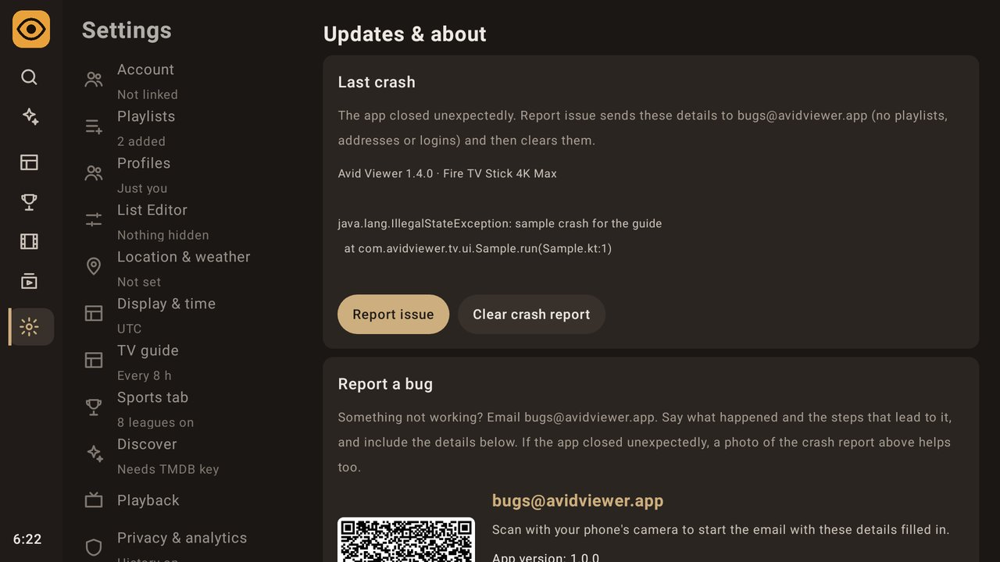

The next time it starts, the app says **Avid Viewer closed unexpectedly**:

- **Report issue** sends the details to **bugs@avidviewer.app**: the app version, the TV model and Android / Fire OS version, and the error. Web addresses, host names, IP addresses, user names, passwords and tokens are removed first; no playlists, logins or keys are sent. When it's sent, the message says thanks, closes after a few seconds, and the details are cleared.
- If it can't be sent (no connection, for example), the message says so and the details stay in **Settings › Updates & about › Last crash**, where **Report issue** can try again.
- **Cancel** closes the message. Nothing is sent, and the details stay in Last crash.

**If the app vanished to the Fire TV home screen.** Sometimes the TV closes the app itself, usually to free memory, and the app gets no chance to save anything. From 1.7.0 the app notices at its next start and shows the same message, so **Report issue** covers this too. The report says the app **closed while in use**, with the last few steps (screen names such as "Screen: search", or "Search: 2 words"; never what you searched or watched) and the memory in use. On Fire OS 8 and later it also includes the reason the TV gives (low memory, not responding, or a crash in the video code). Leaving the app with Home or Back is never reported, nor is force-stopping it in the TV's settings, nor is installing an update while the app is on screen (1.17.2).

### Backup questions

**Backup & restore only says Link this device.** Backups live in your avidviewer.app account from 1.12.0. Link the device in Settings › Account, then back up.

**I forgot my backup PIN.** Sign in at avidviewer.app/account and choose **Show PIN** next to the backup. If it asks you to sign in again, that's because the PIN is shown only after a recent sign-in.

**A backup from an older version (an `.avbak` file or a network share).** These can't be restored from 1.12.0. Once the device is linked to your account, it makes a new backup in your account the next day (or choose Back up now).

### Reliability

Every build runs automated usability tests before it's released: the real app screens on a TV-sized screen, driven by simulated remote presses. They cover every screen and Settings section, re-ordering, List Editor bulk actions, search, hold-to-scroll, backups (including a real network share) and a 600-press random-key crash hunt. A failing test stops the release.

## 12. Control4

The **Avid Viewer** Control4 driver (`um_avid_viewer.c4z`) adds Avid Viewer to the Watch menu. Picking it switches the room to your Fire TV and opens Avid Viewer. Your Control4 installer adds it in Composer.

**Download:** [Control4 drivers folder](https://drive.google.com/drive/folders/1PeYs-U4YgndrVZm6PN-uAF-hgRGoIr9d) on Google Drive, or the [driver file directly](https://drive.google.com/file/d/10XxPywvX456lPTmou6xsqERmbTfhOJul/view?usp=drivesdk). Anyone with the link can download it. You can also scan the QR code in **Settings › Updates & about** with a phone.

### What you need

- Avid Viewer installed on the Fire TV.
- A Fire TV driver in your Control4 system that works with Control4's universal app drivers. Its connections include an **App Switcher** with App or MiniApp inputs.

### Setup in Composer

1. Add the Avid Viewer driver to the room.
2. Under **Connections**, connect the driver's **Avid Viewer** output to a free **App / MiniApp** input on the Fire TV driver's App Switcher.
3. In **System Design**, select the room and check that it shows **Audio Path = Yes** for Avid Viewer.
4. Refresh Navigators.

### Using it

- Choose **Avid Viewer** under **Watch** on a Control4 remote, touchscreen or the app.
- Remote keys pass through to the Fire TV, so the D-pad, OK, Back and Menu work in Avid Viewer as usual.
- If the Fire TV driver's **Passthrough Mode** is Off, the Fire TV takes over as the selected device once Avid Viewer opens.

### Control4 troubleshooting

- **The remote stops working after choosing Avid Viewer:** the room has no audio path for Avid Viewer. Fix the connections until System Design shows Audio Path = Yes.
- **The Fire TV switches on but Avid Viewer doesn't open:** check that the app is installed. Some third-party Fire TV drivers only launch apps from their own list and can't use this driver.
- **To see what the driver sends:** turn on its **Debug Mode** property. Its **Fire TV Package** property shows `com.avidviewer.tv`.

---

## 13. Supplemental services

Optional services that work alongside Avid Viewer. None of them is required; each adds something the app can't do on its own.

### TMDB: Discover

[Discover](#6-discover) uses a free key from **TMDB** (The Movie Database) to show what's new, trending and in theaters, and where to watch it. Without a key, Discover only shows how to add one.

**Get a key** (on a computer; TMDB's sign-up pages aren't made for phones)

1. Create a free account at [themoviedb.org](https://www.themoviedb.org/signup) and confirm your email.
2. Open your account **Settings › API** ([themoviedb.org/settings/api](https://www.themoviedb.org/settings/api)) and click **Create** (or **Request an API key**).
3. For the type of use choose **Personal** (non-commercial), and accept the terms of use.
4. Fill in the form. TMDB also asks for your name, email, phone and address; those are your own. For the application details you can use:
   - **Application name:** `Avid Viewer`
   - **Application URL:** `https://github.com/mavenmarty/avid-viewer`
   - **Application summary:** `Avid Viewer is a free, non-commercial media player for Android TV and Fire TV that brings the live TV, movies and series from services I already subscribe to into one guide. It uses TMDB only to show titles, artwork, descriptions and where-to-watch information on its Discover screen, for my household. No TMDB data is resold or redistributed, and the app credits TMDB as its source.`
5. Submit. The API page then shows two values: the **API Key** (32 characters) and the **API Read Access Token** (a long one). Either works in Avid Viewer; the API Key is shorter to type.

**Add it to Avid Viewer**

1. Open **Settings › Discover**, highlight **TMDB API key** and press **OK**.
2. Type or paste the key and press **Save** (or Done on the keyboard). It's stored encrypted on the TV.
3. Open **Discover**. If TMDB doesn't accept the key, Discover says so; check for a typo.

**Good to know**

- **Several TVs:** the same key works on all your TVs. Enter it on each one, or restore a backup, which includes it. Keep it to your household: it's linked to your TMDB account, and a misused key can be turned off, which stops Discover on every TV that uses it.
- **How much it's used:** Avid Viewer contacts TMDB only while Discover is open: roughly 100–150 requests when you go through all four tabs, and a tab refreshes after 6 hours. TMDB limits requests per home connection (about 50 a second), not per key, with no daily cap.
- **My streaming services** (Settings › Discover) tells Discover which services you subscribe to, so "New" and "where to watch" favour them.

## 14. Using your cable or satellite subscription

Cable and satellite companies such as Xfinity (Comcast), Spectrum, Cox, DIRECTV, DISH and Midco **don't give subscribers M3U links or Xtream logins**. Their live streams are locked inside their own apps and boxes. Services that sell an "Xfinity" or "Spectrum" M3U are not your TV provider; avoid them.

You can still watch the channels you pay for in Avid Viewer by running software at home that signs in with your provider account and turns your channels into an M3U playlist and a TV guide. Avid Viewer then loads them like any other M3U playlist.

### Option 1: Channels DVR with TV Everywhere (recommended)

[Channels DVR](https://getchannels.com) is paid server software that runs on a computer, NAS or NVIDIA Shield in your home. Its **TV Everywhere** feature signs in with your TV provider account, the same login you use for network apps like FOX or HGTV, and adds the networks your package includes.

1. Install **Channels DVR Server** and start a subscription, following the Channels setup guide.
2. In the server's web page, add a **TV Everywhere** source and sign in with your provider account.
3. In Avid Viewer, open **Settings › Playlists › Add playlist** and choose **M3U link**:
   - **M3U playlist link:** `http://<server address>:8089/devices/ANY/channels.m3u?format=ts`
   - **TV guide (XMLTV) link:** `http://<server address>:8089/devices/ANY/guide/xmltv`

   Replace `<server address>` with the IP address of the computer running Channels DVR, for example `192.168.1.50`. You can also copy both links from **Settings › Sources** in the Channels DVR web page.
4. Choose **Add playlist**. The channel numbers in the playlist match the guide, so listings appear without matching channels by hand.

**Good to know:**
- The channels you get depend on your provider, package and location, and on each network's TV Everywhere agreement. Channels DVR's [availability page](https://getchannels.com/docs/channels-dvr-server/tv-everywhere/availability/) shows them per provider. Some local channels may be missing or need their own sign-in.
- These links only work on your home network, and the Channels DVR computer must be on.

### Option 2: An HDHomeRun tuner and an antenna (free local channels)

An HDHomeRun network tuner with a TV antenna picks up free over-the-air channels (ABC, CBS, FOX, NBC, PBS and more) and shares them on your home network.

- **M3U playlist link:** `http://hdhomerun.local/lineup.m3u`, or use the tuner's IP address in place of `hdhomerun.local`.
- **TV guide:** the tuner doesn't supply an XMLTV guide. Add one as a guide source (Settings › Playlists › ▤ Guide sources), or use Option 1: Channels DVR can include HDHomeRun channels and provides their guide.
- HDHomeRun models that take a CableCARD can tune cable channels, but they're no longer made. Xfinity ends CableCARD support on November 30, 2026, and other providers are phasing it out. Copy-protected cable channels don't play on Fire TV and other Android devices.

### Option 3: FastChannels (advanced)

[FastChannels](https://github.com/kineticman/FastChannels) is free, self-hosted software (run in Docker) that combines free streaming channels and TV Everywhere networks into one M3U playlist and XMLTV guide. Use its feed links, such as `http://<server address>:5523/feeds/default/m3u` and `/feeds/default/epg.xml`, as the M3U and guide links. Its TV Everywhere sign-in is in beta and has only been verified with Xfinity, Cox and Sling TV.

### By provider

| Provider | M3U link from the provider | Channels DVR TV Everywhere |
|---|---|---|
| Xfinity (Comcast) | No | Yes, listed as "Xfinity" |
| Spectrum (Charter) | No | Yes, listed as "Spectrum" |
| Cox | No | Yes, listed as "Cox" |
| DIRECTV / DIRECTV STREAM | No | Yes, listed under both names |
| DISH | No | Yes, listed as "DISH" |
| Midco | No | Yes, listed as "Midco" |
| Verizon Fios, Optimum, Mediacom, WOW! | No | Yes, each listed by name |
| Sling TV, Hulu Live, YouTube TV | No | Yes, each listed by name |

"Listed" means you can choose that provider when you sign in. Which channels work still depends on your package and location; check the availability page before you subscribe.

### Troubleshooting

- **The playlist won't load:** make sure the Fire TV and the server are on the same home network, and that the address and port are right. Open the M3U link in a web browser on a computer at home; it should download a file.
- **A channel shows "not available" or won't play:** the network may not offer TV Everywhere for your provider or package, or the channel uses copy protection.
- **No guide listings:** check the TV guide link, then use **Download the guide now** in Settings › TV guide. For a single channel, press Menu on it and choose **Match guide…**.

## Release notes

Every public release since 1.0.35, newest first. From 1.1.0, versions are numbered major.minor.patch: new features raise the middle number, fixes the last one (the GitHub tag adds a build number, for example `v1.1.0.186`). Releases are published on GitHub (`mavenmarty/avid-viewer`) as `AvidViewer.apk`. The app offers each new version itself, or you can check in Settings › Updates & about › **Check now**.

<!-- new-releases: entries for new builds are added automatically below this line -->

### 1.18.0 — November 18, 2026, 5:16 AM CT (current)

**Release notes**

- **The last live channel in Continue watching:** the live channel this profile last watched, on any TV, comes first until its program ends. OK tunes it; Menu › Remove takes it off. Only the channel is sent, locked; never the program. See [Pick up where you left off](#pick-up-where-you-left-off).
- **Sort channels:** one setting per playlist, **Provider's order · A–Z · Manual**, for every category, profile and TV (Menu on a category › Sort channels; Settings › Playlists › Channel order; the website's Order & names). A–Z uses the names as shown, renames included. Moving a channel switches to Manual.
- **Sort ★ Favorites and lists:** A–Z (channels from every playlist mixed) or Manual, per profile (Menu on the list; the website's Favorites & lists).
- **Who's watching? first with a Kids profile**, with Kids highlighted; without one, the app opens straight on the last profile used. The Kids splash is gone.

**Change log**

- Live TV in pick up where you left off
- Sort channels by provider, A–Z or manual; Who's watching? at start with Kids

### 1.17.2 — November 17, 2026, 5:48 PM CT

- **One profile's settings stay with that profile.** From 1.17.0, a sync finishing just after you switched profiles on a TV could copy the previous profile's hidden categories, Discover settings and My List onto the new one. Fixed; the first sync after updating also sets each profile's hidden categories in your account's playlists back to exactly what the website says for it.
- **No crash report after an update.** The 1.17.0 check never ran. (The update to 1.17.2 itself may still show one, made by 1.17.1.)
- **Website, Add channels:** **Select all** / **Select none**, and every channel in a category is listed (before: the first 300). Published on its own before the app.
- **Website, What a profile can see:** says whose choices you're editing and when they were saved, and always loads that profile's own.

**Change log**

- An update while on screen is no longer reported as a crash (version read at start)
- One profile's settings can no longer land on another during a sync

### 1.17.1 — November 17, 2026, 2:48 PM CT

**Release notes**

- **Series in Continue watching:** a series stays until its latest episode is watched, and comes back when a new episode or season appears (before, series never showed there). Series watched before 1.17.1 come back once their page is opened. Removing a series keeps it off every TV until something new happens to it.
- **Website:** Continue watching shows one row per series; the header says **Get the app** and **My account** (which opens Playlists).
- **Suggestions:** adding a suggested channel to a list, or ✕, puts the highlight on the next suggestion.
- **OK on a category always opens it.**
- The temporary buffer log (from 1.10.0) is removed.

**Change log**

- Remove the temporary buffer log (1.10.0)
- Series stay in Continue watching until the latest episode is watched
- BUG-033, adding or dismissing a suggestion moves the highlight to the next one
- OK on a category always opens it (BUG-045); test for BUG-033
- Adding a suggested channel to a list keeps the highlight on the suggestions (BUG-033)
- A suggestion getting the highlight back wins over the guide in every mode (BUG-033)

### 1.17.0 — November 17, 2026, 10:38 AM CT

**Release notes**

- **Pick up where you left off on every TV:** where a profile stopped in each movie and episode, and the episodes it finished, follow it to its other TVs, with "Stopped at … on Living room" on the title and "from Bedroom" in Continue watching (now with series too). Menu in Continue watching removes a title on every TV.
- **Private:** locked so only your TVs and your passkey can read it; avidviewer.app and its admins can't. On by default; turn it off for the account or a profile, which deletes what the account holds.
- **Discover per profile:** My streaming services, how Discover opens and titles for grown-ups, set on the website; My List follows the profile; the TMDB key is entered once for every TV.
- **Kids profiles:** no Discover and no shared places, for their privacy.
- **A device must be linked to an account to get playlists:** the welcome screen and Add playlist show the link code; devices that already have playlists keep working and are asked to link.
- **No more crash report after updating** (the update to 1.17.0 itself may still show one).

**Change log**

- The welcome screen asks to link the device instead of adding a playlist
- Unlinked devices are asked to link, and adding a playlist needs a linked device
- Updating the app while it's on screen is no longer reported as a crash
- Pick up where you left off on every TV
- The account's TMDB key can't stop the rest of the sync; tests keep Keystore values readable
- Kids profiles keep their places on each TV (privacy); history test sets the account's settings first

### 1.16.0 — November 17, 2026, 9:04 AM CT

**Release notes**

- **Favorites and lists follow the profile** to every TV, and can be managed at avidviewer.app › Profiles › **Favorites & lists**: drag and drop, move to top or bottom, Add channels, new list, rename, hide on the TV, delete, re-order lists, Undo.
- **Category and channel order and names belong to the playlist**, for every profile and device: Playlists › Edit › **Order & names**, with drag and drop, move to top or bottom, rename (the provider's name shown underneath), A–Z or the provider's order, Undo and Reset.
- **Changes on a TV go back to the account**; the most recent change wins. The first time a TV syncs a profile, its favorites and lists are combined with the account's.
- If syncing fails, the TV says so, with the reason.

**Change log**

- Favorites, lists, order and names sync with the account
- A sync asked for during another one runs right after it

### 1.15.2 — November 17, 2026, 6:57 AM CT

**Release notes**

- **Removing a playlist no longer freezes the app.** On a Fire TV, removing a big playlist could stop the app responding until Fire OS closed it.
- **No second copies of a playlist.** A playlist from your account that's already on the device (typed with the remote) takes over that copy, keeping its favorites and history. Two copies already on a device become one, keeping the device's own, and the TV says so.
- **Website:** adding a playlist with the name of one a device already has points you to **Add to account** instead.

**Change log**

- Removing a playlist deletes its channels, guide and movies in the background
- The same playlist from the account and from the device (same server and username, or the same M3U link) is one playlist; existing copies merge
- Website: duplicate-name warning when adding a playlist

### 1.15.1 — November 17, 2026, 6:12 AM CT

**Release notes**

- **Playlists added on your devices show on the website.** avidviewer.app/playlists lists them under **Added on your devices**; **Add to account** gives one to that device's profiles (and so to other devices with those profiles) without typing it again. The device keeps its copy.
- **No more retyping logins.** After **Set up with passkey** (once), your devices send the logins they have, locked so only your browser can open them. Playlists saved before 1.15.0 get their logins from a device that has them.
- **Edit shows the login:** **Show the saved login** (passkey) or **Fill in from** a device.
- **Remove on every playlist row.** A removed playlist stays listed, tagged **Removing**, until every device confirms it's gone.
- **What the website knows** about each playlist: its live categories and channels, movie and series categories, and which device sent them, or why there are none yet.
- **Account pages in five tabs:** Playlists · Profiles · Devices · Backups · Account. Signing in opens Playlists.
- **Needs your attention** on every tab: anything that failed or is waiting on you, in plain words, with what to do. Each item can be dismissed.
- **Kids profiles finish** once every grown-up profile has a PIN; until then they aren't sent to devices.
- **Away devices:** a device that hasn't checked in for 7 days is marked Away; its changes wait for it.
- **On the TV:** a playlist from your account that can't be added says why.

**Change log**

- Devices report every playlist they have; logins locked for the account's own key (made in your browser, opened only with your passkey)
- Add to account for playlists typed on a TV; logins imported from devices; Edit fills in the login
- Remove on each row, Removing until devices confirm; categories known per playlist
- Account pages in five tabs; Backups and Account tabs; Needs your attention with dismiss; Away devices; Kids profiles finish when grown-ups have PINs
- Website database migrations 0010–0011

### 1.15.0 — November 16, 2026, 9:34 PM CT

**Release notes**

- **Profiles from your account.** At avidviewer.app/profiles, add and manage profiles (name, colour, Parent, PIN, Kids), give them playlists, put them on devices, and choose what each one can see in each playlist: categories and channels, for live TV, movies and series. Linked devices show exactly those profiles. See [Set up with your phone](#set-up-with-your-phone) and [Profiles](#profiles).
- **Playlists go to profiles, profiles go to devices.** A device gets a playlist when any of its profiles has it. The new Devices page (avidviewer.app/devices) chooses each device's profiles.
- **Type a login once.** Logins are kept in your account, locked with your passkey, so a new device gets them after a passkey prompt instead of retyping.
- **PINs for grown-ups with a Kids profile.** Creating a Kids profile on the website first sets a PIN on every grown-up profile; devices get them within a minute.
- **Watching now and Stop stream.** The website shows which playlists are playing, on which device and profile, and for how long (never the channel or title). Stop stream ends playback on that device within seconds.
- **Which profile opens.** One profile: no profiles at all. A Kids profile on the device: the app opens on Kids with a 5-second splash and Change profile. Otherwise: the last profile used, with no splash.
- **The profile on the info bar.** With two or more profiles, the info bar over video shows the profile in use.

**Change log**

- Device profiles merged into the account by name on the first 1.15.0 check-in (PIN hashes, Parent, Kids categories and hides in account playlists; what 1.14.0 sent becomes those profiles' playlists); account profiles then replace the device's own, data kept
- Account hides go into each profile's own hidden lists and come out again when the website shows them; Kids categories for account playlists follow the website
- Category and channel names of account playlists sent to the account (names and counts only) for choosing what profiles see
- Watching now every 15 s while playing (playlist and profile only); Stop from the website stops playback and offers Watch again
- Launch rules, Kids splash, profile chip on the info bar; Settings › Profiles managed at avidviewer.app on linked devices; Settings › Account lists the device's profiles with Check for changes now
- Website: Playlists, Profiles and Devices pages; logins kept with a passkey (WebAuthn PRF) vault key; database migration 0009

### 1.14.0 — November 16, 2026, 7:40 PM CT

**Release notes**

- **Playlists from your phone.** On avidviewer.app/playlists, enter a playlist and choose which of your linked devices get it and, on each, which profiles can see it. Devices pick it up within a minute while Avid Viewer is open. Edit or remove it there too. See [Set up with your phone](#set-up-with-your-phone).
- **Playlists per profile.** A playlist sent from the website can be limited to some profiles; the others don't see it anywhere.
- **Setup codes retired.** The website's setup page and **Enter a setup code** are gone: link the device with the code on its screen, then send playlists from the website.
- **No more crash message at every start.** 1.12.0 and 1.13.0 reported "closed while in use" each time the app opened; nothing had actually gone wrong.
- **Full screen after 5 minutes.** With a channel playing in a preview and no button pressed for 5 minutes, the app goes full screen to avoid screen burn-in.

**Change log**

- Device key (P-256, kept encrypted with the Android Keystore) and profiles reported to the account; inbox checked once a minute while on screen; logins opened on the device (ECDH + HKDF-SHA256 + AES-GCM) and checked like hand-added ones; acknowledgements back to the account
- Playlists carry where they came from and the profiles that see them (kept in backups); the profile in use sees only its playlists
- Setup codes removed from the app and the website (/setup/ goes to /playlists/)
- The unclean-exit check runs when the app starts, before any screen marks itself on screen
- Idle full screen from previews (5 minutes; Back returns)
- Website: Playlists page, devices' keys and profiles, admin dashboard shows playlists and whether backups are on; deploys keep values added in the Cloudflare dashboard

### 1.13.0 — November 16, 2026, 5:51 PM CT

**Release notes**

- **Link with the code on the device.** The welcome screen now shows this device's own code and a QR code. Scan it with your phone and avidviewer.app/link opens with the code filled in, or type the code there (**Add a device** on your Account page). Choose **Add this device**, and the device offers your account's backups.
- **No example codes.** The website's code box and the setup-code dialog no longer show a sample code that looked like a real one.
- **New icon.** The app icon and the Fire TV / Android TV banner match avidviewer.app: a dark eye on amber.

**Change log**

- Welcome screen: link code and QR code on the right (a new code replaces an expired one; linking stops when you leave the screen); Add a playlist highlighted first, Enter a setup code beside it
- Website: Add a device page (code formatted as you type, QR code fills it in and finds the device, one press to add); backups of removed devices cleaned up when backups are sent or listed (no scheduled job)
- App icon, round icon, in-app logo and TV banner redrawn from the website's logo
- Tests never contact avidviewer.app (a fake site everywhere)

### 1.12.0 — November 16, 2026, 8:32 AM CT

**Release notes**

- **Backups in your account.** Backups now go to your avidviewer.app account instead of a file or a network share, so only a device linked to your account can back up or restore. Each device keeps one backup there, its most recent. See [Backup & restore](#backup--restore).
- **Back up every day, or now.** Choose a backup PIN at the first **Back up now**; the device remembers it and backs up once a day when something changed. Forgot the PIN? **Show PIN** on your Account page.
- **Copy another device's setup.** **Restore from your account** lists every device's backup. On a new device, **Sign in to your account** on the welcome screen links it and offers those backups.
- **Account is first in Settings.** It sits just above Playlists; Settings still opens on Playlists.
- **Removed:** backup files in the Download folder, network-share (SAMBA) backups, and the Homestead section of this guide. Older backup files can't be restored; a linked device makes a new backup in your account.

**Change log**

- Backups: `AccountApi.uploadBackup` / `listBackups` / `downloadBackup` (`/api/tv/backup`, `/api/tv/backups`); backup PIN, last-sent fingerprint and the daily switch in `AccountStore`; `Backup.fingerprint` so an unchanged device isn't sent again; daily check from the app's ticker
- Settings › Updates & about › Backup & restore rewritten (Link this device when not linked); welcome screen **Sign in to your account** with the link code and the account's backups
- Removed `BackupFiles`, `Smb` (smbj), storage permissions, the file picker and the CI Samba service; setup codes no longer carry backup files
- "Device" instead of "TV" in account and backup wording; Account first in the Settings list
- Website (same morning): one backup per device in D1, PIN kept encrypted for Show PIN (sign-in in the last hour or a passkey), Backups and Add a device on the Account page, a removed device's backup kept 30 days

### 1.11.0 — November 15, 2026, 9:20 PM CT

**Release notes**

- **Set up with your phone.** Enter your playlists (or upload a backup) at avidviewer.app/setup, get a code like K7M2-QX9P, and type it on the TV: **Enter a setup code** on the welcome screen, or **Settings › Playlists › Use a setup code**. Logins are encrypted in your browser; the website can't read them.
- **Link this TV to your account.** New **Settings › Account**: the TV shows a code and a QR code; approve it on your phone at avidviewer.app/link. Your TVs are listed on avidviewer.app/account, where you can rename or remove them. Sign-in uses an emailed link or a passkey, no passwords.
- **The user guide QR code opens the guide on avidviewer.app** instead of the PDF.

**Change log**

- Setup codes: `data/SetupCode.kt` (PBKDF2 + AES-GCM, matching the website's setup.js), welcome screen and Settings › Playlists entry points
- Account: `data/Account.kt`, Settings › Account (code + QR, polling, sign out), check-in after a minute and every 6 hours, setup codes made while signed in link the TV
- User guide link → avidviewer.app/guide
- Tests: setup-code fixtures sealed by the website's own script, end-to-end setup code, account linking and sign-out, removed TV unlinks

### 1.10.1 — November 15, 2026, 2:32 PM CT

**Release notes**

- **Security checks.** The app now watches for signs that it's being tampered with: a rooted TV, hooking tools, a modified or re-signed copy, a debugger, an emulator or an app cloner. Nothing changes for viewers; if something is found it is noted on the TV and reported to bugs@avidviewer.app (each kind once, at most one email a day). Developer options, ADB and installing outside an app store are normal on a Fire TV that sideloads the app and are never reported.
- **A copy re-signed by someone else won't run.** It shows a notice instead of the app. Updates from Avid Viewer itself are unaffected.
- **Smaller, harder to reverse-engineer app.** Release builds are now shrunk and obfuscated.

**Change log**

- freeRASP (Talsec) runtime checks on signed releases, findings kept on the TV, alerts sent through the crash relay
- Release signature check (Integrity) with a block screen for re-signed copies
- R8 code shrinking and obfuscation; the mapping file kept as a private build artifact
- Tests: security findings (alerts once per kind, Fire TV's normal state never sent), certificate hash conversion

### 1.10.0 — November 15, 2026, 11:46 AM CT

**Release notes**

- **Frozen channels reconnect by themselves.** When the picture stands still for 5 seconds while the sound plays, or the provider stops sending and the buffer is nearly empty, the app reopens the stream ("Reconnecting…" shows briefly). A live channel comes back at the live point; a movie or episode where it was. It tries at most 3 times in 3 minutes on one channel.
- **The guide stays on now.** It no longer scrolls back into programs that already aired. Left on the first program goes to the channel name, and Left again to the category list.
- **The playback log notes each channel's buffer** (how many seconds were held, typical and lowest) and each reconnect, so freezes can be compared across channels. This measurement is temporary.

**Change log**

- PlaybackMonitor: reconnect on a picture still for 5 s or no data for 4 s with under 8 s buffered; not in the first 10 s of a channel or of a reconnect; at most 3 in 3 minutes
- Playback log: RECOVER (reconnected / playing again / gave up) and BUFFER entries; reconnects counted in the summary
- Guide: no scrolling before the current half hour
- Tests: reconnect rules, reconnects in the summary, Left from the first program at now

### 1.9.0 — November 15, 2026, 9:19 AM CT

**Release notes**

- **2 hours across the whole screen.** In the full-width guide the programs now stretch to fill the screen. With the category list showing, the guide shows 2.5 hours, also filling the width.
- **A bigger preview.** The preview window is half again as big; the guide shows a few fewer rows and the details panel is narrower.
- **Right from the category list goes to a channel**: the first channel on screen, where you'd scrolled to, not the day strip. Right on another category opens it, like OK.
- **Full width as soon as you choose a category.** Before, the category list could stay on screen until you came back from full-screen video.

**Change log**

- Guide: 2 hours (full width) or 2.5 hours (with the category list), scaled to the screen's width; preview 347 × 195 (was 231 × 130)
- Right in the category list: the first channel fully on screen, scroll kept; another category opens
- The full layout starts as soon as the guide takes the highlight
- Test: Right from the category list

### 1.8.0 — November 15, 2026, 8:31 AM CT

**Release notes**

- **The highlight no longer jumps to the main menu.** Hiding a category (TV, Movies or Series), deleting a list, taking a poster off My List or moving a guide source used to send the highlight to the main menu or ‹ Menu. It now goes to the item that took its place.
- **Rename in 5 presses instead of 9.** Rename and ＋ New list open with the keyboard up and the current name selected; **Done** saves.
- **Forms that flow.** Adding a guide source: the keyboard opens on Name, **Next** goes to the address, **Done** saves (3 presses instead of 11). Playlist forms: **Next** goes from field to field, and **Done** on the last one moves to Add playlist / Save changes.
- **The TV Guide fills the screen** while you're in it. **Left** from the channel names, or **Back**, brings back the category list and the main menu. See [TV Guide](#3-tv-guide).
- **Fewer update pop-ups.** The Update available dialog waits until the newest version has been out for 24 hours. See [Updates & about](#updates--about).

**Change log**

- The highlight goes to the nearest remaining item in the same column when the one it was on disappears, also when a dialog closes; deliberate landings and typing are left alone
- My List: the next poster; guide source ▲ / ▼: the same source; ＋ New list: the new list's row
- Text fields: the keyboard opens with Rename and New list (name selected); Done saves; Next moves between fields; the field keeps the highlight after the keyboard closes
- TV Guide: full width while it has the highlight; Left or Back brings back the category list and menu icons
- Update dialog: 24 hours after the newest release, restarted by a newer build; Later waits 24 hours; checks every 6 hours while running
- Tests: remote-only tests for each navigation fix, the full-screen guide and the update reminder

### 1.7.0 — November 14, 2026, 3:05 PM CT

**Release notes**

- **Search no longer closes the app on a two-word search** (#16). On a Fire TV with 1 GB of memory, typing a search such as "the office" in the main menu's Search could send you to the Fire TV home screen: the first word alone matched much of the TV guide, and each pause in typing started another search while the last one kept going. A newer search now stops the older one, and only the best matches are kept.
- **Near matches in search.** A small typo or a missing word still finds what you mean, after the exact matches: in the main Search, the TV guide's search, and the Movies and Series search. See [Search](#5-search).
- **Hard closes are reported.** If the TV closes the app while you're using it, the next start says so and **Report issue** sends what happened. See [If the app closes unexpectedly](#if-the-app-closes-unexpectedly).
- **Favorites and lists keep your place.** Hide suggestions can be reached with the remote (#17); adding a suggested channel moves the highlight to the next suggestion (#18); removing a channel from a list highlights the one that takes its place instead of jumping to the top left (#19).

**Change log**

- Search: a newer search stops the one before; at most 60 programs and 50 channels a playlist are kept while searching, by rank then time; each repeated program title is checked once (#16)
- Ranked, forgiving matching: as typed, every word at a word start, every word anywhere, then near (one slip a word, two for 8+ letters; one word left out of 3+, or a 1–2 letter word; numbers exact); main Search, TV guide search, Movies / Series search (when fewer than 30 exact titles)
- Closes while on screen (no app error) become a crash report at the next start: last steps, memory, Android's reason on Fire OS 8+; 256 KB set aside so an out-of-memory error can still be written
- Favorites: ▲ from a suggestion reaches Hide suggestions; after adding or ✕ the highlight goes to the next suggestion; removing a channel highlights its neighbour (#17, #18, #19)
- Tests: near matches and ranking; two-word search stays bounded; hard close reported at the next launch

### 1.6.0 — November 14, 2026, 12:13 PM CT

**Release notes**

- **A welcome screen for new installs.** With no playlists yet, Avid Viewer opens on a welcome screen: a short explanation, **Add a playlist** (highlighted), **Restore a backup**, and the user guide as a QR code to scan with your phone. See [Getting started](#first-start-the-welcome-screen).

**Change log**

- Welcome screen at start while there are no playlists: Add a playlist opens the add form; Restore a backup opens Settings › Updates & about; QR code of the user guide
- Test: a new install opens on the welcome screen and Add a playlist reaches the add form; a TV with playlists skips it

### 1.5.2 — November 14, 2026, 9:48 AM CT

**Release notes**

- **The playback log no longer records what you watch.** Each channel or title is a short code instead, such as "Live channel 4F2A" or "Title 9C01". It's the same every time on your TV, so freezes on one channel still show up together, but it can't be turned back into a name. Names already in the log from 1.5.0–1.5.1 are replaced with "Earlier stream" when you update.
- **Crash reports and playback logs now reach us.** Until now they were sent but filed where the bug workflow didn't see them.

**Change log**

- Playback log: a code per channel or title (from a random number kept on the TV) instead of its name; older names replaced with "Earlier stream"
- Crash relay: each report gets an id and is moved to the Inbox, unread (the relay's sent copy used to stay in Sent only); its manifest lists the Gmail permission this needs

### 1.5.1 — November 14, 2026, 8:23 AM CT

**Release notes**

- **Recently added lists each movie once** (#14). A title with more than one provider tag in front of its name ("NF - Allen", "4K-NF - Allen") counted as a different title from "Allen", so it could appear two or three times. Movies already on the TV are put right a few seconds after the update starts; nothing needs downloading again.
- **Adding a guide source works with the remote** (#15). **Add guide source** and **Edit** now put the highlight in the form (it used to jump to the top left of the screen), and it returns to the button after Save or Cancel. While you're in the form or Guide sources, the playlist list steps aside so there's room.

**Change log**

- Titles compared without any of their leading provider tags; saved catalogs re-checked once in the background (#14)
- Guide sources: the form takes the highlight and gives it back; the playlist list hides while the right side has the highlight (#15)

### 1.5.0 — November 13, 2026, 7:25 PM CT

**Release notes**

- **Finding out why video freezes.** The app now keeps a **playback log**: each time the picture freezes or stops, it notes the channel, how long it lasted and the likely cause, whether the provider's server, your network, or the TV itself. See [If video freezes](#if-video-freezes).
- **Stream info** in full screen (**Menu** › Stream info): the video format, your download speed next to what the stream needs, how much is buffered, freezes and dropped frames, live.
- **Playback log** in Settings › Updates & about: a summary and the latest problems, **Send playback log**, **Clear log**, and **Send it automatically** (on: at most once a day, only when there were freezes or errors). The log goes to bugs@avidviewer.app the same way crash reports do, without addresses or logins.
- **Screenshots** in every section of this guide.

**Change log**

- Playback log: freezes (waiting for data), picture stops (sound goes on), player errors, failed stream downloads and dropped-frame bursts, each with the channel and a likely cause; kept on the TV (last 400 entries)
- Stream info in Picture & sound; Playback log in Settings › Updates & about, sent through the crash relay by hand or once a day automatically
- User guide: a screenshot in every section

### 1.4.0 — November 13, 2026, 2:38 PM CT

**Release notes**

- **A new look: themes.** Each profile picks its own colours in Settings › Profiles (Edit), or for the profile you're using in Settings › Display & time › **Theme**. There are five: **Dark roast** (dark brown with a soft warm-grey highlight), **Midnight blue** (the look up to 1.3.0), **Espresso & cream**, **Espresso & ivory** and **Mocha & latte**. If you're updating, your profiles keep Midnight blue until you change them; new installs and new profiles start on Dark roast. In the warm themes the highlight is a light tile with dark text, which is easier on the eyes than the blue ring.
- **Posters first in Movies and Series.** Posters fill their tiles, with no frame or text block under them. The title and year show on a dark fade only on the highlighted poster (and on titles with no artwork); the highlighted poster grows a little and gets a ring.
- **Three layouts for Movies and Series**: **Grid**, **Featured** (the highlighted title's artwork and details above the posters) and **Showcase** (its artwork fills the screen, with one row of posters along the bottom). Switch with the buttons above the posters; each profile remembers its choice. See [Movies and Series](#8-movies-and-series).

**Change log**

- Themes: five colour themes, one per profile (Settings › Profiles › Edit, and Settings › Display & time for the profile in use); profiles from before 1.4.0 keep Midnight blue, new installs and new profiles get Dark roast; themes and layouts are saved with profiles (and in backups)
- Movies and Series: posters fill their tiles; title and year on a fade on the highlighted poster and on posters with no artwork; the highlighted poster grows and gets a ring
- Movies and Series: Grid, Featured and Showcase layouts, remembered per profile
- Tests for themes on existing and new installs; screenshots of the layouts and every theme

### 1.3.0 — November 13, 2026, 1:18 PM CT

**Release notes**

- **Sports lists games straight away again.** In 1.2.0, Sports could show no games for 20 minutes or more after updating, with a big TV guide and several playlists. The schedule now appears as soon as ESPN answers, with **Finding channels…** on each game until its channels are found, which now takes seconds.
- **Report issue after a crash.** The "Avid Viewer closed unexpectedly" message now has **Report issue** and **Cancel**. Report issue sends the crash details to bugs@avidviewer.app (with addresses and logins removed), then clears them; Cancel keeps them on the TV. The same button is in Settings › Updates & about › Last crash. See *If the app closes unexpectedly*.

**Change log**

- Sports: the guide and channels are read in index order, so finding a game's channels takes seconds; games are listed before their channels are found ("Finding channels…"); overlapping re-matches become one more pass
- Crash message: Report issue (sends to bugs@avidviewer.app, then clears) and Cancel (keeps); Report issue in Settings › Last crash; addresses, hosts, IPs and logins removed before sending
- The crash relay that emails reports (a Google Apps Script web app)
- Tests for the faster guide reads, the crash message's Report issue and Cancel, and what's removed from reports

### 1.2.0 — November 13, 2026, 10:22 AM CT

**Release notes**

- **Crash fixed in Sports:** the app could close while Sports was finding channels for games, if the TV guide was being refreshed at the same moment (seen on a Fire TV with a large guide). The guide is now read in small pieces, and Sports keeps the games already shown if a read fails (GitHub #9).
- **Discover: Menu adds to My List.** Press **Menu** on a title to add it to My List, or again to take it off, as on Movies and Series. A ✓ marks it, and a note at the bottom confirms. Titles that aren't on your provider say so (#10).
- **Discover: “On your provider” button.** Shows only the titles your own playlists have, the ones tagged **▶ ON YOUR PROVIDER** (#13).
- **Sports full screen stays on your game.** **Channel Up/Down** now goes through the channels found for the game you're watching (wrapping around), and the info bar says which, for example "Red Wings at Blues · channel 2 of 3" (#12).
- **Sports: Back keeps your place.** Back from full screen returns to Sports with the channel you were watching highlighted (or the game's card), instead of the button at the top left (#11).

**Change log**

- Sports matching can't crash when the guide refreshes mid-read (#9)
- Discover — Menu adds a title to My List (#10); “On your provider” filter (#13)
- Sports full screen — Channel Up/Down stays on the game's channels (#12); Back keeps your place (#11)

### 1.1.0 — November 13, 2026, 8:33 AM CT

**Release notes**

- **Profiles:** each person gets their own ★ Favorites and lists, hidden channels and categories, My List, last channel, watch history, resume points and next episode. Playlists, the guide and settings are shared. See [Profiles](#profiles).
- **Who's watching?** at start when the TV has more than one profile (or the last profile used, if you prefer). **Switch profile** from the top of the main menu.
- **Kids profile:** only the categories a parent picks, never adult categories, and no Discover, Sports or Settings.
- **A PIN per profile:** any grown-up profile can have its own 4-digit PIN, and every one needs a PIN while a Kids profile exists. A parent's PIN opens any profile.
- **Profiles are in backups.**
- **New version numbers:** major.minor.patch. This release is 1.1.0; earlier versions update to it as usual.

**Change log**

- Profiles with their own favorites, lists, hidden items, My List, last channel, history, resume points and watched episodes; Who's watching? at start or the last profile used; switcher in the main menu; Settings › Profiles
- Kids profile limited to chosen live, movie and series categories (adult categories never), without Discover, Sports or Settings
- A PIN per profile (a parent's opens any), needed by every other profile while a Kids profile exists; 5 wrong tries wait a minute
- Profiles in backups; a restore opens on the owner's profile
- Version numbers from the changes in each release (feature → minor, fix → patch); tags `v<x.y.z>.<build>` so older installs keep finding updates
- Tests for profiles and Kids limits; screenshots of the profile screens

### 1.0.179 — November 12, 2026, 7:16 PM CT

**Release notes**

- **The TV Guide scrolls days ahead**, as far as the listings go (up to 7 days), with a day strip (**Now**, **Tomorrow**, **Sat**…) to jump between days. Downloads keep 7 days of listings instead of 36 hours.
- **2 hours back:** programs that have aired are dimmed and marked "already aired"; OK on one plays the channel live.
- **Hold Left** on a later time to jump back to now. The time columns sit on your local :00 and :30, and the time row names the category.
- **Back with one playlist:** from the categories, Back goes straight to the main menu (GitHub #7).
- **Series pages open on the next episode to watch**; finished episodes say ✓ Watched (#8).
- **Faster Movies & Series:** the category you pause on is read ahead, and posters no longer download for every row that flies past while you hold a button.
- **Steadier downloads:** stalled downloads give up after 45 seconds; failed starts are tried again; an unchanged guide isn't downloaded again.
- **No lost typing:** Back on a form with unsaved changes asks "Discard changes?". Clear cache, Clear crash report, Clear watch history and Remove (TMDB key) ask first.
- **One look everywhere:** a blue bar marks the row you're in, the current value has an outline and a ✓, on/off settings are switches, busy buttons show a spinner, and lists you're not in are dimmed. Loading and error messages are the same on every screen, with **Try again**.
- **TalkBack** no longer reads decorative symbols, and announces the current row or value as selected.
- **Menu button:** the highlighted item now takes the press (on 1.0.170 it could only beep). Holding OK still opens the same menu.

**Change log**

- TV Guide: up to 7 days ahead with a day strip and Now; 2 hours back, dimmed; local half hours; hold Left for now; category in the time row
- Back from the guide's categories skips the playlist list with one live playlist (#7)
- Series page opens on the next unwatched episode (#8)
- Downloads: shorter timeout with retries; unchanged guide sources aren't downloaded again
- Images: one shared, capped downloader; none start while a button is held; highlighted movie category read ahead
- Discard changes? on forms; confirmations for destructive settings; shared loading, empty and error messages with Try again
- One style for the current row and value, switches and busy buttons; dimmed inactive lists; TalkBack fixes
- Menu key handled by the highlighted item; Rename › Cancel returns to the channel
- Tests for each of these; screenshots of the main screens on every test build

### 1.0.170 — November 12, 2026, 4:11 PM CT

**Release notes**

- **Series pages always reach the episodes.** A series opened from My List, or with a long description, could leave the episode list no room, so Down jumped to the main menu. The whole title page now scrolls as one list: details, the season buttons, then every episode.
- **Back steps through Movies and Series one level at a time:** title page → its poster → the category you were in → the main menu, on Movies or Series. Before, Back from a poster skipped the category list and opened the main menu on Discover.
- **Left from the posters lands on your category**, not on whichever category was level with the poster.

**Change log**

- Title page is one scrolling list with the seasons and episodes (GitHub #4)
- Movies & Series: Back from the posters and Left from the first column go to the current category (#5, #6)
- Tests: a series from My List with three copies reaches Episode 1; the whole Back chain and Left by remote

### 1.0.167 — November 12, 2026, 10:50 AM CT

**Release notes**

- **Discover: every version of a title can be reached.** On a Discover title page, the versions on your provider had no room left on a TV screen below the description and Where to watch, so Down couldn't reach them. The page now scrolls as one: the buttons, the description, each version, then Where to watch.

**Change log**

- Discover title page scrolls as one list; Where to watch can be highlighted
- Tests: a long description and three versions, each reached with Down and playable

### 1.0.165 — November 12, 2026, 9:30 AM CT

**Release notes**

- **Movies and Series are quick again, and no longer freeze.** Since 1.0.160, a big catalog made Movies take about 10 seconds to open, with pauses of several seconds when moving to the posters, and opening Series could freeze the app until Fire TV closed it. The "each title once" lists re-grouped the whole catalog for every page; that's now worked out once in the background (a few seconds after start-up, after a download, and after hiding or showing titles), so lists open as quickly as before. Right after start-up or a download, a title may appear twice for a few seconds.

**Change log**

- Each title's copy is stored, worked out in one background pass; list pages read it with no grouping
- Titles shown again in the List Editor appear right away
- Tests: 60,000 titles, 20 pages in under 2 seconds; categories keep their own copy; Hide all / Show all

### 1.0.162 — November 12, 2026, 8:47 AM CT

**Release notes**

- **Playlists load right away after updating.** On the first launch after updating to 1.0.160, a big movie and series catalog held up the channels and the guide for minutes while the app worked out each title's language; if the app was closed meanwhile, the work started over. The upgrade now takes a moment, and the language work happens in the background about 8 seconds after start-up. Until it's done, a title in Movies or Series may briefly show a copy other than the English one.

**Change log**

- Catalog upgrade only adds the language column; languages are filled in the background in short batches
- Language detection is much faster
- Tests: a 60,000-title catalog from 1.0.147 upgrades in under 3 seconds with channels available at once

### 1.0.160 — November 12, 2026, 7:05 AM CT

**Release notes**

- **No more freezes with fast taps in the TV Guide.** Pressing Up/Down quickly in a big category could lock the app until Fire TV closed it, especially right after the list wrapped from the top to the bottom.
- **Picture & sound in full screen.** **Menu** opens a panel with the screen format, audio track (including secondary audio), closed captions and caption style. Choices can be kept for one channel, or used for all. **Add to List** is in the panel too. See *Picture & sound*.
- **Each title once in Movies and Series.** The same title in several languages, qualities or playlists is listed once, shown by its English copy. Its page has **⇄ N versions** to pick another copy.
- **Discover lists every version.** A title's page shows each version on your provider, English first, with its language, category and playlist. Before, it opened only one, sometimes in another language.
- **Series pages:** Down reaches the seasons and episodes even when the description is long.
- **Forgiving search, as you type.** Part of a word is enough ("farg" finds Fargo), words can come in any order, and punctuation doesn't matter. Results appear while you type, on the Search screen and in the TV Guide's search. "Nothing found" now names what was actually searched.

On first launch after updating, the app reads the language of each saved movie and series once. Nothing downloads again.

**Change log**

- TV Guide: channel names move Up/Down themselves and count fast presses from the channel they're heading to; checked with 8,000 channels
- Full screen › Menu: Picture & sound panel (screen formats, audio and caption tracks from the stream, caption style), saved per channel, movie or series, or for all channels
- Movies & Series: one entry per title, English copy first; ⇄ versions on the title page
- Discover: every version on your provider, English first; hidden copies left out
- Search: every word in any order, part of a word, punctuation ignored; results as you type
- Tests: fast taps and wrap-around, the Picture & sound panel, track choices, grouped lists and versions, long series descriptions, search matching

### 1.0.147 — November 11, 2026, 9:41 PM CT

**Release notes**

- **Sports shows games again.** In 1.0.141 every league showed "Couldn't reach ESPN…" and no games, because ESPN's feed refuses requests for several days at once. The app now asks one day at a time, and saves each day's games on the TV, so Sports keeps showing the last list when ESPN is slow or down.

**Change log**

- Sports: one request per league and day (ESPN refuses date ranges); today and yesterday refreshed after about a minute, the next 2 days every 30 minutes; each day saved on the device
- Checked against ESPN's live feed: NFL, NBA, NHL, college football and men's college basketball games with their networks
- Tests: no request uses a range; recently answered days aren't asked again; saved days shown after a restart with ESPN unreachable

### 1.0.141 — November 11, 2026, 4:51 PM CT

**Release notes**

- **Sports, rebuilt around ESPN's schedules:** real games for today and the next 2 days, plus recent finals, for the NFL, NBA, NHL, MLB, WNBA, CFL, college football and men's college basketball. Each game shows where to watch it in your playlists, best first: national TV, guide listings, event channels, then local networks. US channels come first and Canadian ones as a backup; channels for other countries are left out. Before, Sports guessed events from guide listings and often showed promos (and lately nothing).
- **Settings › Sports tab:** choose leagues and their order, whether to show games with no channel found, how long finished games stay, and whether to show scores. Custom keyword and playlist categories, and Add to Sports tab in the category Menu, are gone.
- **Discover no longer freezes or closes** with a large movie and series catalog (the remote stopped responding and the app closed after about 20 seconds). Movies and Series could stall the same way.

**Change log**

- Sports from ESPN's scoreboard feed: 8 North American leagues, today−1 to today+2 (day by day if a range is refused), last answer kept
- Channel matching across playlists: national networks by name, guide listings naming both teams, event channels, local networks; US first, Canada next, other countries left out
- New Sports screen and Settings › Sports tab
- Discover / Movies: paged title lists compared by identity (Compose compared them item by item, reading whole catalogs on the main thread)
- Tests: ESPN parsing, network and country names, matching order, Sports screen with a stand-in ESPN, ESPN unreachable, settings, paged-list comparison

### 1.0.137 — November 11, 2026, 2:12 PM CT

**Release notes**

- **Settings › Updates & about shows every block in full.** On Fire TV, Report a bug and the user guide / Control4 QR codes were cut off at the top of the screen. They can now be highlighted, so the page scrolls them into view: opening the section lands on Report a bug, and Down moves to the QR codes. On TVs with an email app, **Open email app** takes the highlight instead.

**Change log**

- Updates & about: Report a bug and the QR code block can take the highlight, so they're scrolled into view whole (the page used to skip past them to the first button, pushing their tops off screen)
- Tests: opening Updates & about lands on Report a bug; both blocks are reachable with Down and Up and shown whole

### 1.0.133 — November 11, 2026, 12:37 PM CT

**Release notes**

- **Much lighter on Fire TV Stick with big playlists:** channels, the TV guide, movies and series are now kept in a small database on the TV. Screens read only what they show, and downloads go straight into storage instead of being held in memory. Saved channels, guides and catalogs move in on the first launch, so nothing downloads again.
- **The app remembers where you were:** each TV Guide category comes back on the channel you left, the guide keeps the time you scrolled to (Back from full screen lands on the same show), and Movies and Series keep their place in each category, with Back from a title's page landing on its poster.
- **Starts on your last channel**, even a favorite from another playlist; without one, on your first favorite.
- **Settings:** a section opens when you press **OK**, not when you highlight it, and **Left** and **Back** return to the section you were in.
- **Back at the top asks before closing:** "Press Back again to exit".
- **Back after Search** returns to your results, on the result you chose.
- **Settings › Updates & about:** QR codes for the latest user guide and the Control4 driver.
- **TV guide fixes:** guides that list overlapping programmes no longer push the end of a row off screen; changing guide sources quickly no longer lets an older download overwrite a newer one; a failed or empty download keeps the channels and guide you already had.

**Change log**

- On-device database (SQLite) for movies & series, live channels and guide programmes; screens read pages, and search, favorites, category counts and the guide's search box look things up instead of loading whole playlists
- Downloads (M3U, Xtream live/movies/series, XMLTV) stream straight into the database in one transaction; failed or empty downloads keep the saved data; saved choices follow changed keys; old files moved in on first use
- Guide downloads for a playlist run one at a time
- Navigation memory: per-category channel and scroll, guide time and programme, poster after a title page
- Highlight placement retries until it lands (replaces fixed delays); Left-as-Back only in the guide
- Settings: OK opens a section; Left/Back return to its row; entry on the first option
- Back at the top: press again to exit; Back after Search returns to the result
- Start on the last channel, else from Favorites or a list, else the first favorite
- QR codes for the user guide PDF and the Control4 mini driver
- Tests: database (rollback, upgrades, remapping, guide windows), navigation memory, Settings Left/Back/OK, exit, search return, wrap limits, startup channel, QR codes

### 1.0.109 — November 11, 2026, 7:21 AM CT

**Release notes**

- **Steadier on Fire TV Stick with large playlists:** Xtream channel lists download using far less memory, other playlists no longer stay fully loaded in the background, and moving the highlight in a big guide or movie category no longer recalculates the whole list each time. Screens look and behave the same.
- **Favorites from other playlists** are still kept ready, so ★ Favorites and your lists show them instantly. Search still covers every playlist.
- **The "Update available" dialog no longer pops up while you're browsing.** It opens by itself only when the app starts. Otherwise, use **Update** in the main menu or Settings › Updates & about.

**Change log**

- Xtream live channels read one at a time (about 60% less memory for the same list); a guide id sent as null is no longer treated as the text "null"
- Other playlists keep only favorite and list channels in memory; search, local suggestions and category counts read playlists one at a time
- Channel numbers, categories, category channel lists, lookups and movie/series filters are computed once per change instead of on every highlight move
- The guide makes focus handles only for rows on screen
- Update dialog only before the first button press after launch
- Tests: streamed parsing with messy provider data, favorites-only memory, cached lists stay current, update dialog timing

### 1.0.97 — November 10, 2026, 9:00 PM CT

**Release notes**

- **Cleaner top of the TV Guide:** a new details panel shows the channel number, a New tag, time left with a progress bar, two lines about the show, and what's next. The key instructions and category label are gone, leaving room for one more guide row.
- **Search moved into the category lists** of the TV Guide (below ＋ New list), Movies and Series (below My List).
- **Settings fixes:** the list of sections scrolls, so Updates & about is reachable again; Up and Down no longer jump out of the section you're in; the guide download frequency also shows in each playlist's Guide sources.

**Change log**

- TV Guide header: new details panel; key instructions and category label removed; one more guide row
- Search in the guide's category list (below ＋ New list) and in the Movies and Series category lists (below My List); grid search box removed
- Settings: scrollable section list; Up/Down stay within a section (Playlists columns too); frequency setting in Guide sources
- Tests: search placement and header contents; every section reachable; Down at the end of Playlists stays put

### 1.0.94 — November 10, 2026, 7:27 PM CT

**Release notes**

- **TV guide management:** choose how often the guide downloads (4, 8, 12 or 24 hours), add, edit and delete guide sources for each playlist with a time offset, and match a channel to the right listings by hand (**Menu › Match guide…**).
- **Favorites stay on the right channels** when a provider changes its list, including after restoring a backup. Before, they could land one channel off.
- **Back and Left step back one layer at a time:** channels → your category → the playlist list → the main menu.
- **The main menu is always on screen**, as icons, next to the TV Guide.
- **Quicker dialogs:** choosing a list in Add to List, or saving a rename, closes the dialog.
- **Re-order instructions** sit over the preview window, so the list stays in view.

**Change log**

- Settings › TV guide: refresh every 4/8/12/24 h (also while the app runs), last download per playlist, download now, matched-channel count
- Guide sources per playlist: provider on/off; add/edit/turn off/re-order/delete with time offset; sources merged in order; the old single guide address becomes the first source (also in backups)
- Menu › Match guide…: name-ranked guide channels, search, provider's match, no guide
- Stable M3U channel keys from the stream address; old keys remapped on every download; backup references used on restore
- Layered Back and Left; main menu always visible (icons); current category kept when going back
- Add to List and Rename close on the action; smaller re-order panel at the top
- Tests: guide sources, stable keys and restore after a changed list, layer navigation, quick dialogs

### 1.0.86 — November 10, 2026, 5:42 PM CT

**Release notes**

- **Report a bug** in Settings › Updates & about: the address, the details to include, and a QR code that starts the email on your phone.
- **In-app updates no longer hang around 95%:** a slow or stalled download picks up where it stopped, and if Android's installer doesn't respond, **Open installer** finishes the update. *(Updating from 1.0.82 or earlier still uses the old updater; if it hangs, try again or install 1.0.86 once by hand.)*

**Change log**

- Settings › Updates & about: Report a bug (bugs@avidviewer.app, device details, QR code)
- In-app update: stall detection and resume (up to 8 tries), size and APK checks, installer fallback via Android's install screen
- Tests: Report a bug section and email link; update download that stalls at 95%, server without resume support, damaged file

### 1.0.82 — November 10, 2026, 3:45 PM CT

**Release notes**

- **Discover no longer crashes on Fire TV** after 10–15 seconds of browsing.
- **Less memory and smoother navigation with large catalogs** on every screen that loads movies, series or channels. With a large catalog, the "▶ On your provider" tags on Discover may appear a moment after the posters. Nothing needs to download again after updating.

**Change log**

- Channel and movie & series files are saved and loaded one item at a time instead of as one large block (older files still load; a damaged file loads as empty)
- Discover's "On your provider" matching runs in the background instead of on the screen's thread
- Title-name cleaning patterns are prepared once instead of for every title
- Tests: 60,000-title save/load, older files, damaged file, 120,000-title matching without blocking

### 1.0.80 — November 10, 2026, 9:39 AM CT

**Release notes**

- **Lists wrap around:** Down on the last channel or category jumps to the top; Up on the first jumps to the bottom. Holding a button stops at the end. In the TV Guide, Up on the first channel still goes to the preview window first.
- **Series episodes fixed:** you can move from the episodes back up to the season buttons, and after watching, the highlight returns to the episode you watched.
- **TV Guide keeps your place:** Back from full screen returns to the channel you were watching, even far down a long category. Choosing a category reliably highlights its first channel.
- **Navigation lock-ups fixed:** holding an arrow on a slow device (such as a Fire TV Stick) no longer piles up moves and freezes the screen. If a press ever finds nothing highlighted, the app puts the highlight back.
- **Full-screen bar for movies and episodes** hides again a few seconds after you press a button; it stays up only while paused.

**Change log**

- Wrap-around in channel and category lists (a fresh press only; holding stops at the ends)
- Series: Up from the first episode reaches the seasons; Back from the player highlights the episode that played
- TV Guide: Up from the first channel reaches the preview, Up again wraps
- TV Guide and series page: keep placing the highlight until it lands (fixes Back from full screen and newly chosen categories)
- Held-key throttle (late or bunched repeats are dropped) and focus rescue when a key reaches nothing
- Full-screen bar for movies and episodes hides once playing
- New usability tests for each reported bug (series episodes by remote, Back from full screen, wrap-around, holding buttons on every screen), with a fake provider server

### 1.0.67 — November 9, 2026, 8:35 PM CT

**Release notes**

- **New minimalist icon:** a white eye whose pupil is a play button, on blue, with a matching banner on the Fire TV / Android TV home row.
- **Backup & restore** in Settings › Updates & about: a PIN-locked file of your playlists (with logins), lists and settings, saved to the Download folder, where it stays even if the app is deleted.
- **Network share (SAMBA) backups:** save to and restore from a shared folder on a PC or NAS.

**Change log**

- New minimalist app icon (eye with play-button pupil) and matching TV banners
- Backup & restore in Settings › Updates & about (PIN-locked file in Download; restore via file picker or the Download folder); tests
- Backups on a SAMBA network share (SMB 2/3): save, list, restore; tested against a real Samba server in the build

### 1.0.61 — November 9, 2026, 7:10 PM CT

**Release notes**

- **Hold to scroll faster:** holding an arrow speeds up scrolling in every list and grid (3, then 6, then 12 items per repeat). Full screen still changes one channel per press.
- **Re-order in place:** re-order categories and channels from the Menu key, with on-screen instructions.
- **List Editor redesign:** tabs for Live TV · Movies · Series · My lists. It's now only for showing and hiding, and you can hide individual movies and series too. Rename and Re-order moved to the Menu key on the item itself.
- **Movies and Series categories:** Menu offers Rename, Re-order and Hide, the same as TV categories.
- **Crash reports:** after an unexpected close, the app tells you on the next launch and keeps the details on the device.
- **Reliability fixes** found by the new automated usability tests: the highlight could drop off a moving item after a big jump, the first-item highlight could fail on slow devices, and TV Guide rows lost their highlight when moved.

**Change log**

- Hold an arrow key to scroll faster (3, 6, then 12 items per repeat); the guide keeps the highlighted time
- Re-order categories and channels in place from the Menu key (Up/Down, hold to speed up; Left = top; Right = bottom) with on-screen help
- Usability tests (Robolectric + Compose UI) and on-device crash reports; List Editor layout A; Movies/Series category Menu
- TV Guide rows keyed by channel so a moved row keeps its highlight
- Keep the moving item highlighted after jumps; a key press cancels a late automatic highlight
- First-item highlight retries each frame and confirms focus

### 1.0.45 — November 9, 2026, 5:35 PM CT

**Release notes**

- **Faster on Fire TV Stick:** content that's switched off is never loaded, and movies load only when you open Movies, Series or Discover.
- **No more "active playlist":** search covers every playlist, Movies and Series combine titles from all of them, and every switched-on playlist stays downloaded in the background.
- **TV Guide:** scrolls up to 12 hours ahead, Up/Down keeps the time you're on, and channel names no longer widen when highlighted.
- **Readable text everywhere:** long text wraps instead of being cut off.
- **Built-in Sports categories** can be removed and restored.
- **Settings menu** shrinks to icons when you move into a section.
- **Picking a screen from the left menu** highlights that screen's first item.
- **My lists in the List Editor.** *(From 1.0.61 this page only shows and hides lists; rename, re-order and delete are on the Menu key in the TV Guide.)*

**Change log**

- Performance: skip live/VOD of playlists where they're off; load VOD only when a VOD screen needs it
- Search every playlist: keep all playlists downloaded in the background; guide search across playlists; merged Movies/Series; no "active" playlist in the UI; no channel-name flyout
- Readability: wrap descriptions, flow button rows, roomier List Editor, clearer Storage; removable built-in Sports categories; Settings menu shrinks to icons
- Time zone buttons wrap instead of overflowing
- TV Guide: scroll up to 12 hours ahead; Up/Down keeps the highlighted time across rows
- List Editor › My lists: show/hide, rename, re-order and remove lists
- Picking a screen in the left menu highlights that screen's first item

### 1.0.37 — November 9, 2026, 2:42 PM CT

**Release notes**

- **Settings › Channels becomes the List Editor:** show or hide categories (by playlist) and channels (by category), one at a time or in bulk with a filter. *(Redesigned in 1.0.61.)*
- **Hiding a category now applies to its own playlist only.** Before, it hid a same-named category in every playlist. Categories hidden before this release stay hidden everywhere until you show them once in the List Editor.

**Change log**

- List Editor: bulk show/hide categories by playlist and channels by category

### 1.0.35 — November 9, 2026, 2:08 PM CT

**Release notes**

- **Settings › Playlists rework:** a three-column layout with Edit, Refresh and Remove, plus on/off switches for each playlist.
- **Per-playlist content switches:** turn a playlist off entirely, or load only Live TV or only Movies & series.
- **Confirmations:** Refresh, Remove and saving an edit each ask first. Cancel is highlighted by default.
- **Local channel suggestions** near your postal code at the top of ★ Favorites.
- **Channel lists:** "Add to Favorites" becomes **Add to List**, so you can make your own lists alongside Favorites.
- **Preview windows:** move onto the preview and press OK to watch full screen.
- **Category scrolling:** a newly chosen category starts at the top; the same category keeps your place.

**Change log**

- Playlists settings: list, actions and edit form; on/off, Live TV and VOD switches; confirmations
- Local channel suggestions from the postal code in Favorites (skips favorites, dismissible)
- Channel lists (Add to List, new lists, list options); OK on preview windows opens full screen
- Close channel options when the list picker opens
- A new category starts at the top; the same category keeps its scroll (guide, movies, series)
